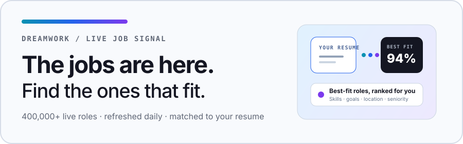

<a href="https://www.dreamworkhq.com/?utm_source=github&utm_medium=readme_cta&utm_campaign=gh-data-science-jobs">
  <picture>
    <source media="(prefers-color-scheme: dark)" srcset="./static/img/banner-dark.svg">
    <source media="(prefers-color-scheme: light)" srcset="./static/img/banner-light.svg">
    
  </picture>
</a>

<h1 align="center">Data Science and Analytics Jobs</h1>

Data scientist, data analyst, and analytics roles in the US and worldwide. Every listing is classified by function from the posting itself, so titles vary but the work is data science.

  
  

  <a href="https://www.dreamworkhq.com/?utm_source=github&utm_medium=readme_cta&utm_campaign=gh-data-science-jobs">
    <picture>
      <source media="(prefers-color-scheme: dark)" srcset="./static/img/btn-matches-dark.svg">
      <source media="(prefers-color-scheme: light)" srcset="./static/img/btn-matches-light.svg">
      
    </picture>
  </a>

  <a href="https://www.dreamworkhq.com/?utm_source=github&utm_medium=link_row&utm_campaign=gh-data-science-jobs">dreamworkhq.com</a>
  ·
  <a href="https://www.dreamworkhq.com/blog?utm_source=github&utm_medium=link_row&utm_campaign=gh-data-science-jobs">Blog</a>
  ·
  <a href="https://www.dreamworkhq.com/research?utm_source=github&utm_medium=link_row&utm_campaign=gh-data-science-jobs">Hiring research</a>
  ·
  <a href="../../issues">Report a listing</a>

Star this repo and new roles land in your GitHub feed every day. Listings come from [Dreamwork](https://www.dreamworkhq.com/?utm_source=github&utm_medium=readme_cta&utm_campaign=gh-data-science-jobs), which crawls 2.8M+ live jobs directly from company career pages.

Last updated: **2026-11-22**. Showing the **600** most recently indexed roles, curated from **1,000+** open listings on Dreamwork. Salary shows when the posting discloses it. Click a role to see details and apply.

<!-- TABLE_START (auto-generated: do not edit by hand; edits are overwritten daily) -->

| Company | Role | Location | Pay | Added |
| --- | --- | --- | --- | --- |
| **[Stitch Fix](https://www.dreamworkhq.com/c/stitchfix.com?utm_source=github&utm_campaign=gh-data-science-jobs)** | [Data Scientist](https://www.dreamworkhq.com/job/cbd260a4-208e-48b9-98e5-3392099eb088?utm_source=github&utm_campaign=gh-data-science-jobs) | Remote (Remote, USA) | $170K–$196K | 0d |
| **[Inter Rapidisimo S.A](https://www.dreamworkhq.com/c/interrapidisimo.com?utm_source=github&utm_campaign=gh-data-science-jobs)** | [Analista de datos Tableau](https://www.dreamworkhq.com/job/2e1c011d-49f6-4fad-98ae-89be62fadf1c?utm_source=github&utm_campaign=gh-data-science-jobs) | Bogotá, D.C., Bogotá, D.C., Colombia | $25K | 0d |
| **[Elsevier](https://www.dreamworkhq.com/c/elsevier.com?utm_source=github&utm_campaign=gh-data-science-jobs)** | [Principal Data Scientist I](https://www.dreamworkhq.com/job/a29382a2-f24c-44a3-9298-a5ecb98ca9c0?utm_source=github&utm_campaign=gh-data-science-jobs) | London Wall (Hybrid) |  | 0d |
| **[Elsevier](https://www.dreamworkhq.com/c/elsevier.com?utm_source=github&utm_campaign=gh-data-science-jobs)** | [Senior Data Scientist III](https://www.dreamworkhq.com/job/37cc2e23-9274-442b-bc7b-9c4aa083ad1b?utm_source=github&utm_campaign=gh-data-science-jobs) | London Wall (Hybrid) |  | 0d |
| **[Magellan](https://www.dreamworkhq.com/c/magellan.com?utm_source=github&utm_campaign=gh-data-science-jobs)** | [Consultant Senior Data Cloud / Salesforce (H/F)](https://www.dreamworkhq.com/job/3c02f6c7-afe2-42d5-bcbb-5883242af67f?utm_source=github&utm_campaign=gh-data-science-jobs) | Paris, IDF, France (Hybrid) |  | 0d |
| **[Jerry.ai](https://www.dreamworkhq.com/c/jerry.ai?utm_source=github&utm_campaign=gh-data-science-jobs)** | [Associate Data Scientist](https://www.dreamworkhq.com/job/2b61f6ec-b0b2-467c-bfd9-d1c6595a3580?utm_source=github&utm_campaign=gh-data-science-jobs) | Remote (New York, New York) | $110K–$140K | 0d |
| **[Jerry.ai](https://www.dreamworkhq.com/c/jerry.ai?utm_source=github&utm_campaign=gh-data-science-jobs)** | [Data Scientist](https://www.dreamworkhq.com/job/14f6791d-e330-4db9-bb61-6737feb8d0d4?utm_source=github&utm_campaign=gh-data-science-jobs) | Remote (New York, New York) | $140K–$160K | 0d |
| **[Natera](https://www.dreamworkhq.com/c/natera.com?utm_source=github&utm_campaign=gh-data-science-jobs)** | [Senior Data Analyst for Lab Production Support, Extended-Hours Support …](https://www.dreamworkhq.com/job/e9841082-6e46-4891-8fa6-8dcb02bed4f1?utm_source=github&utm_campaign=gh-data-science-jobs) | Remote (US Remote) | $114K–$142K | 0d |
| **[Natera](https://www.dreamworkhq.com/c/natera.com?utm_source=github&utm_campaign=gh-data-science-jobs)** | [Senior Data Analyst for Lab Production Support, Extended-Hours Support …](https://www.dreamworkhq.com/job/5c79f779-0768-4683-93e8-ac674aefc2a6?utm_source=github&utm_campaign=gh-data-science-jobs) | San Carlos, CA | $125K–$156K | 0d |
| **[Smartsheet](https://www.dreamworkhq.com/c/smartsheet.com?utm_source=github&utm_campaign=gh-data-science-jobs)** | [Sr. Data Scientist II (Remote Eligible)](https://www.dreamworkhq.com/job/985f5fa3-ecab-47f0-830d-213f8b3cde09?utm_source=github&utm_campaign=gh-data-science-jobs) | Remote | $155K–$185K | 0d |
| **[Expedia Group](https://www.dreamworkhq.com/c/expediagroup.com?utm_source=github&utm_campaign=gh-data-science-jobs)** | [Principal Advanced Data Insight Analyst – Layla AI](https://www.dreamworkhq.com/job/15c64109-3f9b-42f1-8eb6-447089b4bf46?utm_source=github&utm_campaign=gh-data-science-jobs) | Washington - Seattle Campus | $224K–$314K | 0d |
| **[PepsiCo](https://www.dreamworkhq.com/c/pepsico.com?utm_source=github&utm_campaign=gh-data-science-jobs)** | [Analista de datos Jr](https://www.dreamworkhq.com/job/9a797f28-bcc3-4407-aca9-285511bbc7cf?utm_source=github&utm_campaign=gh-data-science-jobs) | Coahuila, Matamoros, Mexico |  | 0d |
| **[Us Experienced](https://www.dreamworkhq.com/c/experiencedrecruitingpartners.com?utm_source=github&utm_campaign=gh-data-science-jobs)** | [Senior Manager - Data and Analytics - Data Analysis, PricewaterhouseCoo…](https://www.dreamworkhq.com/job/7e388f14-b2cb-4216-94be-fc15d6f0bd10?utm_source=github&utm_campaign=gh-data-science-jobs) | SC-Columbia (Hybrid) | $156K–$169K | 0d |
| **[Astrazeneca](https://www.dreamworkhq.com/c/astrazeneca.com?utm_source=github&utm_campaign=gh-data-science-jobs)** | [Senior Manager - Analytics Transformation & Excellence Lead](https://www.dreamworkhq.com/job/d67eea36-179a-4f7b-9e13-8225f78d86a3?utm_source=github&utm_campaign=gh-data-science-jobs) | India - Chennai (Hybrid) |  | 0d |
| **[Onepoint](https://www.dreamworkhq.com/c/wepoint.com?utm_source=github&utm_campaign=gh-data-science-jobs)** | [Stage de fin d'études - Consultant Data F/H](https://www.dreamworkhq.com/job/957eaf18-71c9-4d4c-86ef-826fcb623639?utm_source=github&utm_campaign=gh-data-science-jobs) | Aix-en-Provence, France (Hybrid) |  | 0d |
| **[Onepoint](https://www.dreamworkhq.com/c/wepoint.com?utm_source=github&utm_campaign=gh-data-science-jobs)** | [Consultant Senior Data & AI Strategy (F/H)](https://www.dreamworkhq.com/job/2febf085-b54c-4939-b868-989f613af431?utm_source=github&utm_campaign=gh-data-science-jobs) | Bordeaux, France (Hybrid) |  | 0d |
| **[General Motors](https://www.dreamworkhq.com/c/generalmotors.com?utm_source=github&utm_campaign=gh-data-science-jobs)** | [Senior Artificial Intelligence Machine Learning Scientist](https://www.dreamworkhq.com/job/8c2d52c0-4638-476b-bbf0-a8fa4c874cc6?utm_source=github&utm_campaign=gh-data-science-jobs) | Remote (Warren, Michigan, United States of Amer…) | $145K–$261K | 0d |
| **[General Motors](https://www.dreamworkhq.com/c/generalmotors.com?utm_source=github&utm_campaign=gh-data-science-jobs)** | [Robotics Data Engineer / Data Scientist](https://www.dreamworkhq.com/job/819b1ff9-1d2a-48af-a370-2d2000484c57?utm_source=github&utm_campaign=gh-data-science-jobs) | Warren, Michigan, United States of America (Hybrid) | $105K–$132K | 0d |
| **[AIA](https://www.dreamworkhq.com/c/aia.com?utm_source=github&utm_campaign=gh-data-science-jobs)** | [Data Science, Principal](https://www.dreamworkhq.com/job/640a5af7-1659-4109-90bb-8e6bb4a4a066?utm_source=github&utm_campaign=gh-data-science-jobs) | Kuala Lumpur, MY-AIA Malaysia |  | 0d |
| **[Cibc](https://www.dreamworkhq.com/c/cibc.com?utm_source=github&utm_campaign=gh-data-science-jobs)** | [Consultant, Risk Analytics](https://www.dreamworkhq.com/job/32bb82f7-eea1-496a-97c1-3f321cf647ff?utm_source=github&utm_campaign=gh-data-science-jobs) | Toronto, ON (Hybrid) |  | 0d |
| **[Cibc](https://www.dreamworkhq.com/c/cibc.com?utm_source=github&utm_campaign=gh-data-science-jobs)** | [Senior Manager, Payment Analytics](https://www.dreamworkhq.com/job/e7aa067d-7cab-4c8a-9f95-16c25dbddffe?utm_source=github&utm_campaign=gh-data-science-jobs) | Toronto, ON (Hybrid) |  | 0d |
| **[Inova](https://www.dreamworkhq.com/c/inova.org?utm_source=github&utm_campaign=gh-data-science-jobs)** | [Clinical Data Insights Analyst](https://www.dreamworkhq.com/job/9b842f62-7f4e-44e3-b97c-ec6bb66850c2?utm_source=github&utm_campaign=gh-data-science-jobs) | Fairfax, VA, United States (Hybrid) | $74K–$120K | 0d |
| **[CityOfNewYork](https://www.dreamworkhq.com/c/nyc.gov?utm_source=github&utm_campaign=gh-data-science-jobs)** | [Data Analyst, Bureau of Mental Health](https://www.dreamworkhq.com/job/a5a2a0d7-d05b-478f-87b3-86429cfadc5c?utm_source=github&utm_campaign=gh-data-science-jobs) | Remote (Long Island City, NY, United States) | $88K–$101K | 0d |
| **[TransUnion](https://www.dreamworkhq.com/c/transunion.com?utm_source=github&utm_campaign=gh-data-science-jobs)** | [Lead Data Scientist](https://www.dreamworkhq.com/job/38e8f114-812f-4de9-978c-55f344344fbc?utm_source=github&utm_campaign=gh-data-science-jobs) | Chicago, Illinois (Hybrid) | $113K–$188K | 0d |
| **[DAVITA](https://www.dreamworkhq.com/c/davita.com?utm_source=github&utm_campaign=gh-data-science-jobs)** | [Technical Lead (IKC)](https://www.dreamworkhq.com/job/a4715793-7f3f-4e41-a86c-a5d9fb8f4bb0?utm_source=github&utm_campaign=gh-data-science-jobs) | Remote (09504 - Utah Remote) | $85K–$135K | 0d |
| **[Oklahoma State Government](https://www.dreamworkhq.com/c/ok.gov?utm_source=github&utm_campaign=gh-data-science-jobs)** | [Vital Statistics Quality Assurance Analyst](https://www.dreamworkhq.com/job/4a264d5d-9b25-4734-9aee-3649ab4cb0ff?utm_source=github&utm_campaign=gh-data-science-jobs) | Oklahoma City - 123 Robert S Kerr Ave | $88K | 0d |
| **[Visualsoft](https://www.dreamworkhq.com/c/visualsoft.com?utm_source=github&utm_campaign=gh-data-science-jobs)** | [Senior/Mid Level Data Scientist - Active TS is a MUST (ONSITE - 100%)](https://www.dreamworkhq.com/job/d34aad3b-af8e-4754-976c-ecda3c07d70a?utm_source=github&utm_campaign=gh-data-science-jobs) | Huntsville, AL Information Technology |  | 0d |
| **[Henry Ford Health](https://www.dreamworkhq.com/c/henryfordhealth.org?utm_source=github&utm_campaign=gh-data-science-jobs)** | [Performance Measurement Analyst - Full time - Jackson hybrid (Michigan …](https://www.dreamworkhq.com/job/b3c14f9d-8898-4741-9029-bda6b81ed592?utm_source=github&utm_campaign=gh-data-science-jobs) | Jackson, Michigan (Hybrid) |  | 0d |
| **[Corpay](https://www.dreamworkhq.com/c/corpay.co.nz?utm_source=github&utm_campaign=gh-data-science-jobs)** | [Senior Data Scientist](https://www.dreamworkhq.com/job/e0c967d3-1453-40ea-b2ba-5af330cd8542?utm_source=github&utm_campaign=gh-data-science-jobs) | Chennai - Cross Border |  | 0d |
| **[Capital One](https://www.dreamworkhq.com/c/capitalone.com?utm_source=github&utm_campaign=gh-data-science-jobs)** | [Senior Manager Data Analysis - Human Resources](https://www.dreamworkhq.com/job/d044ab26-7ecf-4b9b-8e08-684dcdb682f6?utm_source=github&utm_campaign=gh-data-science-jobs) | Richmond, VA | $183K–$208K | 0d |
| **[Dallas County](https://www.dreamworkhq.com/c/dallascounty.org?utm_source=github&utm_campaign=gh-data-science-jobs)** | [1000000934.Statistical Research Analyst.Jail Diversion](https://www.dreamworkhq.com/job/67452315-136b-4f95-b46b-e46823f4ebd5?utm_source=github&utm_campaign=gh-data-science-jobs) | Dallas, TX, United States |  | 0d |
| **[Zalando SE](https://www.dreamworkhq.com/c/zalando.se?utm_source=github&utm_campaign=gh-data-science-jobs)** | [Senior Applied Scientist - Search (all genders)](https://www.dreamworkhq.com/job/cd07aa49-bc73-443e-a00b-db0cc11c45fb?utm_source=github&utm_campaign=gh-data-science-jobs) | Berlin, 10243, Germany |  | 0d |
| **[Well Span Health](https://www.dreamworkhq.com/c/s3.amazonaws.com?utm_source=github&utm_campaign=gh-data-science-jobs)** | [Cogito Analyst Senior](https://www.dreamworkhq.com/job/ae9964ed-e672-499f-a54a-39b82ebe8d00?utm_source=github&utm_campaign=gh-data-science-jobs) | York, PA, United States |  | 0d |
| **[Taleo Social Sourcing](https://www.dreamworkhq.com/c/cps.edu?utm_source=github&utm_campaign=gh-data-science-jobs)** | [Data Science Intern (Summer 2027)](https://www.dreamworkhq.com/job/e12d1463-0b1a-4835-b020-533aa571a625?utm_source=github&utm_campaign=gh-data-science-jobs) | United States, Nebraska, Omaha |  | 0d |
| **[Greenheck Group](https://www.dreamworkhq.com/c/greenheck.com?utm_source=github&utm_campaign=gh-data-science-jobs)** | [Data Analyst Co-op](https://www.dreamworkhq.com/job/f1a24465-4851-4ec8-b09f-0fd58f0b2a74?utm_source=github&utm_campaign=gh-data-science-jobs) | Schofield Facility 08 - CF & FETI | $46K–$58K | 0d |
| **[Tetra Tech](https://www.dreamworkhq.com/c/tetratechonline.com?utm_source=github&utm_campaign=gh-data-science-jobs)** | [Data Analyst](https://www.dreamworkhq.com/job/e8d4e969-c3c6-4cc7-ad53-d0e221e5451d?utm_source=github&utm_campaign=gh-data-science-jobs) | Madison, Wisconsin, United States (Hybrid) | $65K–$95K | 0d |
| **[Constellation Energy Generation.](https://www.dreamworkhq.com/c/constellationenergy.com?utm_source=github&utm_campaign=gh-data-science-jobs)** | [2027 PowerFolio Data Analyst Intern - Houston Office](https://www.dreamworkhq.com/job/fb1af362-cb16-4d23-ae63-87da82d52997?utm_source=github&utm_campaign=gh-data-science-jobs) | ; Houston, Texas (Hybrid) |  | 0d |
| **[Naval Nuclear Laboratory](https://www.dreamworkhq.com/c/nnl.gov?utm_source=github&utm_campaign=gh-data-science-jobs)** | [Experienced Data Scientist](https://www.dreamworkhq.com/job/c7572d51-eb26-454f-90e7-8bd06056dfb5?utm_source=github&utm_campaign=gh-data-science-jobs) | West Mifflin, Pennsylvania, United States | $106K–$166K | 0d |
| **[Commonwealth of Pennsylvania](https://www.dreamworkhq.com/c/pa.gov?utm_source=github&utm_campaign=gh-data-science-jobs)** | [Data Analytics Analyst](https://www.dreamworkhq.com/job/09f9105e-e9f3-4a3e-8136-014101dd77ba?utm_source=github&utm_campaign=gh-data-science-jobs) | Remote (Dauphin County, PA) | $63K | 0d |
| **[T-Mobile](https://www.dreamworkhq.com/c/t-mobile.com?utm_source=github&utm_campaign=gh-data-science-jobs)** | [Summer 2027 Data Analyst Internship](https://www.dreamworkhq.com/job/de83c674-6c93-4f62-9f3e-be6ca6f83994?utm_source=github&utm_campaign=gh-data-science-jobs) | WA-Headquarters, Building 5 | $56K–$104K | 0d |
| **[UT Southwestern Medical Center](https://www.dreamworkhq.com/c/utsouthwestern.edu?utm_source=github&utm_campaign=gh-data-science-jobs)** | [Biostatistical Consultant II](https://www.dreamworkhq.com/job/8a5ce001-cf4c-4036-a4d2-9afffa05a8e8?utm_source=github&utm_campaign=gh-data-science-jobs) | Dallas, Texas |  | 0d |
| **AES US** | [Data Analyst, Training Operations](https://www.dreamworkhq.com/job/9668ff95-de77-4668-a147-9669761bb7bc?utm_source=github&utm_campaign=gh-data-science-jobs) | US, Salt Lake City, UT | $83K–$99K | 0d |
| **[Henry Ford Health](https://www.dreamworkhq.com/c/henryfordhealth.org?utm_source=github&utm_campaign=gh-data-science-jobs)** | [Ld Insights Analyst - Medical Group - Full Time](https://www.dreamworkhq.com/job/449987f0-001e-405e-ac47-717517543468?utm_source=github&utm_campaign=gh-data-science-jobs) | Detroit, Michigan |  | 0d |
| **[Wellmark](https://www.dreamworkhq.com/c/wellmark.org?utm_source=github&utm_campaign=gh-data-science-jobs)** | [Sr Data Analyst – Healthcare Economics](https://www.dreamworkhq.com/job/e1193abc-a9c8-4517-ba7e-5d08e6c9bcd6?utm_source=github&utm_campaign=gh-data-science-jobs) | Des Moines, IA, USA (Hybrid) |  | 0d |
| **[MP Materials](https://www.dreamworkhq.com/c/mpmaterials.com?utm_source=github&utm_campaign=gh-data-science-jobs)** | [Data Analyst](https://www.dreamworkhq.com/job/9a564fc1-ee86-43b1-ab3b-f8c71df7ac7d?utm_source=github&utm_campaign=gh-data-science-jobs) | Fort Worth, TX, US |  | 0d |
| **[US](https://www.dreamworkhq.com/c/cogentinfotech.com?utm_source=github&utm_campaign=gh-data-science-jobs)** | [Marketing Science Analyst](https://www.dreamworkhq.com/job/f44d4ba9-67c9-4191-8de6-b04075d4f899?utm_source=github&utm_campaign=gh-data-science-jobs) | Chicago, Illinois, United States of America | $65K–$80K | 0d |
| **[AC Distribution & Marketing](https://www.dreamworkhq.com/c/shop24direct.de?utm_source=github&utm_campaign=gh-data-science-jobs)** | [Datenmanager / Datenanalyst (m/w/d)](https://www.dreamworkhq.com/job/231c78a5-d4c0-44ea-b128-0d6487245511?utm_source=github&utm_campaign=gh-data-science-jobs) | Berlin, Berlin, Deutschland |  | 0d |
| **6045-Ethicon Legal Entity** | [Lead Data Scientist](https://www.dreamworkhq.com/job/b772912c-00d5-453b-9b29-01eeab1a3964?utm_source=github&utm_campaign=gh-data-science-jobs) | Raritan, New Jersey, United States of Ameri… | $112K–$181K | 0d |
| **[Adecco Colombia S.A.](https://www.dreamworkhq.com/c/adeccocolombiana.com?utm_source=github&utm_campaign=gh-data-science-jobs)** | [Analista de Inteligencia de Acceso al Mercado, Automatización y Datos, …](https://www.dreamworkhq.com/job/de909ec5-846d-45bb-8eb8-e8802f8433ce?utm_source=github&utm_campaign=gh-data-science-jobs) | Bogotá, D.C., Bogotá, D.C., Colombia (Hybrid) | $20K | 0d |
| **[Michael Page](https://www.dreamworkhq.com/c/michaelpage.com.mx?utm_source=github&utm_campaign=gh-data-science-jobs)** | [analista de Datos Power BI medios digitales](https://www.dreamworkhq.com/job/a83850df-efcf-4479-a281-f7b0d0b58e2d?utm_source=github&utm_campaign=gh-data-science-jobs) | Bogotá, D.C., Bogotá, D.C., Colombia (Hybrid) |  | 0d |
| **[CTR Management Group](https://www.dreamworkhq.com/c/ctrmanagementgroup.com?utm_source=github&utm_campaign=gh-data-science-jobs)** | [ITAM Data Analyst (ServiceNow Reporting & Dashboards) (Contingent on Aw…](https://www.dreamworkhq.com/job/3ed0f225-6811-4625-82d6-c80a7a2e48e4?utm_source=github&utm_campaign=gh-data-science-jobs) | Alexandria, VA | $100K–$120K | 0d |
| **Core Value Insurance Group** | [Data Analyst](https://www.dreamworkhq.com/job/4ef9a96e-3d5c-4af6-aa8c-4b9da2759b2f?utm_source=github&utm_campaign=gh-data-science-jobs) | 2700 Interplex Dr, Feasterville-Trevose, PA… | $100K | 0d |
| **[Amazon](https://www.dreamworkhq.com/c/amazon.com?utm_source=github&utm_campaign=gh-data-science-jobs)** | [Applied Scientist III - AMZ10563756](https://www.dreamworkhq.com/job/e3f34a99-e745-4c2a-8ddd-54dfd848c7c1?utm_source=github&utm_campaign=gh-data-science-jobs) | Seattle, Washington, USA | $167K–$226K | 0d |
| **[Codetech](https://www.dreamworkhq.com/c/codetech.com?utm_source=github&utm_campaign=gh-data-science-jobs)** | [Senior Data Analyst](https://www.dreamworkhq.com/job/d75b3a1e-ff52-417e-a44d-d00ede70c294?utm_source=github&utm_campaign=gh-data-science-jobs) | McLean, VA, 22067, United States |  | 0d |
| **[Systems Planning and Analysis](https://www.dreamworkhq.com/c/spa.com?utm_source=github&utm_campaign=gh-data-science-jobs)** | [Data Scientist](https://www.dreamworkhq.com/job/efd4ff05-ad8f-48e9-9e15-52ab6666035a?utm_source=github&utm_campaign=gh-data-science-jobs) | Mark Center | $100K | 0d |
| **[Booz Allen Hamilton](https://www.dreamworkhq.com/c/boozallen.com?utm_source=github&utm_campaign=gh-data-science-jobs)** | [Data Analyst](https://www.dreamworkhq.com/job/9a98a0a9-8222-43a3-94c7-ccbd213991c7?utm_source=github&utm_campaign=gh-data-science-jobs) | USA, NC, Camp Lejeune (501 N St) (Hybrid) | $78K–$176K | 0d |
| **[Serigor](https://www.dreamworkhq.com/c/serigor.com?utm_source=github&utm_campaign=gh-data-science-jobs)** | [Data Scientist- Junior (Remote)](https://www.dreamworkhq.com/job/0a4cea2d-ab98-4357-b7d1-3767fb5a39a3?utm_source=github&utm_campaign=gh-data-science-jobs) | Remote (Raleigh, NC, 27601, United States) |  | 0d |
| **[PREMIER Bankcard](https://www.dreamworkhq.com/c/premierbankcard.com?utm_source=github&utm_campaign=gh-data-science-jobs)** | [PREMIER Analytics Internship](https://www.dreamworkhq.com/job/69ab9974-b023-4050-946b-031131a61e84?utm_source=github&utm_campaign=gh-data-science-jobs) | Sioux Falls Credit Card |  | 0d |
| **[First Merchants Brand](https://www.dreamworkhq.com/c/firstmerchants.com?utm_source=github&utm_campaign=gh-data-science-jobs)** | [Senior Data Analyst](https://www.dreamworkhq.com/job/3487c80c-0f4b-40f2-b563-8104d0f60ad1?utm_source=github&utm_campaign=gh-data-science-jobs) | Remote (Michigan, 00000, United States) |  | 0d |
| **[Cresilon](https://www.dreamworkhq.com/c/ovativegroup.com?utm_source=github&utm_campaign=gh-data-science-jobs)** | [Manager, Marketing Mix Modeling (MMM)](https://www.dreamworkhq.com/job/d3e9a53b-a66d-435d-968d-36521004f9c7?utm_source=github&utm_campaign=gh-data-science-jobs) | Minneapolis (Hybrid) | $90K–$132K | 0d |
| **[Koch](https://www.dreamworkhq.com/c/gppackaging.com?utm_source=github&utm_campaign=gh-data-science-jobs)** | [Data and Analytics Intern](https://www.dreamworkhq.com/job/9fadd276-a672-4265-8e3c-31a7599310a0?utm_source=github&utm_campaign=gh-data-science-jobs) | Lisle, Illinois, United States | $58K | 0d |
| **[Mount Sinai Medical Center of F…](https://www.dreamworkhq.com/c/msmc.com?utm_source=github&utm_campaign=gh-data-science-jobs)** | [Hospital Epic Systems BI Developer](https://www.dreamworkhq.com/job/d32fc853-0762-4d6d-84bf-ae8006ad17ac?utm_source=github&utm_campaign=gh-data-science-jobs) | Miami Beach, FL |  | 0d |
| **[Community Behavioral Health.](https://www.dreamworkhq.com/c/communitybehavioralhealth.org?utm_source=github&utm_campaign=gh-data-science-jobs)** | [Manager of Reporting & Integration](https://www.dreamworkhq.com/job/31308cf4-2ce1-4fbb-acdc-3b52f26c5679?utm_source=github&utm_campaign=gh-data-science-jobs) | 801 Market Street, Philadelphia, PA, US | $88K | 0d |
| **ry Elite Booth** | [Data Analyst](https://www.dreamworkhq.com/job/058044e7-ceb4-43c1-9444-a2ce94c52c5c?utm_source=github&utm_campaign=gh-data-science-jobs) | Remote (Illinois, United States) |  | 0d |
| **[Amazon](https://www.dreamworkhq.com/c/amazon.com?utm_source=github&utm_campaign=gh-data-science-jobs)** | [Data Scientist II - AMZ10037942](https://www.dreamworkhq.com/job/40630188-21e7-46e8-9086-b60195c6bb2f?utm_source=github&utm_campaign=gh-data-science-jobs) | Seattle, Washington, USA | $144K–$184K | 0d |
| **[Payactiv](https://www.dreamworkhq.com/c/payactiv.com?utm_source=github&utm_campaign=gh-data-science-jobs)** | [Business Intelligence Analyst](https://www.dreamworkhq.com/job/20b035c1-ffaf-4b8e-99e0-c45866037662?utm_source=github&utm_campaign=gh-data-science-jobs) | Milpitas, CA | $169K–$179K | 0d |
| **[UT Southwestern Medical Center](https://www.dreamworkhq.com/c/utsouthwestern.edu?utm_source=github&utm_campaign=gh-data-science-jobs)** | [Health System Quality Analytics Team Lead](https://www.dreamworkhq.com/job/db541920-dbdf-4eec-b1f9-f5438cba1493?utm_source=github&utm_campaign=gh-data-science-jobs) | Dallas, Texas |  | 0d |
| **[DeliveryHero](https://www.dreamworkhq.com/c/deliveryhero.com?utm_source=github&utm_campaign=gh-data-science-jobs)** | [Staff Data Scientist - Global Search, Consumer](https://www.dreamworkhq.com/job/4817b06b-5993-475a-bf9d-1a4ef173b862?utm_source=github&utm_campaign=gh-data-science-jobs) | Berlin, 10827, Germany (Hybrid) |  | 0d |
| **[Henry Ford Health](https://www.dreamworkhq.com/c/henryfordhealth.org?utm_source=github&utm_campaign=gh-data-science-jobs)** | [Lead Data Scientist](https://www.dreamworkhq.com/job/a7027c5c-858a-4999-acaa-365781d9065c?utm_source=github&utm_campaign=gh-data-science-jobs) | Detroit, Michigan |  | 0d |
| **[Lukka](https://www.dreamworkhq.com/c/lukka.com?utm_source=github&utm_campaign=gh-data-science-jobs)** | [Blockchain Reference Data Analyst](https://www.dreamworkhq.com/job/6ebb9df7-1a3c-475e-85fa-b41cd92b0303?utm_source=github&utm_campaign=gh-data-science-jobs) | Remote (Bengaluru, India) |  | 0d |
| **[Thehartford](https://www.dreamworkhq.com/c/thehartford.com?utm_source=github&utm_campaign=gh-data-science-jobs)** | [Applied AI/Data Science Manager](https://www.dreamworkhq.com/job/cf3b8f76-ea7a-4e17-bd7e-0d35a4aa1902?utm_source=github&utm_campaign=gh-data-science-jobs) | Hartford CT- Home (Hybrid) | $127K–$190K | 0d |
| **[Compass Health Center](https://www.dreamworkhq.com/c/compasshealthcenter.com?utm_source=github&utm_campaign=gh-data-science-jobs)** | [Data Analyst](https://www.dreamworkhq.com/job/97d58786-6367-456a-adbc-73078d8daa99?utm_source=github&utm_campaign=gh-data-science-jobs) | Chicago, Illinois, United States |  | 0d |
| **[Amazon](https://www.dreamworkhq.com/c/amazon.com?utm_source=github&utm_campaign=gh-data-science-jobs)** | [Applied Scientist , Sponsored Products](https://www.dreamworkhq.com/job/7b491f6e-414e-40c9-97fe-de9d473b8f83?utm_source=github&utm_campaign=gh-data-science-jobs) | Seattle, Washington, USA | $143K–$193K | 0d |
| **[DHRM](https://www.dreamworkhq.com/c/dbhds.virginia.gov?utm_source=github&utm_campaign=gh-data-science-jobs)** | [Data Analyst](https://www.dreamworkhq.com/job/eaae0259-c6c6-4364-b9f6-95b77019ab4b?utm_source=github&utm_campaign=gh-data-science-jobs) | Henrico, Virginia - G - K - Henrico Virginia (Hybrid) | $73K–$84K | 0d |
| **[Vanderbilt University Medical C…](https://www.dreamworkhq.com/c/vanderbilthealth.com?utm_source=github&utm_campaign=gh-data-science-jobs)** | [Data Scientist 2](https://www.dreamworkhq.com/job/eba441d3-1faf-41e8-a6ef-ede7262cbbc8?utm_source=github&utm_campaign=gh-data-science-jobs) | Remote (2525 WEST END AVE (LOC00248)) |  | 0d |
| **[UT Southwestern Medical Center](https://www.dreamworkhq.com/c/utsouthwestern.edu?utm_source=github&utm_campaign=gh-data-science-jobs)** | [Biostatistical Consultant I](https://www.dreamworkhq.com/job/6616ec92-92c4-4bb3-80b1-439b0e58f5f6?utm_source=github&utm_campaign=gh-data-science-jobs) | Dallas, Texas |  | 0d |
| **[Tetra Tech](https://www.dreamworkhq.com/c/tetratechonline.com?utm_source=github&utm_campaign=gh-data-science-jobs)** | [Data Analyst](https://www.dreamworkhq.com/job/b3747362-76d4-4802-b440-f62b6f2b022f?utm_source=github&utm_campaign=gh-data-science-jobs) | Washington, District Of Columbia, United St… | $105K–$118K | 0d |
| **[Hawkeye Area Community Action P…](https://www.dreamworkhq.com/c/hacap.org?utm_source=github&utm_campaign=gh-data-science-jobs)** | [Data Analyst](https://www.dreamworkhq.com/job/79abb6a0-fec7-4a42-9c00-7fe21509ba07?utm_source=github&utm_campaign=gh-data-science-jobs) | Hiawatha, IA, 52233, USA | $64K–$71K | 0d |
| **Synergy Solutions** | [Senior Power BI Developer / Analytics Consultant](https://www.dreamworkhq.com/job/add9487a-ae44-4a3c-a861-031d6e6b686c?utm_source=github&utm_campaign=gh-data-science-jobs) | Los Angeles, California, 90013, United Stat… | $114K–$146K | 0d |
| **[Clear Resolution Consulting](https://www.dreamworkhq.com/c/clearresolutionconsulting.com?utm_source=github&utm_campaign=gh-data-science-jobs)** | [Computer Scientist, Senior](https://www.dreamworkhq.com/job/7e4452e6-628b-4ca3-91ec-f94a91028292?utm_source=github&utm_campaign=gh-data-science-jobs) | Remote (Joint Base Anacostia-Bolling Wash D.C.) | $100K–$130K | 0d |
| **[Revolutionmedicines](https://www.dreamworkhq.com/c/revolutionmedicines.com?utm_source=github&utm_campaign=gh-data-science-jobs)** | [Associate Principal Statistical Analyst](https://www.dreamworkhq.com/job/ae8370ee-4a4c-4172-a1ef-5813b2dae37f?utm_source=github&utm_campaign=gh-data-science-jobs) | Redwood City, California, United States (Hybrid) | $164K–$246K | 0d |
| **US Army Civilian Human Resource…** | [Operations Research Analyst (Talent Analysis)](https://www.dreamworkhq.com/job/7d7c94ea-76f8-4516-b813-271b4393ddb8?utm_source=github&utm_campaign=gh-data-science-jobs) | Rock Island, Illinois | $76K | 0d |
| **[NYU Langone Health](https://www.dreamworkhq.com/c/nyulangone.org?utm_source=github&utm_campaign=gh-data-science-jobs)** | [Data Analyst, Sala Institute](https://www.dreamworkhq.com/job/091ce220-229a-4b9a-a2a4-b02391fb4e54?utm_source=github&utm_campaign=gh-data-science-jobs) | This position is located in New York | $66K–$84K | 0d |
| **[Cloudious](https://www.dreamworkhq.com/c/cloudious.com?utm_source=github&utm_campaign=gh-data-science-jobs)** | [Technical Data Analyst – Data Quality (DQ)](https://www.dreamworkhq.com/job/30db9d77-4643-403f-88af-d350d0a73a74?utm_source=github&utm_campaign=gh-data-science-jobs) | Remote (Alabama, United States) | $114K–$125K | 0d |
| **Johnson & Johnson** | [Manager, Commercial AI & Advanced Analytics](https://www.dreamworkhq.com/job/9aded9c6-e9dd-4814-b748-2f79ddec77ee?utm_source=github&utm_campaign=gh-data-science-jobs) | Titusville, New Jersey, United States of Am… (Hybrid) | $120K–$207K | 0d |
| **[Streamline](https://www.dreamworkhq.com/c/streamline.com?utm_source=github&utm_campaign=gh-data-science-jobs)** | [Data Scientist, Mid](https://www.dreamworkhq.com/job/f57b45ee-a833-46a3-81b9-d668b6aa4277?utm_source=github&utm_campaign=gh-data-science-jobs) | Washington, DC | $138K | 0d |
| **[Taleo Social Sourcing](https://www.dreamworkhq.com/c/cps.edu?utm_source=github&utm_campaign=gh-data-science-jobs)** | [Data Scientist](https://www.dreamworkhq.com/job/f520e132-c197-4046-8558-ef1a7d7a8c73?utm_source=github&utm_campaign=gh-data-science-jobs) | Arlington, Texas, United States |  | 0d |
| **[Mitsubishi UFJ Financial Group](https://www.dreamworkhq.com/c/mufgemea.com?utm_source=github&utm_campaign=gh-data-science-jobs)** | [Data & AI Analyst](https://www.dreamworkhq.com/job/96ca25b4-2433-4c53-9499-0d1c6219adec?utm_source=github&utm_campaign=gh-data-science-jobs) | Remote (1221 Avenue of the Americas) | $100K–$120K | 0d |
| **[Amazon](https://www.dreamworkhq.com/c/amazon.com?utm_source=github&utm_campaign=gh-data-science-jobs)** | [Senior Applied Scientist, AWS Security](https://www.dreamworkhq.com/job/784d2269-656c-4916-ac07-2f3465fad1bc?utm_source=github&utm_campaign=gh-data-science-jobs) | Seattle, Washington, USA | $167K–$226K | 0d |
| **[Henry Ford Health](https://www.dreamworkhq.com/c/henryfordhealth.org?utm_source=github&utm_campaign=gh-data-science-jobs)** | [Data Scientist, HC Analytics](https://www.dreamworkhq.com/job/700368d5-c5eb-4efd-9663-c12a4075014c?utm_source=github&utm_campaign=gh-data-science-jobs) | Detroit, Michigan |  | 0d |
| **[Praescient Analytics](https://www.dreamworkhq.com/c/praescient.com?utm_source=github&utm_campaign=gh-data-science-jobs)** | [Senior Data Architect - Team Lead (Public Trust)](https://www.dreamworkhq.com/job/c94c596c-e2af-4b55-bf68-b2cfe9e2d972?utm_source=github&utm_campaign=gh-data-science-jobs) | Remote (Fairfax, Virginia, United States) | $110K–$185K | 0d |
| **6062-Janssen Pharmaceuticals Le…** | [Manager, Commercial AI & Advanced Analytics](https://www.dreamworkhq.com/job/b0931afb-7a12-48e0-97dc-5db521d38d6b?utm_source=github&utm_campaign=gh-data-science-jobs) | Titusville, New Jersey, United States of Am… (Hybrid) | $120K–$207K | 0d |
| **[Amazon](https://www.dreamworkhq.com/c/amazon.com?utm_source=github&utm_campaign=gh-data-science-jobs)** | [Senior Business Intelligence Engineer, Global Logistics Analytics](https://www.dreamworkhq.com/job/58276929-5585-4465-b7bb-b5186881ed18?utm_source=github&utm_campaign=gh-data-science-jobs) | Bellevue, Washington, USA | $130K–$176K | 0d |
| **[GlobalFoundries](https://www.dreamworkhq.com/c/gf.com?utm_source=github&utm_campaign=gh-data-science-jobs)** | [AI/ML Analytics Intern, Digital Manufacturing (Summer 2027)](https://www.dreamworkhq.com/job/17762717-2a85-4d61-9f0d-69f117e7ffd0?utm_source=github&utm_campaign=gh-data-science-jobs) | USA - New York - Malta | $42K–$83K | 0d |
| **[Amazon](https://www.dreamworkhq.com/c/amazon.com?utm_source=github&utm_campaign=gh-data-science-jobs)** | [Senior Business Intelligence Engineer, Prime Air](https://www.dreamworkhq.com/job/d6c62688-e374-4f20-8146-3e408a9bdc06?utm_source=github&utm_campaign=gh-data-science-jobs) | Seattle, Washington, USA | $130K–$176K | 0d |
| **[Amazon](https://www.dreamworkhq.com/c/amazon.com?utm_source=github&utm_campaign=gh-data-science-jobs)** | [Data Scientist II, Region Flexibility](https://www.dreamworkhq.com/job/7ccfa80e-bc17-4ad8-bf3f-68a20d7e66a0?utm_source=github&utm_campaign=gh-data-science-jobs) | Sunnyvale, California, USA | $157K–$213K | 0d |
| **Advanced Micro Devices** | [Senior Data Science Manager](https://www.dreamworkhq.com/job/a64fafe8-47b6-433b-b2e4-4e63f337c81e?utm_source=github&utm_campaign=gh-data-science-jobs) | US,CA,Santa Clara |  | 0d |
| **[Bayer](https://www.dreamworkhq.com/c/bayer.com?utm_source=github&utm_campaign=gh-data-science-jobs)** | [Associate Principal Scientist, Preclinical – Data Science & AI (all gen…](https://www.dreamworkhq.com/job/4a4ea797-1107-4cb8-af01-fbf1afb7b4f1?utm_source=github&utm_campaign=gh-data-science-jobs) | Berlin, 13353, Germany (Hybrid) | $100K–$122K | 0d |
| **[Amazon](https://www.dreamworkhq.com/c/amazon.com?utm_source=github&utm_campaign=gh-data-science-jobs)** | [Applied Scientist, Advertiser Growth Engine](https://www.dreamworkhq.com/job/c34a5a0a-4795-47ac-9dae-90dc23be9c9f?utm_source=github&utm_campaign=gh-data-science-jobs) | New York, New York, USA | $172K–$223K | 0d |
| **[Expedia](https://www.dreamworkhq.com/c/expedia.com?utm_source=github&utm_campaign=gh-data-science-jobs)** | [Principal Advanced Data Insight Analyst – Layla AI](https://www.dreamworkhq.com/job/75dc8907-7ab1-4e92-a6b5-eab0777ada03?utm_source=github&utm_campaign=gh-data-science-jobs) | Washington - Seattle | $359K | 0d |
| **[Tetra Tech](https://www.dreamworkhq.com/c/tetratechonline.com?utm_source=github&utm_campaign=gh-data-science-jobs)** | [Data Analyst - Disaster Recovery Cadre](https://www.dreamworkhq.com/job/61113d6d-6e54-479f-bbc2-9bfa165f0007?utm_source=github&utm_campaign=gh-data-science-jobs) | Remote (Baton Rouge, Louisiana, United States) |  | 0d |
| **[CheQ Digital](https://www.dreamworkhq.com/c/cheq.in?utm_source=github&utm_campaign=gh-data-science-jobs)** | [Business Analyst](https://www.dreamworkhq.com/job/00d7ed3e-389e-48be-b853-ddc90bf76fcf?utm_source=github&utm_campaign=gh-data-science-jobs) | Bangalore North, Karnataka, 560068, India |  | 0d |
| **[Publicis Groupe Holdings B.V](https://www.dreamworkhq.com/c/epsilon.fr?utm_source=github&utm_campaign=gh-data-science-jobs)** | [Senior Analyst, Business Intelligence](https://www.dreamworkhq.com/job/cd40e45f-bade-4276-97fa-a4f79bef97d7?utm_source=github&utm_campaign=gh-data-science-jobs) | 111 S. Independence Mall East | $73K | 0d |
| **[Jobgether](https://www.dreamworkhq.com/c/jobgether.com?utm_source=github&utm_campaign=gh-data-science-jobs)** | [Senior Data Scientist, Model Risk Management](https://www.dreamworkhq.com/job/29053d46-534c-44d6-a1b9-888445be022f?utm_source=github&utm_campaign=gh-data-science-jobs) | Remote (India) |  | 0d |
| **[Booz Allen Hamilton](https://www.dreamworkhq.com/c/boozallen.com?utm_source=github&utm_campaign=gh-data-science-jobs)** | [Power BI Data Visualization Specialist](https://www.dreamworkhq.com/job/da911519-0fde-42ec-99dd-4a632bf98e03?utm_source=github&utm_campaign=gh-data-science-jobs) | USA, VA, Ashburn (22001 Loudoun County Pkwy) (Hybrid) | $62K–$141K | 0d |
| **[Cigna Group](https://www.dreamworkhq.com/c/carepathrx.com?utm_source=github&utm_campaign=gh-data-science-jobs)** | [Business Analytics Lead Analyst](https://www.dreamworkhq.com/job/621056e5-9653-4c5f-9432-9abdc41b7914?utm_source=github&utm_campaign=gh-data-science-jobs) | Remote (United States Work at Home) | $79K–$132K | 0d |
| **[Fund for Public Health NYC](https://www.dreamworkhq.com/c/fphnyc.org?utm_source=github&utm_campaign=gh-data-science-jobs)** | [Food Access Data Intern](https://www.dreamworkhq.com/job/13e85026-a4c6-4019-82fe-698464fa9857?utm_source=github&utm_campaign=gh-data-science-jobs) | 485 Throop Ave, Brooklyn, NY 11221, USA (Hybrid) | $44K | 0d |
| **[Luminous Power Technologies](https://www.dreamworkhq.com/c/luminouspowertech.com?utm_source=github&utm_campaign=gh-data-science-jobs)** | [Assistant General Manager](https://www.dreamworkhq.com/job/2d613a14-17e5-4f0e-a8f1-c2bb336438ae?utm_source=github&utm_campaign=gh-data-science-jobs) | Italy |  | 0d |
| **[EPAM](https://www.dreamworkhq.com/c/epam.com?utm_source=github&utm_campaign=gh-data-science-jobs)** | [Data Architect](https://www.dreamworkhq.com/job/72ad69fe-18fb-4287-80b6-68d66257e866?utm_source=github&utm_campaign=gh-data-science-jobs) | Toronto, Canada |  | 0d |
| **[Booz Allen Hamilton](https://www.dreamworkhq.com/c/boozallen.com?utm_source=github&utm_campaign=gh-data-science-jobs)** | [Geospatial Energy Analyst](https://www.dreamworkhq.com/job/a939199d-a18d-40bc-babe-7d5b93d13e01?utm_source=github&utm_campaign=gh-data-science-jobs) | USA, DC, Washington (200 MacDill Blvd) (Hybrid) | $78K–$176K | 0d |
| **Johnson & Johnson** | [Lead Data Scientist](https://www.dreamworkhq.com/job/d11a2294-b049-4ad6-ad5c-14593c1bf2f7?utm_source=github&utm_campaign=gh-data-science-jobs) | Raritan, New Jersey, United States of Ameri… | $112K–$181K | 0d |
| **[Trinityhealth](https://www.dreamworkhq.com/c/trinity-health.org?utm_source=github&utm_campaign=gh-data-science-jobs)** | [REMOTE Senior Population Health Analyst](https://www.dreamworkhq.com/job/986c9d5c-ea6e-470c-ac84-af27b69de41a?utm_source=github&utm_campaign=gh-data-science-jobs) | Remote (Livonia, Michigan) | $88K | 0d |
| **[Cisco](https://www.dreamworkhq.com/c/cisco.com?utm_source=github&utm_campaign=gh-data-science-jobs)** | [Data Science Analyst II (Intern) – Untied States](https://www.dreamworkhq.com/job/56371ba5-5292-4e25-80a3-3ad65afaa792?utm_source=github&utm_campaign=gh-data-science-jobs) | San Jose, California, US | $44K–$185K | 0d |
| **[Fisher Investments](https://www.dreamworkhq.com/c/fisherinvestments.com?utm_source=github&utm_campaign=gh-data-science-jobs)** | [Global Marketing Data & Analytics Analyst](https://www.dreamworkhq.com/job/b8855254-0625-4abe-b9db-79b379e5ecd1?utm_source=github&utm_campaign=gh-data-science-jobs) | Tampa, Florida, United States (Hybrid) | $120K | 0d |
| **[Jobgether](https://www.dreamworkhq.com/c/jobgether.com?utm_source=github&utm_campaign=gh-data-science-jobs)** | [AI Search Analyst](https://www.dreamworkhq.com/job/81c202db-8063-487b-97b3-0d7b707be29a?utm_source=github&utm_campaign=gh-data-science-jobs) | Remote (India) |  | 0d |
| **[Meta](https://www.dreamworkhq.com/c/meta.com?utm_source=github&utm_campaign=gh-data-science-jobs)** | [Data Scientist](https://www.dreamworkhq.com/job/5118eb5b-8fac-4b7b-aff2-347ccf069599?utm_source=github&utm_campaign=gh-data-science-jobs) | Bellevue, WA | $241K–$285K | 0d |
| **[RHC Group Management](https://www.dreamworkhq.com/c/bookmarkmedical.com?utm_source=github&utm_campaign=gh-data-science-jobs)** | [Manager, Analytics](https://www.dreamworkhq.com/job/f64a02a1-0e42-406e-8219-7946dc149262?utm_source=github&utm_campaign=gh-data-science-jobs) | Nashville, TN, US |  | 0d |
| **[McLaren](https://www.dreamworkhq.com/c/mclaren.org?utm_source=github&utm_campaign=gh-data-science-jobs)** | [Program Manager Business Intelligence](https://www.dreamworkhq.com/job/f1ecde17-361d-4f1c-8140-3f4651a4700c?utm_source=github&utm_campaign=gh-data-science-jobs) | Michigan, Grand Blanc |  | 0d |
| **[SANY America](https://www.dreamworkhq.com/c/sanyamerica.com?utm_source=github&utm_campaign=gh-data-science-jobs)** | [Product Data Analyst](https://www.dreamworkhq.com/job/d5fd9fec-70a6-4d01-b6ec-c64b026fae7c?utm_source=github&utm_campaign=gh-data-science-jobs) | Peachtree City, GA, 30269, USA |  | 0d |
| **[Stanford Faculty Positions](https://www.dreamworkhq.com/c/stanford.edu?utm_source=github&utm_campaign=gh-data-science-jobs)** | [Biostatistician 2](https://www.dreamworkhq.com/job/b33bee1b-7dbb-40a2-bf39-21b5e303de0b?utm_source=github&utm_campaign=gh-data-science-jobs) | School of Medicine, Stanford, California, U… | $115K–$134K | 0d |
| **[Taleo Social Sourcing](https://www.dreamworkhq.com/c/cps.edu?utm_source=github&utm_campaign=gh-data-science-jobs)** | [Senior Data Strategist](https://www.dreamworkhq.com/job/22a1720a-496c-4666-8137-5914ad629a79?utm_source=github&utm_campaign=gh-data-science-jobs) | 42 West Madison Street (Planning and Data M… |  | 0d |
| **[SAP](https://www.dreamworkhq.com/c/sap.com?utm_source=github&utm_campaign=gh-data-science-jobs)** | [Data Scientist- Data Labs, Finance & Spend](https://www.dreamworkhq.com/job/44f561a3-65ce-4f63-a6b1-3e719f37276a?utm_source=github&utm_campaign=gh-data-science-jobs) | India (Hybrid) |  | 0d |
| **[Amazon](https://www.dreamworkhq.com/c/amazon.com?utm_source=github&utm_campaign=gh-data-science-jobs)** | [Applied Scientist II, Detail Page](https://www.dreamworkhq.com/job/76fccdb9-b756-419e-a17d-aa3310c6adbb?utm_source=github&utm_campaign=gh-data-science-jobs) | Bengaluru, Karnataka, IND |  | 0d |
| **[Mondelez International](https://www.dreamworkhq.com/c/mondelez.com?utm_source=github&utm_campaign=gh-data-science-jobs)** | [RDQ & Procurement Data Modeling & Analyst, Analytics](https://www.dreamworkhq.com/job/75894b89-47b5-460e-87e6-6f3cbdb72ebf?utm_source=github&utm_campaign=gh-data-science-jobs) | Business Office (Joy House 2) - Mumbai, Ind… |  | 0d |
| **[Epidemic Sound](https://www.dreamworkhq.com/c/epidemicsound.com?utm_source=github&utm_campaign=gh-data-science-jobs)** | [Senior Analytics Engineer](https://www.dreamworkhq.com/job/872e152a-e381-4cae-9754-7a469a4b4bbf?utm_source=github&utm_campaign=gh-data-science-jobs) | Stockholm HQ |  | 0d |
| **[Deutsche Bank](https://www.dreamworkhq.com/c/db.com?utm_source=github&utm_campaign=gh-data-science-jobs)** | [Bond Analytics Analyst, AYST](https://www.dreamworkhq.com/job/50d58105-5dc5-422c-afb4-2bf7b3044738?utm_source=github&utm_campaign=gh-data-science-jobs) | Bangalore Velankani ISC |  | 0d |
| **[Ascend Bank](https://www.dreamworkhq.com/c/ascendbank.com?utm_source=github&utm_campaign=gh-data-science-jobs)** | [Business Intelligence Developer II](https://www.dreamworkhq.com/job/665d9b94-b5e1-403f-b221-ccad4f0b1fc8?utm_source=github&utm_campaign=gh-data-science-jobs) | Wallingford, CT, US | $81K–$108K | 0d |
| **[Amazon](https://www.dreamworkhq.com/c/amazon.com?utm_source=github&utm_campaign=gh-data-science-jobs)** | [Principal Applied Scientist, Supply Tech - Advertising](https://www.dreamworkhq.com/job/b84bbf0b-bf57-444d-9806-de5e54b93b9c?utm_source=github&utm_campaign=gh-data-science-jobs) | Seattle, Washington, USA | $199K–$269K | 0d |
| **[Truist Bank](https://www.dreamworkhq.com/c/truist.com?utm_source=github&utm_campaign=gh-data-science-jobs)** | [Technical Redress Evaluation (TRE) Analyst](https://www.dreamworkhq.com/job/a98caab4-5eea-4e45-83d6-bc8c1cf4358b?utm_source=github&utm_campaign=gh-data-science-jobs) | Atlanta GA - 303 Peachtree Center Avenue |  | 0d |
| **[Carewest Innovative Healthcare](https://www.dreamworkhq.com/c/carewest.ca?utm_source=github&utm_campaign=gh-data-science-jobs)** | [Senior Analyst (2026-1332)](https://www.dreamworkhq.com/job/50df727b-bfbd-4e00-86e1-7191a32b8250?utm_source=github&utm_campaign=gh-data-science-jobs) | Calgary, AB | $66K–$90K | 0d |
| **[Booz Allen Hamilton](https://www.dreamworkhq.com/c/boozallen.com?utm_source=github&utm_campaign=gh-data-science-jobs)** | [Data Scientist, Senior](https://www.dreamworkhq.com/job/7b9965de-f57c-4009-b840-52fe1bce735b?utm_source=github&utm_campaign=gh-data-science-jobs) | USA, VA, Reston (12310 Sunrise Valley Dr) (Hybrid) | $99K–$225K | 0d |
| **[Booz Allen Hamilton](https://www.dreamworkhq.com/c/boozallen.com?utm_source=github&utm_campaign=gh-data-science-jobs)** | [Supply Chain and Infectious Disease Risk Modeling Data Scientist](https://www.dreamworkhq.com/job/33495424-e448-4148-b204-8c0e41969b70?utm_source=github&utm_campaign=gh-data-science-jobs) | Undisclosed Location - USA, MD, Bethesda (Hybrid) | $78K–$176K | 0d |
| **[JD Power](https://www.dreamworkhq.com/c/jdpower.com?utm_source=github&utm_campaign=gh-data-science-jobs)** | [Analyst, Consumer Insights – Auto, Utilities, Telecom](https://www.dreamworkhq.com/job/e4f7e404-685b-4fc4-afc1-d0a3840b0453?utm_source=github&utm_campaign=gh-data-science-jobs) | Remote (Michigan - Remote) | $49K–$63K | 0d |
| **[Clear Resolution Consulting](https://www.dreamworkhq.com/c/clearresolutionconsulting.com?utm_source=github&utm_campaign=gh-data-science-jobs)** | [Data Scientist, Mid](https://www.dreamworkhq.com/job/69f881ff-6ae6-4391-aa7e-6a5450788ddc?utm_source=github&utm_campaign=gh-data-science-jobs) | Remote (Joint Base Anacostia-Bolling Wash D.C.) | $100K–$130K | 0d |
| **[Johns Hopkins University](https://www.dreamworkhq.com/c/jhu.edu?utm_source=github&utm_campaign=gh-data-science-jobs)** | [Sr. Research Data Manager (School of Medicine - Pediatrics)](https://www.dreamworkhq.com/job/e884cfe8-4401-4dd9-8550-f0f48c0aae97?utm_source=github&utm_campaign=gh-data-science-jobs) | Baltimore, MD, United States (Hybrid) | $57K–$100K | 0d |
| **[Amazon](https://www.dreamworkhq.com/c/amazon.com?utm_source=github&utm_campaign=gh-data-science-jobs)** | [Data Scientist, NA Operations](https://www.dreamworkhq.com/job/480a87ab-ca66-4399-a8f5-345a21c8fbc8?utm_source=github&utm_campaign=gh-data-science-jobs) | Bellevue, Washington, USA | $108K–$160K | 0d |
| **[Pfizer Digital](https://www.dreamworkhq.com/c/pfizer.com?utm_source=github&utm_campaign=gh-data-science-jobs)** | [Senior Manager Medical Insights, Data Analyst](https://www.dreamworkhq.com/job/b21e4c7a-37f0-4a3e-95db-961268d92ffd?utm_source=github&utm_campaign=gh-data-science-jobs) | United States - New York - New York City (Hybrid) | $124K–$207K | 0d |
| **[Henry Ford Health](https://www.dreamworkhq.com/c/henryfordhealth.org?utm_source=github&utm_campaign=gh-data-science-jobs)** | [Sr. Business Intelligence Developer \| Full Time](https://www.dreamworkhq.com/job/2b61c32d-2555-460d-bbe1-5581837e6078?utm_source=github&utm_campaign=gh-data-science-jobs) | Detroit, Michigan |  | 0d |
| **[PricewaterhouseCoopers](https://www.dreamworkhq.com/c/strategyand.pwc.com?utm_source=github&utm_campaign=gh-data-science-jobs)** | [Senior Manager - Data and Analytics - Data Analysis, PricewaterhouseCoo…](https://www.dreamworkhq.com/job/c4328b29-5b82-4159-a209-d6ef13864353?utm_source=github&utm_campaign=gh-data-science-jobs) | Columbia - 1333 Main Street (Hybrid) | $156K–$169K | 0d |
| **[Booz Allen Hamilton](https://www.dreamworkhq.com/c/boozallen.com?utm_source=github&utm_campaign=gh-data-science-jobs)** | [Data Scientist](https://www.dreamworkhq.com/job/21e80aea-f78b-446c-9119-97819c3f333b?utm_source=github&utm_campaign=gh-data-science-jobs) | USA, VA, Arlington (1550 Crystal Dr Suite 3… (Hybrid) | $78K–$176K | 0d |
| **[Trulioo](https://www.dreamworkhq.com/c/trulioo.com?utm_source=github&utm_campaign=gh-data-science-jobs)** | [Senior Manager, Data Analytics](https://www.dreamworkhq.com/job/b20c7420-61c1-42be-8472-47c2124b81a7?utm_source=github&utm_campaign=gh-data-science-jobs) | Vancouver, BC (Hybrid) | $102K–$120K | 0d |
| **[Guidehouse](https://www.dreamworkhq.com/c/guidehouse.com?utm_source=github&utm_campaign=gh-data-science-jobs)** | [Data Analyst (Dashboard Developer)](https://www.dreamworkhq.com/job/2bfc6309-a947-4d1c-9b94-426c43fe8471?utm_source=github&utm_campaign=gh-data-science-jobs) | Home Office: Greensboro, GA | $68K–$113K | 0d |
| **[TD Bank](https://www.dreamworkhq.com/c/tdsecurities.com?utm_source=github&utm_campaign=gh-data-science-jobs)** | [Data Scientist III (US)](https://www.dreamworkhq.com/job/46068cca-1c5c-4329-8b16-a34d9c4c524a?utm_source=github&utm_campaign=gh-data-science-jobs) | Remote (200 State Street Corporate, Boston, Mas…) | $96K–$156K | 0d |
| **[Tetra Tech](https://www.dreamworkhq.com/c/tetratechonline.com?utm_source=github&utm_campaign=gh-data-science-jobs)** | [Senior Environmental GIS/Data Scientist](https://www.dreamworkhq.com/job/2e219aaa-c871-4d98-8595-7915d8e2abd6?utm_source=github&utm_campaign=gh-data-science-jobs) | Chicago, Illinois, United States (Hybrid) | $187K–$229K | 0d |
| **Sparksoft** | [Data Scientist](https://www.dreamworkhq.com/job/5c863e83-b2c1-49c6-8f8e-8f4c6aec5fa1?utm_source=github&utm_campaign=gh-data-science-jobs) | Remote (Remote/Hybrid if local to Maryland) |  | 0d |
| **AES Clean Energy** | [Data Analyst, Training Operations](https://www.dreamworkhq.com/job/65a896b6-4f43-4c25-9529-67a84ed7508f?utm_source=github&utm_campaign=gh-data-science-jobs) | US, Salt Lake City, UT | $83K–$99K | 0d |
| **[Parkinson Canada](https://www.dreamworkhq.com/c/parkinsoncanada.ca?utm_source=github&utm_campaign=gh-data-science-jobs)** | [Senior Data Analyst](https://www.dreamworkhq.com/job/88fc5b8d-116a-4821-b1a3-830d8f4c5b31?utm_source=github&utm_campaign=gh-data-science-jobs) | Remote (North York, ON, Canada) | $56K–$65K | 0d |
| **[DFT Operator](https://www.dreamworkhq.com/c/dfto.org.uk?utm_source=github&utm_campaign=gh-data-science-jobs)** | [Senior Customer Insight Analyst](https://www.dreamworkhq.com/job/28e71c0f-71e4-4f54-8d09-2085efa659c7?utm_source=github&utm_campaign=gh-data-science-jobs) | London (South East) (Hybrid) | $60K–$67K | 0d |
| **[Sopra Steria Next](https://www.dreamworkhq.com/c/soprasteria-next.com?utm_source=github&utm_campaign=gh-data-science-jobs)** | [BA MDM / Manager Data - Sopra Steria Next](https://www.dreamworkhq.com/job/91612fc7-101f-4a31-9f22-6564e960ebac?utm_source=github&utm_campaign=gh-data-science-jobs) | 1 Rue Serpentines, 92400 Courbevoie, France (Hybrid) |  | 0d |
| **[Gartner](https://www.dreamworkhq.com/c/gartner.com?utm_source=github&utm_campaign=gh-data-science-jobs)** | [Data Analyst](https://www.dreamworkhq.com/job/140be1a5-ee5d-4471-ae93-0fc6101f5ff7?utm_source=github&utm_campaign=gh-data-science-jobs) | Gurgaon - Cyber Park (Hybrid) |  | 0d |
| **[Iqvia](https://www.dreamworkhq.com/c/iqvia.com?utm_source=github&utm_campaign=gh-data-science-jobs)** | [Sr Stat Programmer](https://www.dreamworkhq.com/job/e1b0f109-1863-4488-b80b-24e569f8eec3?utm_source=github&utm_campaign=gh-data-science-jobs) | Bangalore, India |  | 0d |
| **[IKS Health Career](https://www.dreamworkhq.com/c/ikshealth.com?utm_source=github&utm_campaign=gh-data-science-jobs)** | [Business Analyst](https://www.dreamworkhq.com/job/ea25c080-6d11-4f5d-b9af-3c0b45ea174a?utm_source=github&utm_campaign=gh-data-science-jobs) | Hyderabad, Telangana, India |  | 0d |
| **[Incedo](https://www.dreamworkhq.com/c/incedo.com?utm_source=github&utm_campaign=gh-data-science-jobs)** | [Data Scientist](https://www.dreamworkhq.com/job/537f2470-c30e-4d1b-afab-bac730da3e38?utm_source=github&utm_campaign=gh-data-science-jobs) | Chennai |  | 0d |
| **[Google](https://www.dreamworkhq.com/c/google.com?utm_source=github&utm_campaign=gh-data-science-jobs)** | [Business Intelligence Developer, Google Cloud](https://www.dreamworkhq.com/job/4a38557d-8d50-474d-a596-25f41776e6ae?utm_source=github&utm_campaign=gh-data-science-jobs) | Mexico City, CDMX, Mexico |  | 0d |
| **[Tata 1mg](https://www.dreamworkhq.com/c/1mg.com?utm_source=github&utm_campaign=gh-data-science-jobs)** | [Senior Manager](https://www.dreamworkhq.com/job/81d241c6-f92f-4ca5-ba71-dd9f81a36c94?utm_source=github&utm_campaign=gh-data-science-jobs) | Motorola 2nd Floor, Saffron Enclave, 415/2,… |  | 0d |
| **[Weloglobal](https://www.dreamworkhq.com/c/weloglobal.com?utm_source=github&utm_campaign=gh-data-science-jobs)** | [Andromeda Delta - Audio Transcription Raters Bengali (India)](https://www.dreamworkhq.com/job/7bf5b4a6-48d0-4fcd-b3cd-0633d09e7aed?utm_source=github&utm_campaign=gh-data-science-jobs) | Remote (India) |  | 0d |
| **[Frostbank](https://www.dreamworkhq.com/c/frostbank.com?utm_source=github&utm_campaign=gh-data-science-jobs)** | [Data Analyst Supervisor](https://www.dreamworkhq.com/job/f0240623-0829-4f08-afcf-c12f50bd9ef8?utm_source=github&utm_campaign=gh-data-science-jobs) | San Antonio, TX - One Frost |  | 0d |
| **[Fhios](https://www.dreamworkhq.com/c/fhios.es?utm_source=github&utm_campaign=gh-data-science-jobs)** | [Power BI / Data Analyst](https://www.dreamworkhq.com/job/7e0ce490-1cfe-4959-9a3e-b2d0de1ecbb0?utm_source=github&utm_campaign=gh-data-science-jobs) | Híbrido (Barcelona, BARCELONA, España) (Hybrid) |  | 0d |
| **[Tetra Tech](https://www.dreamworkhq.com/c/tetratechonline.com?utm_source=github&utm_campaign=gh-data-science-jobs)** | [Data Analyst - Disaster Recovery Cadre](https://www.dreamworkhq.com/job/9ff9744b-b3ba-4907-b647-4114c8926f1e?utm_source=github&utm_campaign=gh-data-science-jobs) | Remote (Austin, Texas, United States) |  | 0d |
| **[Network1](https://www.dreamworkhq.com/c/networkrecruitmentinternational.com?utm_source=github&utm_campaign=gh-data-science-jobs)** | [Data Scientist](https://www.dreamworkhq.com/job/1feb03d6-0464-475d-a44c-69c2af52ec7f?utm_source=github&utm_campaign=gh-data-science-jobs) | Cape Town, Western Cape, South Africa |  | 0d |
| **[Advance Stores Company](https://www.dreamworkhq.com/c/advancestores.com?utm_source=github&utm_campaign=gh-data-science-jobs)** | [Data Science Intern](https://www.dreamworkhq.com/job/8ef346d3-9896-4fb4-9670-a8b39f0eff1b?utm_source=github&utm_campaign=gh-data-science-jobs) | Raleigh, NC |  | 0d |
| **[Principal Financial Group](https://www.dreamworkhq.com/c/principal.com?utm_source=github&utm_campaign=gh-data-science-jobs)** | [Quantitative Developer (Machine Learning & AI)](https://www.dreamworkhq.com/job/c2765341-1df7-4527-9380-0becffa312f4?utm_source=github&utm_campaign=gh-data-science-jobs) | Des Moines,IA,Corp Ctr (Hybrid) | $120K–$165K | 0d |
| **[CSU Careers](https://www.dreamworkhq.com/c/sjsu.edu?utm_source=github&utm_campaign=gh-data-science-jobs)** | [Advancement Data Analyst, University Advancement](https://www.dreamworkhq.com/job/441f259b-86c4-47e3-91c4-f645250535e0?utm_source=github&utm_campaign=gh-data-science-jobs) | San Marcos - Southern California (Hybrid) | $70K–$101K | 0d |
| **[California State University San…](https://www.dreamworkhq.com/c/csusm.edu?utm_source=github&utm_campaign=gh-data-science-jobs)** | [Advancement Data Analyst, University Advancement](https://www.dreamworkhq.com/job/4009a132-339e-45c5-a0b6-144ced2dfd41?utm_source=github&utm_campaign=gh-data-science-jobs) | San Marcos - Southern California (Hybrid) | $70K–$101K | 0d |
| **[Accenture](https://www.dreamworkhq.com/c/accenture.com?utm_source=github&utm_campaign=gh-data-science-jobs)** | [Sales Data Analyst](https://www.dreamworkhq.com/job/7080ebe3-c408-4f05-af9d-111eead55f5d?utm_source=github&utm_campaign=gh-data-science-jobs) | Atlanta, 3565 Piedmont Rd NE., ACN Ops (Hybrid) | $70K–$196K | 0d |
| **[Cvshealth](https://www.dreamworkhq.com/c/cvshealth.com?utm_source=github&utm_campaign=gh-data-science-jobs)** | [Senior Data Scientist](https://www.dreamworkhq.com/job/0fa0a01b-acd7-4c7e-b3ad-3bff754c1f25?utm_source=github&utm_campaign=gh-data-science-jobs) | Hartford-Farmington Ave Rogers (Hybrid) | $102K–$204K | 0d |
| **[Walmart](https://www.dreamworkhq.com/c/walmart.com?utm_source=github&utm_campaign=gh-data-science-jobs)** | [Senior Data Scientist](https://www.dreamworkhq.com/job/c09a395f-e427-4c5f-8f31-b5a1d5451920?utm_source=github&utm_campaign=gh-data-science-jobs) | (USA) Crossman Respect Building CA SUNNYVAL… | $169K–$234K | 0d |
| **[Google](https://www.dreamworkhq.com/c/google.com?utm_source=github&utm_campaign=gh-data-science-jobs)** | [Senior Product Data Scientist, Search App Growth](https://www.dreamworkhq.com/job/51b9ad27-84b7-43ec-b5ad-c8819674ab54?utm_source=github&utm_campaign=gh-data-science-jobs) | Mountain View, CA, USA | $163K–$236K | 0d |
| **[Headway](https://www.dreamworkhq.com/c/headway.co?utm_source=github&utm_campaign=gh-data-science-jobs)** | [Middle/Senior Data Analyst](https://www.dreamworkhq.com/job/4c8dc607-a3cf-4489-883a-a6cea7c3ba92?utm_source=github&utm_campaign=gh-data-science-jobs) | Korolenkivska vulytsia, 3 Kyiv, 01033 Ukrai… |  | 0d |
| **[Accenture](https://www.dreamworkhq.com/c/accenture.com?utm_source=github&utm_campaign=gh-data-science-jobs)** | [Data Engineer](https://www.dreamworkhq.com/job/662a3a3c-4eac-469e-b190-a235510a5e6d?utm_source=github&utm_campaign=gh-data-science-jobs) | Chennai, CDC2E |  | 0d |
| **[Weloglobal](https://www.dreamworkhq.com/c/weloglobal.com?utm_source=github&utm_campaign=gh-data-science-jobs)** | [Andromeda Delta - Audio Transcription Raters Tamil (India)](https://www.dreamworkhq.com/job/8b8d5dd0-035e-4233-96c2-dd6e200d5073?utm_source=github&utm_campaign=gh-data-science-jobs) | Remote (India) |  | 0d |
| **[UT Southwestern Medical Center](https://www.dreamworkhq.com/c/utsouthwestern.edu?utm_source=github&utm_campaign=gh-data-science-jobs)** | [Biostatistical Consultant III](https://www.dreamworkhq.com/job/c72b0f1e-3854-47a3-af8d-7e419ea64ba8?utm_source=github&utm_campaign=gh-data-science-jobs) | Dallas, Texas |  | 0d |
| **Hewlett Packard Enterprise** | [Quantitative AI Scientist, Finance (PhD)](https://www.dreamworkhq.com/job/bbca8f30-b1dc-4756-9127-0b0b869a0348?utm_source=github&utm_campaign=gh-data-science-jobs) | Spring, Texas, United States of America | $96K–$221K | 0d |
| **[UT Southwestern Medical Center](https://www.dreamworkhq.com/c/utsouthwestern.edu?utm_source=github&utm_campaign=gh-data-science-jobs)** | [Data Scientist III, Mineral Metabolism, Levi Lab](https://www.dreamworkhq.com/job/327302cf-9da6-464c-b8fa-24cd8260dab0?utm_source=github&utm_campaign=gh-data-science-jobs) | Dallas, Texas |  | 0d |
| **[Systems Planning and Analysis](https://www.dreamworkhq.com/c/spa.com?utm_source=github&utm_campaign=gh-data-science-jobs)** | [Integrated Analytics Intern (Summer 2027)](https://www.dreamworkhq.com/job/e6c59aef-009e-42f2-b9de-bf67f4e08180?utm_source=github&utm_campaign=gh-data-science-jobs) | Alexandria, VA | $48K | 0d |
| **[John Deere](https://www.dreamworkhq.com/c/deere.com?utm_source=github&utm_campaign=gh-data-science-jobs)** | [Part-Time Student - Data Analytics - Moline, IL or Waterloo, IA or Des …](https://www.dreamworkhq.com/job/f6163c76-fd0b-4be3-9586-42f58cacc2b7?utm_source=github&utm_campaign=gh-data-science-jobs) | United States | $31K–$83K | 0d |
| **[UMB Bank](https://www.dreamworkhq.com/c/umbbank.com?utm_source=github&utm_campaign=gh-data-science-jobs)** | [Business Systems Analyst I](https://www.dreamworkhq.com/job/9ea9270e-dfb7-4a28-bc9f-3d83f42b1113?utm_source=github&utm_campaign=gh-data-science-jobs) | PA - Chadds Ford - 223 Wilmington West Ches… | $59K–$87K | 0d |
| **[Gallo](https://www.dreamworkhq.com/c/gallo.com?utm_source=github&utm_campaign=gh-data-science-jobs)** | [Advanced Analytics & Statistics Manager](https://www.dreamworkhq.com/job/9095d5a5-49eb-48ca-a02e-fa6efe126d38?utm_source=github&utm_campaign=gh-data-science-jobs) | Dallas, TX (Hybrid) | $137K–$206K | 0d |
| **[Visualsoft](https://www.dreamworkhq.com/c/visualsoft.com?utm_source=github&utm_campaign=gh-data-science-jobs)** | [Senior Data Scientist / Top SECRET / ONSITE](https://www.dreamworkhq.com/job/c6ee0165-4b33-48a8-a1a5-524e5b69785e?utm_source=github&utm_campaign=gh-data-science-jobs) | Washington, DC Information Technology |  | 0d |
| **[Meta](https://www.dreamworkhq.com/c/meta.com?utm_source=github&utm_campaign=gh-data-science-jobs)** | [Data Scientist, Analytics](https://www.dreamworkhq.com/job/8ab3db4e-b5e3-4881-bcca-8fec591234c8?utm_source=github&utm_campaign=gh-data-science-jobs) | Menlo Park, CA | $254K–$285K | 0d |
| **[Amazon](https://www.dreamworkhq.com/c/amazon.com?utm_source=github&utm_campaign=gh-data-science-jobs)** | [Applied Scientist II, Sponsored Products and Brands - Advertiser Growth…](https://www.dreamworkhq.com/job/455fa859-e238-40b1-b679-81b85268b313?utm_source=github&utm_campaign=gh-data-science-jobs) | Seattle, Washington, USA | $143K–$193K | 0d |
| **[Xcel Energy](https://www.dreamworkhq.com/c/xcelenergy.com?utm_source=github&utm_campaign=gh-data-science-jobs)** | [Gas Regulatory Analyst](https://www.dreamworkhq.com/job/bc293da9-a59a-4f53-82f9-00263756e6d5?utm_source=github&utm_campaign=gh-data-science-jobs) | Lipan Distribution Center (Hybrid) | $64K–$91K | 0d |
| **[Weeghman & Briggs](https://www.dreamworkhq.com/c/weeghmanandbriggs.com?utm_source=github&utm_campaign=gh-data-science-jobs)** | [Junior Data Scientist](https://www.dreamworkhq.com/job/1856598e-6ee9-4655-8104-c284a8a74e01?utm_source=github&utm_campaign=gh-data-science-jobs) | Remote (NC, USA) |  | 0d |
| **[Cetera Financial Group](https://www.dreamworkhq.com/c/ceterafinancial.com?utm_source=github&utm_campaign=gh-data-science-jobs)** | [Senior Advanced Analytics Manager](https://www.dreamworkhq.com/job/0138afcc-635d-453d-acdf-acf81844e085?utm_source=github&utm_campaign=gh-data-science-jobs) | San Diego, CA, United States (Hybrid) | $136K–$166K | 0d |
| **[Fabuwood Cabinetry Corp](https://www.dreamworkhq.com/c/fabuwood.com?utm_source=github&utm_campaign=gh-data-science-jobs)** | [Machine Learning Engineer](https://www.dreamworkhq.com/job/3aa7eba5-3491-4e54-9903-a10d4515187d?utm_source=github&utm_campaign=gh-data-science-jobs) | Headquarters, Newark, NJ, US |  | 0d |
| **[Indeed.com](https://www.dreamworkhq.com/c/bhcpartners.org?utm_source=github&utm_campaign=gh-data-science-jobs)** | [BI Analyst IV](https://www.dreamworkhq.com/job/5143c13c-9a0c-462e-b0ab-d5887edaa408?utm_source=github&utm_campaign=gh-data-science-jobs) | New York, United States of America | $134K–$202K | 0d |
| **[Steel Warehouse](https://www.dreamworkhq.com/c/steelwarehouse.com?utm_source=github&utm_campaign=gh-data-science-jobs)** | [Data & Analytics Manager](https://www.dreamworkhq.com/job/2299fd3e-e8c1-467c-ad3d-a10e8d5e481c?utm_source=github&utm_campaign=gh-data-science-jobs) | SOUTH BEND, IN |  | 0d |
| **[Amazon](https://www.dreamworkhq.com/c/amazon.com?utm_source=github&utm_campaign=gh-data-science-jobs)** | [Data Scientist III - AMZ10563931](https://www.dreamworkhq.com/job/a0ebeb60-9fd4-4db9-bae2-acdb7c780bcf?utm_source=github&utm_campaign=gh-data-science-jobs) | Seattle, Washington, USA | $166K–$215K | 0d |
| **[Tetra Tech](https://www.dreamworkhq.com/c/tetratechonline.com?utm_source=github&utm_campaign=gh-data-science-jobs)** | [Data Analyst - Disaster Recovery Cadre](https://www.dreamworkhq.com/job/5dc4080a-278e-4179-b249-67e6fa9f87a5?utm_source=github&utm_campaign=gh-data-science-jobs) | Remote (Albuquerque, New Mexico, United States) |  | 0d |
| **[Endeavor Air](https://www.dreamworkhq.com/c/endeavorair.com?utm_source=github&utm_campaign=gh-data-science-jobs)** | [Analyst, Operations Analysis and Performance (OAP)](https://www.dreamworkhq.com/job/606a9384-5880-47e7-ae14-1b7a352ee6cc?utm_source=github&utm_campaign=gh-data-science-jobs) | Minneapolis, Minnesota, United States | $68K | 0d |
| **[Microsoft](https://www.dreamworkhq.com/c/microsoft.com?utm_source=github&utm_campaign=gh-data-science-jobs)** | [Principal Data Science Manager - CoreAI](https://www.dreamworkhq.com/job/f8524f8f-ce75-4b82-93ee-f748320ca207?utm_source=github&utm_campaign=gh-data-science-jobs) | Redmond, Washington, United States | $166K–$296K | 0d |
| **[Mfinite Consulting](https://www.dreamworkhq.com/c/mfiniteconsult.com?utm_source=github&utm_campaign=gh-data-science-jobs)** | [Junior Data Scientist](https://www.dreamworkhq.com/job/0167e488-fc73-4ecc-bb6a-dec1b9c36606?utm_source=github&utm_campaign=gh-data-science-jobs) | Remote (Raleigh, North Carolina, United States) |  | 0d |
| **[Amazon](https://www.dreamworkhq.com/c/amazon.com?utm_source=github&utm_campaign=gh-data-science-jobs)** | [Data Scientist III - AMZ10593723](https://www.dreamworkhq.com/job/eefbe8c1-03ee-456e-a7d5-2f370cb5014e?utm_source=github&utm_campaign=gh-data-science-jobs) | Seattle, Washington, USA | $166K–$215K | 0d |
| **[Delta Dental of Iowa](https://www.dreamworkhq.com/c/deltadentaliowa.org?utm_source=github&utm_campaign=gh-data-science-jobs)** | [Associate Data Analyst - Government Programs](https://www.dreamworkhq.com/job/af821f79-15a9-4980-a5df-1ae2df6217b7?utm_source=github&utm_campaign=gh-data-science-jobs) | Johnston, IA (Hybrid) |  | 0d |
| **[Amazon](https://www.dreamworkhq.com/c/amazon.com?utm_source=github&utm_campaign=gh-data-science-jobs)** | [Business Intel Engineer III - AMZ10587231](https://www.dreamworkhq.com/job/e1d8d909-14c4-42bf-91a8-322995b50583?utm_source=github&utm_campaign=gh-data-science-jobs) | Seattle, Washington, USA | $144K–$176K | 0d |
| **[State of Utah](https://www.dreamworkhq.com/c/utah.gov?utm_source=github&utm_campaign=gh-data-science-jobs)** | [WorkingSenior Business Analyst - Data Analytics Title](https://www.dreamworkhq.com/job/3e133351-d005-47dc-962a-fea1a60a446f?utm_source=github&utm_campaign=gh-data-science-jobs) | Taylorsville State Office Building (TSOB) 4… (Hybrid) | $52K | 0d |
| **[WK Kellogg Co](https://www.dreamworkhq.com/c/wkkellogg.com?utm_source=github&utm_campaign=gh-data-science-jobs)** | [Temporary Student Support - Retail Strategy](https://www.dreamworkhq.com/job/b19caa7f-f0d5-4544-88bf-c6f606a067b2?utm_source=github&utm_campaign=gh-data-science-jobs) | MI-Michigan No WK Kellogg Co Location (Hybrid) | $40K–$50K | 0d |
| **[Frostbank](https://www.dreamworkhq.com/c/frostbank.com?utm_source=github&utm_campaign=gh-data-science-jobs)** | [Data Analyst I - Data Analytics](https://www.dreamworkhq.com/job/81083df9-00b9-4d1d-906b-afe58bb6cf4d?utm_source=github&utm_campaign=gh-data-science-jobs) | San Antonio, TX - One Frost |  | 0d |
| **[Publicis Groupe](https://www.dreamworkhq.com/c/publicisresources.com?utm_source=github&utm_campaign=gh-data-science-jobs)** | [Identity Analytics Intern - Summer 2027](https://www.dreamworkhq.com/job/3cfd142a-abdf-4780-b103-c1ad13503a54?utm_source=github&utm_campaign=gh-data-science-jobs) | Chicago, Illinois, United States | $56K | 0d |
| **[Bright Vision Technologies](https://www.dreamworkhq.com/c/bvteck.com?utm_source=github&utm_campaign=gh-data-science-jobs)** | [Senior Data Analyst](https://www.dreamworkhq.com/job/4b2697d9-5dfb-4258-be5c-8604867a8b02?utm_source=github&utm_campaign=gh-data-science-jobs) | Remote (Fremont / East Bay, CA) | $115K–$165K | 0d |
| **[Bright Vision Technologies](https://www.dreamworkhq.com/c/bvteck.com?utm_source=github&utm_campaign=gh-data-science-jobs)** | [Data Analyst](https://www.dreamworkhq.com/job/13a7e631-6e25-4095-bfa0-823d75fdae31?utm_source=github&utm_campaign=gh-data-science-jobs) | Remote (Fremont / East Bay, CA) | $115K–$165K | 0d |
| **[Taleo Social Sourcing](https://www.dreamworkhq.com/c/cps.edu?utm_source=github&utm_campaign=gh-data-science-jobs)** | [Principal Data Scientist](https://www.dreamworkhq.com/job/f78f9eeb-2fbd-4a0c-9bec-0d8b53fe712b?utm_source=github&utm_campaign=gh-data-science-jobs) | Arlington, Texas, United States |  | 0d |
| **[ALTEN Consulting Services](https://www.dreamworkhq.com/c/alten.de?utm_source=github&utm_campaign=gh-data-science-jobs)** | [Data Analyst / Scientist - Daten Management (all gender)](https://www.dreamworkhq.com/job/b894109e-1282-40dd-983e-86b1f127455a?utm_source=github&utm_campaign=gh-data-science-jobs) | Forchheim, Bayern, 91301 Germany (Hybrid) | $62K–$73K | 0d |
| **[UT Southwestern Medical Center](https://www.dreamworkhq.com/c/utsouthwestern.edu?utm_source=github&utm_campaign=gh-data-science-jobs)** | [Biostatistical Consultant II, Nephrology](https://www.dreamworkhq.com/job/aca718f0-7dde-42f1-8d4e-061b5584e1a6?utm_source=github&utm_campaign=gh-data-science-jobs) | Remote (Dallas, Texas) |  | 0d |
| **San Antonio** | [Data Analyst, Clinical Operations](https://www.dreamworkhq.com/job/02a9ed46-5958-4ae7-af83-2842939f7caf?utm_source=github&utm_campaign=gh-data-science-jobs) | San Antonio, Texas, 78229, United States |  | 0d |
| **[Southern Company](https://www.dreamworkhq.com/c/southerncompany.com?utm_source=github&utm_campaign=gh-data-science-jobs)** | [Customer Insights Analyst I, II or III](https://www.dreamworkhq.com/job/2ec60e11-970a-497d-b7d9-651c35578ad3?utm_source=github&utm_campaign=gh-data-science-jobs) | Atlanta, GA, United States | $58K–$121K | 0d |
| **[State of Mississippi](https://www.dreamworkhq.com/c/ms.gov?utm_source=github&utm_campaign=gh-data-science-jobs)** | [Research/Data Analyst I](https://www.dreamworkhq.com/job/6ca20ab0-9c41-486c-ae66-176f791b532d?utm_source=github&utm_campaign=gh-data-science-jobs) | 25 - HINDS COUNTY, MS | $37K–$40K | 0d |
| **[Tokio Marine HCC](https://www.dreamworkhq.com/c/tokiomarine.com?utm_source=github&utm_campaign=gh-data-science-jobs)** | [AI Data Scientist](https://www.dreamworkhq.com/job/8f736b3f-6cbe-45ff-935a-1fb9a7b20484?utm_source=github&utm_campaign=gh-data-science-jobs) | Georgia - Kennesaw |  | 0d |
| **[Defense Contract Audit Agency](https://www.dreamworkhq.com/c/dcaa.mil?utm_source=github&utm_campaign=gh-data-science-jobs)** | [Data Scientist](https://www.dreamworkhq.com/job/50beaa00-1ffb-4024-96ba-45be81260fab?utm_source=github&utm_campaign=gh-data-science-jobs) | Anaheim, California | $126K | 0d |
| **[Diversified Services Network](https://www.dreamworkhq.com/c/dsnworldwide.com?utm_source=github&utm_campaign=gh-data-science-jobs)** | [(1120764) Product Compliance Data Analyst](https://www.dreamworkhq.com/job/c654adb9-f5e9-4559-a82f-d20597ca4d25?utm_source=github&utm_campaign=gh-data-science-jobs) | Rapid City, South Dakota, United States | $35K–$40K | 0d |
| **[UT Southwestern Medical Center](https://www.dreamworkhq.com/c/utsouthwestern.edu?utm_source=github&utm_campaign=gh-data-science-jobs)** | [Biostatistical Consultant I, Internal Medicine](https://www.dreamworkhq.com/job/7771c938-0490-40d3-863c-0dd81af7371d?utm_source=github&utm_campaign=gh-data-science-jobs) | Dallas, Texas |  | 0d |
| **[Tower Loan](https://www.dreamworkhq.com/c/towerloan.com?utm_source=github&utm_campaign=gh-data-science-jobs)** | [Data Scientist](https://www.dreamworkhq.com/job/16c981ef-5811-4dbe-9d46-4d46f7919df7?utm_source=github&utm_campaign=gh-data-science-jobs) | Home Office (Fixed) |  | 0d |
| **[Capital One](https://www.dreamworkhq.com/c/capitalone.com?utm_source=github&utm_campaign=gh-data-science-jobs)** | [Senior Manager, Data Analysis - Card Partnerships](https://www.dreamworkhq.com/job/27f98f51-abb3-4544-a982-af915693ef8c?utm_source=github&utm_campaign=gh-data-science-jobs) | Chicago, IL | $183K–$208K | 0d |
| **[John H. Northrop & Associates](https://www.dreamworkhq.com/c/aeroeraospace.com?utm_source=github&utm_campaign=gh-data-science-jobs)** | [Senior Operations Research Analyst](https://www.dreamworkhq.com/job/27573ea7-dc75-4eda-99d6-5ac2ec438919?utm_source=github&utm_campaign=gh-data-science-jobs) | Newport News, VA, USA | $180K–$197K | 0d |
| **[Travelers](https://www.dreamworkhq.com/c/travelers.com?utm_source=github&utm_campaign=gh-data-science-jobs)** | [Senior Manager, Decision Science](https://www.dreamworkhq.com/job/ba39e6ab-99cd-4deb-bc9a-26384d94de4c?utm_source=github&utm_campaign=gh-data-science-jobs) | Hartford - Tower | $123K–$204K | 0d |
| **[Aligned Automation Services](https://www.dreamworkhq.com/c/alignedautomation.com?utm_source=github&utm_campaign=gh-data-science-jobs)** | [Data Scientist](https://www.dreamworkhq.com/job/ffdd4079-8bed-4ff0-95c0-4da1e930533a?utm_source=github&utm_campaign=gh-data-science-jobs) | Pune City, Maharashtra, 411001, India |  | 0d |
| **[Marriott](https://www.dreamworkhq.com/c/marriott.com?utm_source=github&utm_campaign=gh-data-science-jobs)** | [Senior Manager, Marketing Measurement Analytics (CALA)](https://www.dreamworkhq.com/job/0bbf181b-cacb-4455-8f9f-cf5938f5f979?utm_source=github&utm_campaign=gh-data-science-jobs) | Plantation, FL, United States |  | 0d |
| **Sci Solutions Global** | [Data Analyst](https://www.dreamworkhq.com/job/d011f965-5b97-4d7e-9a10-74b575912e11?utm_source=github&utm_campaign=gh-data-science-jobs) | Mclean, Virginia, 22103, United States | $73K | 0d |
| **[Tetra Tech](https://www.dreamworkhq.com/c/tetratechonline.com?utm_source=github&utm_campaign=gh-data-science-jobs)** | [Data Analyst - Disaster Recovery Cadre](https://www.dreamworkhq.com/job/976022ec-0a74-49be-8896-923934998cad?utm_source=github&utm_campaign=gh-data-science-jobs) | Remote (Nashville, Tennessee, United States) |  | 0d |
| **[Dairy Farmers of America](https://www.dreamworkhq.com/c/dfamilk.com?utm_source=github&utm_campaign=gh-data-science-jobs)** | [Sr. Data Scientist - Applied Machine Learning and Optimization](https://www.dreamworkhq.com/job/ffb69105-f9b2-4828-a47f-0c457ab30083?utm_source=github&utm_campaign=gh-data-science-jobs) | Kansas City, Kansas, United States | $135K–$145K | 0d |
| **[StratifyIQ](https://www.dreamworkhq.com/c/stratifyiq.com?utm_source=github&utm_campaign=gh-data-science-jobs)** | [Data & PropTech Analyst](https://www.dreamworkhq.com/job/f5c25b94-a864-4fdd-90eb-5aecbb26b71e?utm_source=github&utm_campaign=gh-data-science-jobs) | Remote (Panama) |  | 0d |
| **[Publicis Groupe Holdings B.V](https://www.dreamworkhq.com/c/epsilon.fr?utm_source=github&utm_campaign=gh-data-science-jobs)** | [Manager, Data Science and Analytics (Paid Media Analytics)](https://www.dreamworkhq.com/job/b69f02c3-3203-4c73-8cf5-38de794afa8a?utm_source=github&utm_campaign=gh-data-science-jobs) | 375 Hudson | $89K | 0d |
| **[Faropoint](https://www.dreamworkhq.com/c/faropoint.com?utm_source=github&utm_campaign=gh-data-science-jobs)** | [Senior Data Scientist, Research & Applied Science](https://www.dreamworkhq.com/job/24f55332-bec1-4a2e-9fc4-2e12bcbc33b5?utm_source=github&utm_campaign=gh-data-science-jobs) | Hoboken, New Jersey | $160K–$200K | 0d |
| **[Somerset West Community Health …](https://www.dreamworkhq.com/c/swchc.on.ca?utm_source=github&utm_campaign=gh-data-science-jobs)** | [Senior Data and Information Management Specialist](https://www.dreamworkhq.com/job/412c3504-67fb-47d1-9bfb-8e550c9ead8c?utm_source=github&utm_campaign=gh-data-science-jobs) | Ottawa, Ontario, K1R 6S3, Canada (Hybrid) | $48K–$57K | 0d |
| **[Five Guys](https://www.dreamworkhq.com/c/fiveguys.com?utm_source=github&utm_campaign=gh-data-science-jobs)** | [Senior Customer Insights Analyst](https://www.dreamworkhq.com/job/a588d3d1-8c07-4ed0-aa5d-9708c7906756?utm_source=github&utm_campaign=gh-data-science-jobs) | Alexandria, Virginia, 22314, United States |  | 0d |
| **[Capgemini](https://www.dreamworkhq.com/c/capgemini.com?utm_source=github&utm_campaign=gh-data-science-jobs)** | [Lead Data Scientist](https://www.dreamworkhq.com/job/3fb9a2b9-175f-4abc-a974-74ece7294189?utm_source=github&utm_campaign=gh-data-science-jobs) | Irving (Hybrid) | $111K–$145K | 0d |
| **[McLaren](https://www.dreamworkhq.com/c/mclaren.org?utm_source=github&utm_campaign=gh-data-science-jobs)** | [Business Intelligence Developer](https://www.dreamworkhq.com/job/4d562c72-18db-4b0b-bc31-9d6d86ef650b?utm_source=github&utm_campaign=gh-data-science-jobs) | Michigan, Grand Blanc |  | 0d |
| **[UCB](https://www.dreamworkhq.com/c/ucb.com?utm_source=github&utm_campaign=gh-data-science-jobs)** | [Recruitment Data Policies Clinical Data Portfolio Lead](https://www.dreamworkhq.com/job/70415e7b-45f6-4f8d-b430-48d43618a1fa?utm_source=github&utm_campaign=gh-data-science-jobs) | United States (Hybrid) | $124K–$163K | 0d |
| **[Bold Orange Company](https://www.dreamworkhq.com/c/boldorange.com?utm_source=github&utm_campaign=gh-data-science-jobs)** | [Senior Analyst](https://www.dreamworkhq.com/job/fab262f8-88d3-4da4-986e-1077b1446eb8?utm_source=github&utm_campaign=gh-data-science-jobs) | Minneapolis, MN - Open to candidates outsid… |  | 0d |
| **[Ping](https://www.dreamworkhq.com/c/ping.com?utm_source=github&utm_campaign=gh-data-science-jobs)** | [Data Analyst](https://www.dreamworkhq.com/job/3e492211-5413-4531-848f-cc0189be0cc8?utm_source=github&utm_campaign=gh-data-science-jobs) | Phoenix, AZ, 85029, USA |  | 0d |
| **[Bloomberg Industry Group](https://www.dreamworkhq.com/c/bloomberglaw.com?utm_source=github&utm_campaign=gh-data-science-jobs)** | [Senior Data Scientist, AI Enablement](https://www.dreamworkhq.com/job/52712c14-fbcf-43dc-bbaa-ea6ab3cd459e?utm_source=github&utm_campaign=gh-data-science-jobs) | Arlington, VA - 1801 S Bell (INDG) | $150K–$180K | 0d |
| **[EmblemHealth Career](https://www.dreamworkhq.com/c/emblemhealth.com?utm_source=github&utm_campaign=gh-data-science-jobs)** | [Lead Risk Adjustment Data Analyst - Hybrid](https://www.dreamworkhq.com/job/aa84f157-207c-4c01-ac96-48f63d8f0169?utm_source=github&utm_campaign=gh-data-science-jobs) | New York, New York (Hybrid) |  | 0d |
| **[Jobgether](https://www.dreamworkhq.com/c/jobgether.com?utm_source=github&utm_campaign=gh-data-science-jobs)** | [Senior BI/DW Developer](https://www.dreamworkhq.com/job/592edd81-7cf3-4ad0-91ac-ba89593d0e75?utm_source=github&utm_campaign=gh-data-science-jobs) | Remote (India) |  | 0d |
| **[NYU Langone Health](https://www.dreamworkhq.com/c/nyulangone.org?utm_source=github&utm_campaign=gh-data-science-jobs)** | [Data Analyst - Manhattan, OB/GYN](https://www.dreamworkhq.com/job/1223028d-d41a-4f1e-ba17-eb80f5e5bd75?utm_source=github&utm_campaign=gh-data-science-jobs) | This position is located in New York | $70K–$75K | 0d |
| **[Bright Vision Technologies](https://www.dreamworkhq.com/c/bvteck.com?utm_source=github&utm_campaign=gh-data-science-jobs)** | [Senior Data Scientist](https://www.dreamworkhq.com/job/b2f5cd30-2c96-4d7e-845a-bd5b1f8a7c5e?utm_source=github&utm_campaign=gh-data-science-jobs) | Remote | $160K–$180K | 0d |
| **[Berkshire Hathaway Energy](https://www.dreamworkhq.com/c/berkshirehathawayenergy.com?utm_source=github&utm_campaign=gh-data-science-jobs)** | [Mgr, Data Science](https://www.dreamworkhq.com/job/6a88e8cd-a8c9-4417-92d5-1811629a64cc?utm_source=github&utm_campaign=gh-data-science-jobs) | Des Moines, IA, United States | $155K–$194K | 0d |
| **[Five Guys](https://www.dreamworkhq.com/c/fiveguys.com?utm_source=github&utm_campaign=gh-data-science-jobs)** | [Senior Data Scientist](https://www.dreamworkhq.com/job/a615617b-7c7f-454c-a429-089e7046abc2?utm_source=github&utm_campaign=gh-data-science-jobs) | Alexandria, Virginia, 22314, United States |  | 0d |
| **[Tetra Tech](https://www.dreamworkhq.com/c/tetratechonline.com?utm_source=github&utm_campaign=gh-data-science-jobs)** | [Data Analyst - Disaster Recovery Cadre](https://www.dreamworkhq.com/job/05f53367-c19d-4bb9-acaf-a966a70ae83a?utm_source=github&utm_campaign=gh-data-science-jobs) | Remote (Dallas, Texas, United States) |  | 0d |
| **First Bank & Trust** | [Data Analyst Intern](https://www.dreamworkhq.com/job/ac8c026b-44e7-4f3a-a6f9-2fe1d926c8a6?utm_source=github&utm_campaign=gh-data-science-jobs) | Sioux Falls, SD (I-229) |  | 0d |
| **Naval Supply Systems Command** | [Operations Research Analyst](https://www.dreamworkhq.com/job/02183525-8966-4592-a35e-a84575e70cca?utm_source=github&utm_campaign=gh-data-science-jobs) | Norfolk, Virginia | $128K | 0d |
| **[U.S. Secret Service](https://www.dreamworkhq.com/c/secretservice.gov?utm_source=github&utm_campaign=gh-data-science-jobs)** | [Data Scientist](https://www.dreamworkhq.com/job/5536f8f5-89f8-470c-88ae-56d46443be90?utm_source=github&utm_campaign=gh-data-science-jobs) | Laurel, Maryland | $144K | 0d |
| **[Bright Vision Technologies](https://www.dreamworkhq.com/c/bvteck.com?utm_source=github&utm_campaign=gh-data-science-jobs)** | [Data Science Engineer](https://www.dreamworkhq.com/job/3859cc21-b639-4743-a68b-4b8c49338f92?utm_source=github&utm_campaign=gh-data-science-jobs) | Remote (Frisco / North Dallas, TX) | $115K–$165K | 0d |
| **[Amazon](https://www.dreamworkhq.com/c/amazon.com?utm_source=github&utm_campaign=gh-data-science-jobs)** | [Senior Applied Scientist , Sponsored Products](https://www.dreamworkhq.com/job/b7793cd5-92f7-4c55-bb6f-be22b76ddfdc?utm_source=github&utm_campaign=gh-data-science-jobs) | Seattle, Washington, USA | $167K–$226K | 0d |
| **[First American Payments Systems](https://www.dreamworkhq.com/c/celerocommerce.com?utm_source=github&utm_campaign=gh-data-science-jobs)** | [Senior Analyst II - Performance Optimization](https://www.dreamworkhq.com/job/ec7fd563-2458-4a09-9ca8-33c90058d2b0?utm_source=github&utm_campaign=gh-data-science-jobs) | New York, NY, USA | $130K–$153K | 0d |
| **[StratifyIQ](https://www.dreamworkhq.com/c/stratifyiq.com?utm_source=github&utm_campaign=gh-data-science-jobs)** | [Data & PropTech Analyst](https://www.dreamworkhq.com/job/b62ca251-2563-4179-931e-d87a417f6ccb?utm_source=github&utm_campaign=gh-data-science-jobs) | Remote (El Salvador) |  | 0d |
| **[Steampunk](https://www.dreamworkhq.com/c/steampunk.com?utm_source=github&utm_campaign=gh-data-science-jobs)** | [Data Scientist](https://www.dreamworkhq.com/job/c91e933b-3bef-4a06-9f00-451b1e7a45aa?utm_source=github&utm_campaign=gh-data-science-jobs) | Remote (McLean, Virginia, United States) |  | 0d |
| **[Vericast](https://www.dreamworkhq.com/c/vericast.com?utm_source=github&utm_campaign=gh-data-science-jobs)** | [Principal Data Scientist - Advanced Analytics](https://www.dreamworkhq.com/job/957d4d81-01af-4753-b319-02833c8fb8b6?utm_source=github&utm_campaign=gh-data-science-jobs) | Remote (San Antonio, TX, USA) | $170K–$200K | 0d |
| **[Booz Allen Hamilton](https://www.dreamworkhq.com/c/boozallen.com?utm_source=github&utm_campaign=gh-data-science-jobs)** | [Data Scientist](https://www.dreamworkhq.com/job/09eac02b-98e8-4867-9a9a-7fb4f1f142a2?utm_source=github&utm_campaign=gh-data-science-jobs) | USA, VA, Quantico (2301 Little Rd) (Hybrid) | $99K–$225K | 0d |
| **[ICF](https://www.dreamworkhq.com/c/icfnext.com?utm_source=github&utm_campaign=gh-data-science-jobs)** | [Data Scientist](https://www.dreamworkhq.com/job/5351eeb2-9775-4201-b1f4-24f59fbd0dc3?utm_source=github&utm_campaign=gh-data-science-jobs) | Remote (Maryland Remote Office (MD99)) | $131K–$223K | 0d |
| **[IGN](https://www.dreamworkhq.com/c/ign.com?utm_source=github&utm_campaign=gh-data-science-jobs)** | [Manager, Business Intelligence](https://www.dreamworkhq.com/job/88e25e9a-831e-47d6-868d-76df53a5c4db?utm_source=github&utm_campaign=gh-data-science-jobs) | Los Angeles, California (Hybrid) | $100K–$120K | 0d |
| **[Energizer Holdings](https://www.dreamworkhq.com/c/energizer.com?utm_source=github&utm_campaign=gh-data-science-jobs)** | [Manager, Analytics](https://www.dreamworkhq.com/job/ef91eff5-d703-42be-9194-d0e231bb2476?utm_source=github&utm_campaign=gh-data-science-jobs) | St. Louis, MO, USA (Hybrid) | $109K | 0d |
| **[Jobgether](https://www.dreamworkhq.com/c/jobgether.com?utm_source=github&utm_campaign=gh-data-science-jobs)** | [Lead/Staff Engineer - Applied AI](https://www.dreamworkhq.com/job/1c88b96a-9271-426d-b2b3-9846f9c8f52c?utm_source=github&utm_campaign=gh-data-science-jobs) | Remote (India) | $62K–$78K | 0d |
| **[Amazon](https://www.dreamworkhq.com/c/amazon.com?utm_source=github&utm_campaign=gh-data-science-jobs)** | [Business Intelligence Engineer II - AMZ10563803](https://www.dreamworkhq.com/job/0a050c58-f1ce-4a96-b9f3-d547baa2ff9b?utm_source=github&utm_campaign=gh-data-science-jobs) | Seattle, Washington, USA | $144K–$160K | 0d |
| **[Taleo Social Sourcing](https://www.dreamworkhq.com/c/cps.edu?utm_source=github&utm_campaign=gh-data-science-jobs)** | [Data Analyst, OSD](https://www.dreamworkhq.com/job/2a7f265d-9110-442e-a0fa-564c379db170?utm_source=github&utm_campaign=gh-data-science-jobs) | 42 West Madison Street (Ofc Students w/Disa… |  | 0d |
| **[RHC Group Management](https://www.dreamworkhq.com/c/bookmarkmedical.com?utm_source=github&utm_campaign=gh-data-science-jobs)** | [Data Analyst](https://www.dreamworkhq.com/job/9ff3eebd-1484-457c-a745-41b60b300e52?utm_source=github&utm_campaign=gh-data-science-jobs) | Westwood, MA, US |  | 0d |
| **[VCUHealth](https://www.dreamworkhq.com/c/vcuhealth.org?utm_source=github&utm_campaign=gh-data-science-jobs)** | [Business Intelligence Developer II](https://www.dreamworkhq.com/job/d8f1e982-cdcc-4fe8-8e7c-3cb5fdda81c3?utm_source=github&utm_campaign=gh-data-science-jobs) | LOC100052 Parham Road Facility | $76K–$117K | 0d |
| **General Dynamics Information Te…** | [Geospatial Analyst - ArcGIS](https://www.dreamworkhq.com/job/641e2986-5e8e-4123-82cd-f1fd13a3bcc8?utm_source=github&utm_campaign=gh-data-science-jobs) | USA VA Virginia Beach - 2425 Stalwart Rd (V… | $111K–$150K | 0d |
| **[Henry Ford Health](https://www.dreamworkhq.com/c/henryfordhealth.org?utm_source=github&utm_campaign=gh-data-science-jobs)** | [Principal Business Intelligence Analyst](https://www.dreamworkhq.com/job/210a68be-caf1-4d8e-825c-5150361e29b6?utm_source=github&utm_campaign=gh-data-science-jobs) | Detroit, Michigan |  | 0d |
| **[University of Toledo](https://www.dreamworkhq.com/c/utoledo.edu?utm_source=github&utm_campaign=gh-data-science-jobs)** | [Research Data Analyst - 501793](https://www.dreamworkhq.com/job/80446b86-4e8d-4236-8182-c896902df9cf?utm_source=github&utm_campaign=gh-data-science-jobs) | - Administration Toledo, OH - Main Campus -… |  | 0d |
| **[InnoSoul](https://www.dreamworkhq.com/c/nchealth.org?utm_source=github&utm_campaign=gh-data-science-jobs)** | [Remote/Local Data Scientist (15+)](https://www.dreamworkhq.com/job/96322234-9141-4ced-a0ae-990ef3d7c9af?utm_source=github&utm_campaign=gh-data-science-jobs) | Remote (Raleigh, NC, United States) |  | 0d |
| **[EverWatch](https://www.dreamworkhq.com/c/everwatch.com?utm_source=github&utm_campaign=gh-data-science-jobs)** | [Systems Analyst](https://www.dreamworkhq.com/job/6ec4153a-82d5-4ce0-b47c-9f35a104f541?utm_source=github&utm_campaign=gh-data-science-jobs) | Aurora, Colorado, United States | $85K–$105K | 0d |
| **[Naturtreu](https://www.dreamworkhq.com/c/naturtreu.de?utm_source=github&utm_campaign=gh-data-science-jobs)** | [(Senior) Data Analyst (m/w/d) - remote](https://www.dreamworkhq.com/job/520d7ad3-41db-4680-970e-493a44055964?utm_source=github&utm_campaign=gh-data-science-jobs) | Remote |  | 0d |
| **[Expedia](https://www.dreamworkhq.com/c/expedia.com?utm_source=github&utm_campaign=gh-data-science-jobs)** | [Senior Data Analyst - Layla AI](https://www.dreamworkhq.com/job/b0bb868f-c6b5-4597-a595-fa0739a9d262?utm_source=github&utm_campaign=gh-data-science-jobs) | Washington - Seattle | $277K | 0d |
| **[Contributor Development Partner…](https://www.dreamworkhq.com/c/cdpvox.org?utm_source=github&utm_campaign=gh-data-science-jobs)** | [Data & Insights Analyst- Full Time (Remote)](https://www.dreamworkhq.com/job/872e7836-79d8-424f-89a3-a877ec7311a5?utm_source=github&utm_campaign=gh-data-science-jobs) | Remote (Boston, MA, US) | $65K–$70K | 0d |
| **[Amazon](https://www.dreamworkhq.com/c/amazon.com?utm_source=github&utm_campaign=gh-data-science-jobs)** | [Business Intel Engineer II - AMZ10563914](https://www.dreamworkhq.com/job/68ce4bab-e543-48ca-aae3-ef20adda413b?utm_source=github&utm_campaign=gh-data-science-jobs) | Seattle, Washington, USA | $115K–$160K | 0d |
| **[The Gap](https://www.dreamworkhq.com/c/gap.com?utm_source=github&utm_campaign=gh-data-science-jobs)** | [Sr. Manager, Logistics Analytics & Optimization](https://www.dreamworkhq.com/job/900cc166-dcfe-40a6-8a94-000832375beb?utm_source=github&utm_campaign=gh-data-science-jobs) | NDC NorthEast Distribution Center |  | 0d |
| **[Salt Lake County](https://www.dreamworkhq.com/c/slco.org?utm_source=github&utm_campaign=gh-data-science-jobs)** | [Opioid Settlement Funds Performance & Data Analyst](https://www.dreamworkhq.com/job/433ae6ed-6f55-40df-921f-3beb5c6910bd?utm_source=github&utm_campaign=gh-data-science-jobs) | SALT LAKE CITY, Utah, United States (Hybrid) | $71K–$88K | 0d |
| **[Weloglobal](https://www.dreamworkhq.com/c/weloglobal.com?utm_source=github&utm_campaign=gh-data-science-jobs)** | [Andromeda Delta - Audio Transcription Raters Turkish (Turkey)](https://www.dreamworkhq.com/job/10f3171a-71b4-425a-ae22-12f3e4cf2aa2?utm_source=github&utm_campaign=gh-data-science-jobs) | Remote (India) |  | 0d |
| **[Taleo Social Sourcing](https://www.dreamworkhq.com/c/cps.edu?utm_source=github&utm_campaign=gh-data-science-jobs)** | [Manager, Master Data Management](https://www.dreamworkhq.com/job/c17d2f6c-4e61-4978-a777-0337b289df80?utm_source=github&utm_campaign=gh-data-science-jobs) | 42 West Madison Street (Information & Techn… |  | 0d |
| **[Accenture](https://www.dreamworkhq.com/c/accenture.com?utm_source=github&utm_campaign=gh-data-science-jobs)** | [Custom Software Engineer](https://www.dreamworkhq.com/job/a6008cf4-a8ef-4692-bca2-77d22399abfd?utm_source=github&utm_campaign=gh-data-science-jobs) | Bengaluru, BDC11A |  | 0d |
| **[Accenture](https://www.dreamworkhq.com/c/accenture.com?utm_source=github&utm_campaign=gh-data-science-jobs)** | [I&F Decision Sci Practitioner Manager](https://www.dreamworkhq.com/job/ee6b3469-703d-4801-908b-de43e90384c7?utm_source=github&utm_campaign=gh-data-science-jobs) | Noida, DDC4A |  | 0d |
| **[ASI](https://www.dreamworkhq.com/c/aerosimulation.com?utm_source=github&utm_campaign=gh-data-science-jobs)** | [Data Analyst BI Power BI (F/H)](https://www.dreamworkhq.com/job/5ccaed3a-46cd-43c6-99ab-9c099000428b?utm_source=github&utm_campaign=gh-data-science-jobs) | Lyon, France (Hybrid) | $39K–$51K | 0d |
| **[Taleo Social Sourcing](https://www.dreamworkhq.com/c/cps.edu?utm_source=github&utm_campaign=gh-data-science-jobs)** | [Master Data Management Specialist](https://www.dreamworkhq.com/job/e66abab5-5d5c-4b77-bbbf-4fb0c6353bab?utm_source=github&utm_campaign=gh-data-science-jobs) | 42 West Madison Street (Information & Techn… |  | 0d |
| **[Relay Technologies](https://www.dreamworkhq.com/c/relay.tech?utm_source=github&utm_campaign=gh-data-science-jobs)** | [Staff Applied Scientist, Location Intelligence](https://www.dreamworkhq.com/job/29c35b3a-e2be-43dd-93a1-1d78efc8d2cc?utm_source=github&utm_campaign=gh-data-science-jobs) | London - Hybrid (Hybrid) |  | 0d |
| **[Meta](https://www.dreamworkhq.com/c/meta.com?utm_source=github&utm_campaign=gh-data-science-jobs)** | [Data Scientist](https://www.dreamworkhq.com/job/d859c92e-7448-4f7c-8594-ee93db60e8e9?utm_source=github&utm_campaign=gh-data-science-jobs) | Menlo Park, CA | $262K–$285K | 0d |
| **[ZS](https://www.dreamworkhq.com/c/zs.com?utm_source=github&utm_campaign=gh-data-science-jobs)** | [Commercial Analytics Associate Consultant](https://www.dreamworkhq.com/job/6edb8164-ed07-418f-8f70-6e94f6131914?utm_source=github&utm_campaign=gh-data-science-jobs) | Philadelphia (Hybrid) |  | 0d |
| **[Carnall Farrar](https://www.dreamworkhq.com/c/carnallfarrar.com?utm_source=github&utm_campaign=gh-data-science-jobs)** | [Data Scientist](https://www.dreamworkhq.com/job/4dc2b585-d4be-4f4e-bd9f-86f2539f8054?utm_source=github&utm_campaign=gh-data-science-jobs) | London, England, United Kingdom (Hybrid) | $158K | 0d |
| **[KraftHeinz](https://www.dreamworkhq.com/c/kraftheinz.com?utm_source=github&utm_campaign=gh-data-science-jobs)** | [Data Scientist](https://www.dreamworkhq.com/job/354c65e0-5da6-450a-8adf-d1ce48df17e3?utm_source=github&utm_campaign=gh-data-science-jobs) | Bengaluru - Brookfield GCC |  | 0d |
| **[Amazon](https://www.dreamworkhq.com/c/amazon.com?utm_source=github&utm_campaign=gh-data-science-jobs)** | [Applied Science Manager](https://www.dreamworkhq.com/job/5c50fe99-13ef-4621-8494-ce07d1c37bf4?utm_source=github&utm_campaign=gh-data-science-jobs) | New York, New York, USA | $184K–$249K | 0d |
| **[RADcube](https://www.dreamworkhq.com/c/radcube.com?utm_source=github&utm_campaign=gh-data-science-jobs)** | [Business Analyst](https://www.dreamworkhq.com/job/393b32e1-b24b-4c5e-9b77-fdd56d62dc27?utm_source=github&utm_campaign=gh-data-science-jobs) | Shaikpet, Telangana, 500081, India |  | 0d |
| **[Wells Fargo Bank](https://www.dreamworkhq.com/c/wellsfargo.com?utm_source=github&utm_campaign=gh-data-science-jobs)** | [Senior Risk Analytics Consultant, Credit Risk Strategy ( Gen AI)](https://www.dreamworkhq.com/job/92584fac-3b78-41e1-8c98-111b4e24bc08?utm_source=github&utm_campaign=gh-data-science-jobs) | 111443-IND-HYDERABAD-INTL HYD WF CENTRE BLK… |  | 0d |
| **[Resultant](https://www.dreamworkhq.com/c/resultant.com?utm_source=github&utm_campaign=gh-data-science-jobs)** | [Data & Analytics Consultant Intern - Summer 2027 (Hybrid in Indianapoli…](https://www.dreamworkhq.com/job/9e015ffa-a65d-4009-89c6-9cb6db2a4255?utm_source=github&utm_campaign=gh-data-science-jobs) | Indianapolis, IN, USA (Hybrid) |  | 0d |
| **[Trigent Software](https://www.dreamworkhq.com/c/trigent.com?utm_source=github&utm_campaign=gh-data-science-jobs)** | [Data Analyst-Tableau](https://www.dreamworkhq.com/job/24c2ebea-57cb-4b27-8919-ab218ac6ced7?utm_source=github&utm_campaign=gh-data-science-jobs) | hyderabad, TS, India |  | 0d |
| **[Accenture](https://www.dreamworkhq.com/c/accenture.com?utm_source=github&utm_campaign=gh-data-science-jobs)** | [Custom Software Engineer](https://www.dreamworkhq.com/job/8df22e02-e25c-478d-8fc9-e2c01bfea83d?utm_source=github&utm_campaign=gh-data-science-jobs) | Chennai, CDC2A |  | 0d |
| **[Coca-Cola](https://www.dreamworkhq.com/c/cci.com.tr?utm_source=github&utm_campaign=gh-data-science-jobs)** | [Principal Data Scientist](https://www.dreamworkhq.com/job/1346d3f2-bf9c-4b27-a460-1d1736a2b66a?utm_source=github&utm_campaign=gh-data-science-jobs) | US - GA - Atlanta | $169K–$200K | 0d |
| **[Amazon](https://www.dreamworkhq.com/c/amazon.com?utm_source=github&utm_campaign=gh-data-science-jobs)** | [Business Analyst II - AMZ10237573](https://www.dreamworkhq.com/job/a2508547-4cd5-4d9f-98fc-ac1dc23a04ba?utm_source=github&utm_campaign=gh-data-science-jobs) | Seattle, Washington, USA | $94K–$130K | 0d |
| **[Alan Naguit](https://www.dreamworkhq.com/c/statefarm.com?utm_source=github&utm_campaign=gh-data-science-jobs)** | [Data Analyst - Workforce / People Analytics](https://www.dreamworkhq.com/job/20adffbe-b59f-40ea-9047-9de49a175129?utm_source=github&utm_campaign=gh-data-science-jobs) | Bloomington, IL | $79K | 0d |
| **[Google](https://www.dreamworkhq.com/c/google.com?utm_source=github&utm_campaign=gh-data-science-jobs)** | [Senior Data Scientist](https://www.dreamworkhq.com/job/93c6c523-80c9-4c96-b96c-4b22057b4086?utm_source=github&utm_campaign=gh-data-science-jobs) | Tel Aviv, Israel |  | 0d |
| **[Sarah Cannon Research Institute](https://www.dreamworkhq.com/c/sarahcannon.com?utm_source=github&utm_campaign=gh-data-science-jobs)** | [Sr Clinical Data Analyst - Remote US](https://www.dreamworkhq.com/job/0e758835-b640-48fe-a763-26b8cca00b27?utm_source=github&utm_campaign=gh-data-science-jobs) | Remote (Work at Home - Tennessee, USA (WTNA)) |  | 0d |
| **[Cvent](https://www.dreamworkhq.com/c/cvent.com?utm_source=github&utm_campaign=gh-data-science-jobs)** | [Senior Analyst, Data Governance](https://www.dreamworkhq.com/job/876ac72d-af6b-4e93-88d1-2e832f1b1ba4?utm_source=github&utm_campaign=gh-data-science-jobs) | India-Gurugram |  | 0d |
| **[Hammerhead AI](https://www.dreamworkhq.com/c/hammerheadco.ai?utm_source=github&utm_campaign=gh-data-science-jobs)** | [Data Scientist](https://www.dreamworkhq.com/job/ba0fa592-feee-4348-8563-7014f1cee0b0?utm_source=github&utm_campaign=gh-data-science-jobs) | Redwood City | $150K–$180K | 0d |
| **[Guidehouse](https://www.dreamworkhq.com/c/guidehouse.com?utm_source=github&utm_campaign=gh-data-science-jobs)** | [Management Analyst](https://www.dreamworkhq.com/job/39731749-ab46-42c3-a216-5eb2de6931e6?utm_source=github&utm_campaign=gh-data-science-jobs) | Client Office: Washington, DC | $74K–$124K | 0d |
| **[Amazon](https://www.dreamworkhq.com/c/amazon.com?utm_source=github&utm_campaign=gh-data-science-jobs)** | [Applied Scientist III, Sponsored Products and Brands](https://www.dreamworkhq.com/job/1e9e7f30-726b-4e37-bf89-acfca9ba9595?utm_source=github&utm_campaign=gh-data-science-jobs) | Seattle, Washington, USA | $167K–$226K | 0d |
| **[Streamline](https://www.dreamworkhq.com/c/streamline.com?utm_source=github&utm_campaign=gh-data-science-jobs)** | [Statistician/Mathematician, Senior](https://www.dreamworkhq.com/job/437dfaea-38b2-48dd-b1a6-5b6923bb5fb7?utm_source=github&utm_campaign=gh-data-science-jobs) | Washington, DC | $133K | 0d |
| **[Cognitotherapeutics](https://www.dreamworkhq.com/c/cognitotherapeutics.com?utm_source=github&utm_campaign=gh-data-science-jobs)** | [Clinical Data Scientist](https://www.dreamworkhq.com/job/9393067c-e1f1-45d4-840c-2fa68355033b?utm_source=github&utm_campaign=gh-data-science-jobs) | Cambridge, MA - Hybrid (Hybrid) |  | 0d |
| **[Tetra Tech](https://www.dreamworkhq.com/c/tetratechonline.com?utm_source=github&utm_campaign=gh-data-science-jobs)** | [Data Analyst - Disaster Recovery Cadre](https://www.dreamworkhq.com/job/2f678274-9825-48e5-9f6c-cd8413535cb2?utm_source=github&utm_campaign=gh-data-science-jobs) | Remote (Fort Myers, Florida, United States) |  | 0d |
| **[Volm Companies](https://www.dreamworkhq.com/c/volmcompanies.com?utm_source=github&utm_campaign=gh-data-science-jobs)** | [Data Analyst](https://www.dreamworkhq.com/job/bdc80344-8b2d-48fb-b9d2-bd077a360240?utm_source=github&utm_campaign=gh-data-science-jobs) | Idaho Falls, ID, US | $53K–$64K | 0d |
| **[Beco Beco](https://www.dreamworkhq.com/c/beco.com?utm_source=github&utm_campaign=gh-data-science-jobs)** | [Executive - Data Analyst (Ecommerce)](https://www.dreamworkhq.com/job/bceeab41-1f6d-4e1f-afb5-dcb5977bfd72?utm_source=github&utm_campaign=gh-data-science-jobs) | Mumbai, India |  | 0d |
| **[Insurance Office of America](https://www.dreamworkhq.com/c/ioausa.com?utm_source=github&utm_campaign=gh-data-science-jobs)** | [National Analytic Consultant- Employee Benefits](https://www.dreamworkhq.com/job/d4d5bdcf-5f60-4c8b-b1a2-a1300cb182ab?utm_source=github&utm_campaign=gh-data-science-jobs) | Remote (Monticello, Florida) | $155K–$170K | 0d |
| **[NSW Health](https://www.dreamworkhq.com/c/nslhd.health.nsw.gov.au?utm_source=github&utm_campaign=gh-data-science-jobs)** | [Data Quality Analyst (AP & ED)](https://www.dreamworkhq.com/job/fd0e1c80-f5cc-4995-8a32-01f819de01d7?utm_source=github&utm_campaign=gh-data-science-jobs) | Penrith, Station St Office \| Western Sydney | $96K–$127K | 0d |
| **[Weloglobal](https://www.dreamworkhq.com/c/weloglobal.com?utm_source=github&utm_campaign=gh-data-science-jobs)** | [Andromeda Delta - Audio Transcription Raters Telugu (India)](https://www.dreamworkhq.com/job/b6dfe6d6-a60e-4643-8044-2b7e4595f6b2?utm_source=github&utm_campaign=gh-data-science-jobs) | Remote (India) |  | 0d |
| **[Bright Professionals](https://www.dreamworkhq.com/c/brightprofessionals.nl?utm_source=github&utm_campaign=gh-data-science-jobs)** | [Lead Data Scientist](https://www.dreamworkhq.com/job/faf43c51-e868-447b-b2b7-14338d6d3e51?utm_source=github&utm_campaign=gh-data-science-jobs) | The Hague, Netherlands |  | 0d |
| **[Accenture](https://www.dreamworkhq.com/c/accenture.com?utm_source=github&utm_campaign=gh-data-science-jobs)** | [I&P GN - Talent – Talent & Workforce - Consultant - Enterprise Advisory](https://www.dreamworkhq.com/job/1a63c6f5-d2d8-4ddb-ae69-2aa25557df9b?utm_source=github&utm_campaign=gh-data-science-jobs) | Gurugram, DDC1A |  | 0d |
| **[Accenture](https://www.dreamworkhq.com/c/accenture.com?utm_source=github&utm_campaign=gh-data-science-jobs)** | [Data Modeler](https://www.dreamworkhq.com/job/c9ee403d-b6ab-4ddc-8085-b0ddea908522?utm_source=github&utm_campaign=gh-data-science-jobs) | Hyderabad, HDC3B |  | 0d |
| **[British American Tobacco](https://www.dreamworkhq.com/c/bat.com?utm_source=github&utm_campaign=gh-data-science-jobs)** | [Senior Data, Analytics & AI Manager](https://www.dreamworkhq.com/job/b1addf8b-6227-49f0-8c94-73ebe252e239?utm_source=github&utm_campaign=gh-data-science-jobs) | Poland |  | 0d |
| **[NSW Health](https://www.dreamworkhq.com/c/nslhd.health.nsw.gov.au?utm_source=github&utm_campaign=gh-data-science-jobs)** | [Lead Data Intelligence, Tester & AI Specialist](https://www.dreamworkhq.com/job/789551c0-ef41-4d02-8bf5-820a987e4357?utm_source=github&utm_campaign=gh-data-science-jobs) | St Leonards, Ministry of Health St Leonards… (Hybrid) | $106K–$127K | 0d |
| **[NSW Health](https://www.dreamworkhq.com/c/nslhd.health.nsw.gov.au?utm_source=github&utm_campaign=gh-data-science-jobs)** | [Data Manager](https://www.dreamworkhq.com/job/f1006bd7-4d42-4d36-a0e9-df348f333f1e?utm_source=github&utm_campaign=gh-data-science-jobs) | St Leonards, ACI Head Office \| Sydney (Hybrid) | $95K–$108K | 0d |
| **[Zalando SE](https://www.dreamworkhq.com/c/zalando.se?utm_source=github&utm_campaign=gh-data-science-jobs)** | [Senior Applied Scientist - Demand Forecast (all genders)](https://www.dreamworkhq.com/job/e2010b95-f5fc-4930-918a-b18d1b431daf?utm_source=github&utm_campaign=gh-data-science-jobs) | Berlin, 10243, Germany |  | 0d |
| **[CGI](https://www.dreamworkhq.com/c/cgi.com?utm_source=github&utm_campaign=gh-data-science-jobs)** | [Data Scientist](https://www.dreamworkhq.com/job/fd97dd3b-53c9-4358-85ce-fc6838549e85?utm_source=github&utm_campaign=gh-data-science-jobs) | Bucharest, Romania (Hybrid) |  | 0d |
| **[Generalintuition](https://www.dreamworkhq.com/c/generalintuition.ai?utm_source=github&utm_campaign=gh-data-science-jobs)** | [Data Scientist – Business & Product](https://www.dreamworkhq.com/job/ae730269-c5c5-4bdf-9e2d-37f09b9adf9e?utm_source=github&utm_campaign=gh-data-science-jobs) | New York City | $140K–$240K | 0d |
| **[Tandem](https://www.dreamworkhq.com/c/forus.com?utm_source=github&utm_campaign=gh-data-science-jobs)** | [Data Scientist](https://www.dreamworkhq.com/job/7c49a513-6084-4344-b252-38e08419c1a3?utm_source=github&utm_campaign=gh-data-science-jobs) | New York office | $170K–$275K | 0d |
| **[Edison](https://www.dreamworkhq.com/c/edison.tech?utm_source=github&utm_campaign=gh-data-science-jobs)** | [Biostatistician](https://www.dreamworkhq.com/job/cea78d21-0852-4ea5-8965-4754b5f5b12c?utm_source=github&utm_campaign=gh-data-science-jobs) | San Francisco | $180K–$250K | 0d |
| **[beehiiv](https://www.dreamworkhq.com/c/beehiiv.com?utm_source=github&utm_campaign=gh-data-science-jobs)** | [Senior Data Analyst (U.S.)](https://www.dreamworkhq.com/job/c51074d3-4446-49c1-810f-7921e3b1794b?utm_source=github&utm_campaign=gh-data-science-jobs) | United States | $145K–$165K | 0d |
| **[Emory University](https://www.dreamworkhq.com/c/emory.edu?utm_source=github&utm_campaign=gh-data-science-jobs)** | [Data Scientist - School of Medicine, Pulmonary](https://www.dreamworkhq.com/job/daec5354-1f90-4093-bfdb-55fbd42d1d5a?utm_source=github&utm_campaign=gh-data-science-jobs) | Atlanta, GA, US |  | 0d |
| **[Horizonmedia](https://www.dreamworkhq.com/c/horizonmedia.com?utm_source=github&utm_campaign=gh-data-science-jobs)** | [Senior Analyst, Business Intelligence](https://www.dreamworkhq.com/job/19abfd04-b8e5-425a-b1de-854066ff314b?utm_source=github&utm_campaign=gh-data-science-jobs) | New York, New York (Hybrid) | $95K–$115K | 0d |
| **VARFRA** | [Ingeniero en Base de Datos y Científico en base de datos](https://www.dreamworkhq.com/job/88a9c5c2-8c23-4f8c-a8c2-3ca104f44e01?utm_source=github&utm_campaign=gh-data-science-jobs) | Ciudad de México DF, Miguel Hidalgo, Mexico |  | 0d |
| **Front Face Business** | [Gerente - Business Intelligence](https://www.dreamworkhq.com/job/aa14afbe-3e78-4d50-a526-43b91af4f295?utm_source=github&utm_campaign=gh-data-science-jobs) | Ciudad de México DF, Cuauhtémoc, Mexico |  | 0d |
| **[Ascension](https://www.dreamworkhq.com/c/ascension.org?utm_source=github&utm_campaign=gh-data-science-jobs)** | [Data Quality Analyst](https://www.dreamworkhq.com/job/9e90b8a1-de40-48f8-9cc7-26ef844d205e?utm_source=github&utm_campaign=gh-data-science-jobs) | Wichita, KS, United States | $69K–$96K | 0d |
| **[Cambiumlearning](https://www.dreamworkhq.com/c/cambiumlearning.com?utm_source=github&utm_campaign=gh-data-science-jobs)** | [Statistical Analyst](https://www.dreamworkhq.com/job/73b8846f-020f-487b-8695-fd1a78629fa4?utm_source=github&utm_campaign=gh-data-science-jobs) | Remote |  | 1d |
| **[Harnham - Data & Analytics Recr…](https://www.dreamworkhq.com/c/harnham.com?utm_source=github&utm_campaign=gh-data-science-jobs)** | [Business Intelligence Analyst](https://www.dreamworkhq.com/job/e93c5c51-1a7d-4d62-85dd-bd7d915bba98?utm_source=github&utm_campaign=gh-data-science-jobs) | London (Hybrid) | $62K | 1d |
| **[Instacart](https://www.dreamworkhq.com/c/instacart.com?utm_source=github&utm_campaign=gh-data-science-jobs)** | [Business Intelligence Manager II](https://www.dreamworkhq.com/job/395be32d-9302-4922-9866-89d01cd9566e?utm_source=github&utm_campaign=gh-data-science-jobs) | Remote | $128K–$162K | 1d |
| **[Oldmutual](https://www.dreamworkhq.com/c/oldmutual.com?utm_source=github&utm_campaign=gh-data-science-jobs)** | [Commercial Data & AI Analyst](https://www.dreamworkhq.com/job/e0c04edd-e825-47c4-adb1-49b84c6e4c67?utm_source=github&utm_campaign=gh-data-science-jobs) | Pinelands |  | 1d |
| **[UMBExternal](https://www.dreamworkhq.com/c/umb.com?utm_source=github&utm_campaign=gh-data-science-jobs)** | [AI Intern](https://www.dreamworkhq.com/job/419d6ff9-7354-433a-82e0-b4aaa7638055?utm_source=github&utm_campaign=gh-data-science-jobs) | Kansas City MO (Hybrid) | $34K–$50K | 1d |
| **[UMBExternal](https://www.dreamworkhq.com/c/umb.com?utm_source=github&utm_campaign=gh-data-science-jobs)** | [Business Systems Analyst I](https://www.dreamworkhq.com/job/210eaac8-5384-4ded-8a54-fcef9d14f8e9?utm_source=github&utm_campaign=gh-data-science-jobs) | Chadds Ford PA (Hybrid) | $59K–$87K | 1d |
| **ASESORIAS ADMINISTRATIVAS OPERA…** | [Analista de Data Ventas - cedis Tehuacán](https://www.dreamworkhq.com/job/2f33edfd-5dde-47de-9e16-79325171f30c?utm_source=github&utm_campaign=gh-data-science-jobs) | Puebla, Tehuacán, Mexico |  | 1d |
| **[McGregor Boyall](https://www.dreamworkhq.com/c/mcgregor-boyall.com?utm_source=github&utm_campaign=gh-data-science-jobs)** | [Data Quality Analyst](https://www.dreamworkhq.com/job/5bf69ecb-acfc-4121-9ae2-79a650e2a41c?utm_source=github&utm_campaign=gh-data-science-jobs) | E148RR (Hybrid) | $172K | 1d |
| **[Carnival Corporation](https://www.dreamworkhq.com/c/carnivalcorp.com?utm_source=github&utm_campaign=gh-data-science-jobs)** | [Intern, AI-Powered Competitive Intelligence & Revenue Analytics](https://www.dreamworkhq.com/job/2d16d87e-61aa-4f04-80c2-27729d05925a?utm_source=github&utm_campaign=gh-data-science-jobs) | Seattle, WA, United States (Hybrid) | $52K–$62K | 1d |
| **[Carnival Corporation](https://www.dreamworkhq.com/c/carnivalcorp.com?utm_source=github&utm_campaign=gh-data-science-jobs)** | [Intern, Business Strategy & Performance Analytics](https://www.dreamworkhq.com/job/c220f32b-f345-4e3f-a407-23faa7375b7c?utm_source=github&utm_campaign=gh-data-science-jobs) | Miami, FL, United States (Hybrid) |  | 1d |
| **[Carnival Corporation](https://www.dreamworkhq.com/c/carnivalcorp.com?utm_source=github&utm_campaign=gh-data-science-jobs)** | [Intern, Ancillary Revenue AI & Data Automation](https://www.dreamworkhq.com/job/6fc0fda6-ade6-4271-b209-06fdb8b262b9?utm_source=github&utm_campaign=gh-data-science-jobs) | Miami, FL, United States (Hybrid) |  | 1d |
| **[Ayvens](https://www.dreamworkhq.com/c/ayvens.com?utm_source=github&utm_campaign=gh-data-science-jobs)** | [Asset Risk Data Analytics Analyst](https://www.dreamworkhq.com/job/67bc3a1d-9c45-459d-9252-c124d805bb69?utm_source=github&utm_campaign=gh-data-science-jobs) | Madrid Majadahonda Norias |  | 1d |
| **[Deerfoot Recruitment Solutions …](https://www.dreamworkhq.com/c/deerfoot.co.uk?utm_source=github&utm_campaign=gh-data-science-jobs)** | [Senior Data Consultant](https://www.dreamworkhq.com/job/635aa48c-21ad-4832-b785-008e8962c3b0?utm_source=github&utm_campaign=gh-data-science-jobs) | EC4M8AD (Hybrid) | $92K–$106K | 1d |
| **[Tmhcc](https://www.dreamworkhq.com/c/tmhcc.com?utm_source=github&utm_campaign=gh-data-science-jobs)** | [AI Data Scientist](https://www.dreamworkhq.com/job/6c09c76c-4315-41f3-8524-9d472193da11?utm_source=github&utm_campaign=gh-data-science-jobs) | Georgia - Kennesaw |  | 1d |
| **[Icfexternal](https://www.dreamworkhq.com/c/icf.com?utm_source=github&utm_campaign=gh-data-science-jobs)** | [Data Scientist](https://www.dreamworkhq.com/job/8e8abd0b-744c-4550-acf8-90a38073938b?utm_source=github&utm_campaign=gh-data-science-jobs) | Bethesda, MD (Hybrid) | $131K–$223K | 1d |
| **[Wppmedia](https://www.dreamworkhq.com/c/wppmedia.com?utm_source=github&utm_campaign=gh-data-science-jobs)** | [Associate, Data Science, GOC](https://www.dreamworkhq.com/job/e5d401cb-7b17-4d69-b9af-f03d0b006016?utm_source=github&utm_campaign=gh-data-science-jobs) | Barranquilla, Colombia; Bogota, Colombia; C… (Hybrid) |  | 1d |
| **CONCORD PREMIUM MEATS** | [job analyst](https://www.dreamworkhq.com/job/b9d9385f-3faa-479f-8c8c-e255b9b4e5ea?utm_source=github&utm_campaign=gh-data-science-jobs) | Concord (ON) | $53K–$60K | 1d |
| **[Hc360](https://www.dreamworkhq.com/c/healthcheck360.com?utm_source=github&utm_campaign=gh-data-science-jobs)** | [Data Analyst, Healthcare Analytics](https://www.dreamworkhq.com/job/07399238-d05b-4970-8a65-6943f4365e77?utm_source=github&utm_campaign=gh-data-science-jobs) | Dubuque, Iowa, United States (Hybrid) |  | 1d |
| **[Qventus](https://www.dreamworkhq.com/c/qventus.com?utm_source=github&utm_campaign=gh-data-science-jobs)** | [Senior Analytics Specialist](https://www.dreamworkhq.com/job/b330e0be-a1d6-415f-8243-57a70e52e5d7?utm_source=github&utm_campaign=gh-data-science-jobs) | Remote (Remote, Latin America) |  | 1d |
| **[Nex](https://www.dreamworkhq.com/c/playthatmovesyou.com?utm_source=github&utm_campaign=gh-data-science-jobs)** | [Part Time Data Analyst (For Students Only)](https://www.dreamworkhq.com/job/56fd99eb-79fb-432e-968e-b863af20e0e0?utm_source=github&utm_campaign=gh-data-science-jobs) | Hong Kong (Hybrid) |  | 1d |
| **[MUFGInvestorServices](https://www.dreamworkhq.com/c/mufg-investorservices.com?utm_source=github&utm_campaign=gh-data-science-jobs)** | [Senior Associate, Business Intelligence & Reporting Developer](https://www.dreamworkhq.com/job/aff9ed5e-b351-4cc4-b0a4-40b6d65b8d8d?utm_source=github&utm_campaign=gh-data-science-jobs) | Toronto, ON, Canada (Hybrid) | $44K–$64K | 1d |
| **[Thehartford](https://www.dreamworkhq.com/c/thehartford.com?utm_source=github&utm_campaign=gh-data-science-jobs)** | [Applied AI/Data Science Manager](https://www.dreamworkhq.com/job/1a7c4fc8-04b2-4c5a-9658-7e25521f1b10?utm_source=github&utm_campaign=gh-data-science-jobs) | Remote (Hartford, CT) | $127K–$190K | 1d |
| **[Pointdigitalfinance](https://www.dreamworkhq.com/c/pointdigitalfinance.com?utm_source=github&utm_campaign=gh-data-science-jobs)** | [Senior Data Scientist - Marketing](https://www.dreamworkhq.com/job/39778d04-225e-429d-8454-1177ba8e9ca7?utm_source=github&utm_campaign=gh-data-science-jobs) | United States (Hybrid) | $140K–$204K | 1d |
| **[Deerfoot Recruitment Solutions …](https://www.dreamworkhq.com/c/deerfoot.co.uk?utm_source=github&utm_campaign=gh-data-science-jobs)** | [Data Science & AI Senior Consultant](https://www.dreamworkhq.com/job/e4f3ccac-57f7-4ba3-8b08-ead0fb078158?utm_source=github&utm_campaign=gh-data-science-jobs) | EC4M8AD (Hybrid) | $79K–$106K | 1d |
| **[Mintel](https://www.dreamworkhq.com/c/mintel.com?utm_source=github&utm_campaign=gh-data-science-jobs)** | [Senior Data Scientist](https://www.dreamworkhq.com/job/9947b0c4-e5bc-4838-9f76-e4927c13bcbc?utm_source=github&utm_campaign=gh-data-science-jobs) | Belfast (Hybrid) |  | 1d |
| **[Tecban](https://www.dreamworkhq.com/c/tecban.com.br?utm_source=github&utm_campaign=gh-data-science-jobs)** | [Analista de Operações III – Ciência de Dados e Desenvolvimento](https://www.dreamworkhq.com/job/0b04d757-b9f1-4672-9147-3e0807d7ea44?utm_source=github&utm_campaign=gh-data-science-jobs) | Barueri, São Paulo, Brazil |  | 1d |
| **[Dtone1](https://www.dreamworkhq.com/c/dtone.com?utm_source=github&utm_campaign=gh-data-science-jobs)** | [AI and Data Lead](https://www.dreamworkhq.com/job/61a9a4af-f356-488b-a313-24b8ad89fd0f?utm_source=github&utm_campaign=gh-data-science-jobs) | Dubai, United Arab Emirates |  | 1d |
| **[Tenth Revolution Group](https://www.dreamworkhq.com/c/swarmfarm.com?utm_source=github&utm_campaign=gh-data-science-jobs)** | [Senior BI Developer](https://www.dreamworkhq.com/job/43182613-ea80-4479-a92b-5b15176f5b88?utm_source=github&utm_campaign=gh-data-science-jobs) | Durham (Hybrid) | $73K–$86K | 1d |
| **[Datalabusa](https://www.dreamworkhq.com/c/datalabusa.com?utm_source=github&utm_campaign=gh-data-science-jobs)** | [Data Scientist (3-5 years experience)](https://www.dreamworkhq.com/job/c3abf3f6-31c2-4b78-972c-e96ed46c9a8c?utm_source=github&utm_campaign=gh-data-science-jobs) | Germantown, MD | $90K–$125K | 1d |
| **[MANPOWER](https://www.dreamworkhq.com/c/manpower.com?utm_source=github&utm_campaign=gh-data-science-jobs)** | [Analista de Procesamiento de Datos // Remoto](https://www.dreamworkhq.com/job/4788e83b-d113-4911-a1df-60f6726d7605?utm_source=github&utm_campaign=gh-data-science-jobs) | Lima, Lima, Peru (Hybrid) |  | 1d |
| **Boxer Security S.A.** | [Analista de base de datos - Experiencia en Seguridad Privada](https://www.dreamworkhq.com/job/a3171579-70b0-4364-86db-34c44abfb14b?utm_source=github&utm_campaign=gh-data-science-jobs) | Lima, Lima, Peru |  | 1d |
| **Consorcio LP** | [Analista de Business Intelligence](https://www.dreamworkhq.com/job/3d1fb2c6-727c-4d9c-8750-0e25bc0f65c5?utm_source=github&utm_campaign=gh-data-science-jobs) | Lima, Surquillo, Peru |  | 1d |
| **[Instacart](https://www.dreamworkhq.com/c/instacart.com?utm_source=github&utm_campaign=gh-data-science-jobs)** | [Business Intelligence Manager II](https://www.dreamworkhq.com/job/83d1f841-e835-4f71-a0c1-d43cbb60d5fc?utm_source=github&utm_campaign=gh-data-science-jobs) | Remote (United States - Remote) | $153K–$162K | 1d |
| **[Instacart](https://www.dreamworkhq.com/c/instacart.com?utm_source=github&utm_campaign=gh-data-science-jobs)** | [Business Intelligence Manager II](https://www.dreamworkhq.com/job/dab8cbac-e70e-4115-a399-fac6e4887757?utm_source=github&utm_campaign=gh-data-science-jobs) | Remote (Canada - Remote (ON, AB, BC, or NS Only)) | $93K–$99K | 1d |
| **[Method](https://www.dreamworkhq.com/c/method.com?utm_source=github&utm_campaign=gh-data-science-jobs)** | [Residency Internship Program - Data Design](https://www.dreamworkhq.com/job/d187a817-1f31-4c23-b695-c56da1927934?utm_source=github&utm_campaign=gh-data-science-jobs) | London (Hybrid) | $55K | 1d |
| **[Recrute1 Carrefour](https://www.dreamworkhq.com/c/carrefour.com?utm_source=github&utm_campaign=gh-data-science-jobs)** | [Data Scientist (F/H) en stage](https://www.dreamworkhq.com/job/38dbc759-9f00-4572-a6e1-63625b40dc08?utm_source=github&utm_campaign=gh-data-science-jobs) | LYON 03, 69, FR (Hybrid) |  | 1d |
| **[Konecta México](https://www.dreamworkhq.com/c/konecta.com.mx?utm_source=github&utm_campaign=gh-data-science-jobs)** | [Analista de base de datos / SQL avanzado Power BI](https://www.dreamworkhq.com/job/f03d6184-89d5-44b4-9b0f-f12f029fb0dc?utm_source=github&utm_campaign=gh-data-science-jobs) | Ciudad de México DF, Iztacalco, Mexico |  | 1d |
| **[EXL](https://www.dreamworkhq.com/c/exlservice.com?utm_source=github&utm_campaign=gh-data-science-jobs)** | [Manager](https://www.dreamworkhq.com/job/fda9b6f3-291f-4a9f-a44a-cedb8912556f?utm_source=github&utm_campaign=gh-data-science-jobs) | Haryana, India (Hybrid) |  | 1d |
| **[Next](https://www.dreamworkhq.com/c/careers.next.co.uk?utm_source=github&utm_campaign=gh-data-science-jobs)** | [Lead Data Analyst](https://www.dreamworkhq.com/job/96976aab-bc06-4759-ab61-ea6fe76a1a72?utm_source=github&utm_campaign=gh-data-science-jobs) | Leicester, Leicestershire, United Kingdom (Hybrid) | $61K | 1d |
| **[Voldex](https://www.dreamworkhq.com/c/voldex.com?utm_source=github&utm_campaign=gh-data-science-jobs)** | [Sr Data Analyst - Driving Empire](https://www.dreamworkhq.com/job/b4e3dc58-8d04-4942-980f-c6f70b3dc73f?utm_source=github&utm_campaign=gh-data-science-jobs) | Remote (Remote - Canada) |  | 1d |
| **[SopraSteria1](https://www.dreamworkhq.com/c/soprasteria.com?utm_source=github&utm_campaign=gh-data-science-jobs)** | [BA MDM / Manager Data - Sopra Steria Next](https://www.dreamworkhq.com/job/9533a15d-5189-4292-b62a-6dbddbec3915?utm_source=github&utm_campaign=gh-data-science-jobs) | Courbevoie, IDF, France (Hybrid) |  | 1d |
| **[Helloheart](https://www.dreamworkhq.com/c/helloheart.com?utm_source=github&utm_campaign=gh-data-science-jobs)** | [Clinical AI Quality Specialist](https://www.dreamworkhq.com/job/d70d647c-0b5d-4e2d-acb1-3e9eecb7d06a?utm_source=github&utm_campaign=gh-data-science-jobs) | Remote (Remote US) | $130K–$143K | 1d |
| **[Airbnb](https://www.dreamworkhq.com/c/airbnb.com?utm_source=github&utm_campaign=gh-data-science-jobs)** | [Senior Data Scientist, People Analytics & Research](https://www.dreamworkhq.com/job/dccc99fe-bfcf-4f23-9a1c-b3a5c2645e09?utm_source=github&utm_campaign=gh-data-science-jobs) | Remote | $180K–$210K | 1d |
| **[VISION Y MARKETING S.A.S.](https://www.dreamworkhq.com/c/visionymarketing.com?utm_source=github&utm_campaign=gh-data-science-jobs)** | [Analista de información - Sector consumo masivo en Bogotá](https://www.dreamworkhq.com/job/ea8de089-f0f1-48ab-93d7-ce474b8cdbdb?utm_source=github&utm_campaign=gh-data-science-jobs) | Bogotá, D.C., Bogotá, D.C., Colombia |  | 1d |
| **[CENTRO DE EMPLEO Y TALENTO COLS…](https://www.dreamworkhq.com/c/colsubsidio.edu.co?utm_source=github&utm_campaign=gh-data-science-jobs)** | [Junior Data Bootcamp / Formate como Analista de Datos Junior - Nivel de…](https://www.dreamworkhq.com/job/b6d80acc-a571-427d-9a0d-19c102de5fd7?utm_source=github&utm_campaign=gh-data-science-jobs) | Bogotá, D.C., Bogotá, D.C., Colombia |  | 1d |
| **[Eucalyptus](https://www.dreamworkhq.com/c/eucalyptus.health?utm_source=github&utm_campaign=gh-data-science-jobs)** | [Senior Data Analyst](https://www.dreamworkhq.com/job/f6211e97-4a86-40fd-952c-800a8e860d86?utm_source=github&utm_campaign=gh-data-science-jobs) | UK - HQ - London |  | 1d |
| **[Similarweb](https://www.dreamworkhq.com/c/similarweb.com?utm_source=github&utm_campaign=gh-data-science-jobs)** | [Data Analyst (Big Data)](https://www.dreamworkhq.com/job/0541dc93-9a66-4ab0-ab49-474d86884bdb?utm_source=github&utm_campaign=gh-data-science-jobs) | Prague (Hybrid) |  | 1d |
| **[Jobs Onsemi](https://www.dreamworkhq.com/c/onsemi.com?utm_source=github&utm_campaign=gh-data-science-jobs)** | [Spring 2027 - AI & Data Analytics Intern](https://www.dreamworkhq.com/job/53219e3d-6b9f-470a-8932-00c809d41cfb?utm_source=github&utm_campaign=gh-data-science-jobs) | Scottsdale, AZ, United States |  | 1d |
| **[Lynxanalytics](https://www.dreamworkhq.com/c/lynxanalytics.com?utm_source=github&utm_campaign=gh-data-science-jobs)** | [Data Scientist (India)](https://www.dreamworkhq.com/job/3f4ad62a-f684-410c-a0a1-e9634087024b?utm_source=github&utm_campaign=gh-data-science-jobs) | Pune, Maharashtra, India |  | 1d |
| **[Lynxanalytics](https://www.dreamworkhq.com/c/lynxanalytics.com?utm_source=github&utm_campaign=gh-data-science-jobs)** | [Data Scientist and Senior Data Scientist \| Walk-in Drive \| Pune](https://www.dreamworkhq.com/job/a42908ba-38c1-4e78-b825-43276ac40849?utm_source=github&utm_campaign=gh-data-science-jobs) | Pune, Maharashtra, India |  | 1d |
| **[Minesense](https://www.dreamworkhq.com/c/minesense.com?utm_source=github&utm_campaign=gh-data-science-jobs)** | [Mining Data Analyst Perú](https://www.dreamworkhq.com/job/9e54e5a1-fa54-4fa8-85b9-4e73f1b4945e?utm_source=github&utm_campaign=gh-data-science-jobs) | Lima (Hybrid) |  | 1d |
| **[Minesense](https://www.dreamworkhq.com/c/minesense.com?utm_source=github&utm_campaign=gh-data-science-jobs)** | [Senior Mining Data Analyst (Geologo, Ingeniero Civil de Minas)](https://www.dreamworkhq.com/job/9a840502-347e-4513-90a3-d60507fba882?utm_source=github&utm_campaign=gh-data-science-jobs) | Santiago (Hybrid) |  | 1d |
| **[Minesense](https://www.dreamworkhq.com/c/minesense.com?utm_source=github&utm_campaign=gh-data-science-jobs)** | [Senior Mining Data Analyst Perú](https://www.dreamworkhq.com/job/5ae48ebe-0b57-4b28-b7bf-fc215af1fa3d?utm_source=github&utm_campaign=gh-data-science-jobs) | Lima |  | 1d |
| **[Stefanini Latam](https://www.dreamworkhq.com/c/stefanini.com.br?utm_source=github&utm_campaign=gh-data-science-jobs)** | [Especialista en Calidad de Datos Senior](https://www.dreamworkhq.com/job/ea0f3f4f-64ee-42a3-b00a-f4ba7e4c2da0?utm_source=github&utm_campaign=gh-data-science-jobs) | Bogotá, D.C., Colombia, Colômbia (Hybrid) |  | 1d |
| **[Devoteam](https://www.dreamworkhq.com/c/devoteam.com?utm_source=github&utm_campaign=gh-data-science-jobs)** | [Retail & E-Commerce \| Senior Data Scientist](https://www.dreamworkhq.com/job/9e40f9fd-f83b-411d-bcfc-dbdbe30dc2a0?utm_source=github&utm_campaign=gh-data-science-jobs) | Porto, Porto, Portugal (Hybrid) |  | 1d |
| **[Genomics](https://www.dreamworkhq.com/c/genomics.com?utm_source=github&utm_campaign=gh-data-science-jobs)** | [Scientist - Phenotypic Data](https://www.dreamworkhq.com/job/32c60c4d-f1a2-4401-9567-a038c04f2bb7?utm_source=github&utm_campaign=gh-data-science-jobs) | London (Hybrid) |  | 1d |
| **[Devsavant](https://www.dreamworkhq.com/c/devsavant.com?utm_source=github&utm_campaign=gh-data-science-jobs)** | [Staff Data Scientist (Tech lead)](https://www.dreamworkhq.com/job/5fbad249-300e-473c-a659-40567fd204ea?utm_source=github&utm_campaign=gh-data-science-jobs) | LATAM |  | 1d |
| **[Faire](https://www.dreamworkhq.com/c/faire.com?utm_source=github&utm_campaign=gh-data-science-jobs)** | [Senior Applied AI/ML Scientist - Retailer Growth](https://www.dreamworkhq.com/job/5f197561-b827-44f2-8802-894e07b0bbc9?utm_source=github&utm_campaign=gh-data-science-jobs) | San Francisco, CA (Hybrid) | $211K–$291K | 1d |
| **[Ebury](https://www.dreamworkhq.com/c/ebury.com?utm_source=github&utm_campaign=gh-data-science-jobs)** | [Senior Data Analyst - Finance](https://www.dreamworkhq.com/job/ae1d4912-eb82-481f-b2c4-107490d720a7?utm_source=github&utm_campaign=gh-data-science-jobs) | Málaga (Hybrid) |  | 1d |
| **[Gradus](https://www.dreamworkhq.com/c/gradus.com.br?utm_source=github&utm_campaign=gh-data-science-jobs)** | [Analista de Dados](https://www.dreamworkhq.com/job/d72e2bf9-4c62-46c1-a08b-07ac77d7963f?utm_source=github&utm_campaign=gh-data-science-jobs) | São Paulo, São Paulo, Brazil |  | 1d |
| **[Talkspace](https://www.dreamworkhq.com/c/talkspace.com?utm_source=github&utm_campaign=gh-data-science-jobs)** | [Data Analyst](https://www.dreamworkhq.com/job/5a37f3f2-d1ce-4182-bb52-1532e3a20dd7?utm_source=github&utm_campaign=gh-data-science-jobs) | Remote | $110K–$130K | 1d |
| **[Meta](https://www.dreamworkhq.com/c/meta.com?utm_source=github&utm_campaign=gh-data-science-jobs)** | [Data Scientist](https://www.dreamworkhq.com/job/921333c4-b931-4f59-b582-b6018c73a7f2?utm_source=github&utm_campaign=gh-data-science-jobs) | Menlo Park, CAData & AnalyticsData Science | $262K–$285K | 1d |
| **[Meta](https://www.dreamworkhq.com/c/meta.com?utm_source=github&utm_campaign=gh-data-science-jobs)** | [Data Scientist](https://www.dreamworkhq.com/job/b60e850a-3f47-414d-8f8f-12a26a13775a?utm_source=github&utm_campaign=gh-data-science-jobs) | Bellevue, WAData & AnalyticsData Science | $241K–$285K | 1d |
| **[Meta](https://www.dreamworkhq.com/c/meta.com?utm_source=github&utm_campaign=gh-data-science-jobs)** | [Data Scientist, Analytics](https://www.dreamworkhq.com/job/637aa9bb-3c04-4f95-8004-99ce10f275b9?utm_source=github&utm_campaign=gh-data-science-jobs) | Menlo Park, CAData & AnalyticsData Science | $254K–$285K | 1d |
| **[Momsmeals](https://www.dreamworkhq.com/c/momsmeals.com?utm_source=github&utm_campaign=gh-data-science-jobs)** | [Data Analytics Intern](https://www.dreamworkhq.com/job/30f5524d-4f1d-4800-8b87-b6599632584a?utm_source=github&utm_campaign=gh-data-science-jobs) | Ankeny, IA |  | 1d |
| **[South London and Maudsley NHS F…](https://www.dreamworkhq.com/c/slam.nhs.uk?utm_source=github&utm_campaign=gh-data-science-jobs)** | [Clinical Fellow in Informatics](https://www.dreamworkhq.com/job/0b0b7827-d7e1-4c80-ba3e-d61d280111e9?utm_source=github&utm_campaign=gh-data-science-jobs) | London, SE5 8AF |  | 1d |
| **[Manpower Chile](https://www.dreamworkhq.com/c/manpower.cl?utm_source=github&utm_campaign=gh-data-science-jobs)** | [Bi / iRetail Data Analyst - Ingles Intermedio / Avanzado](https://www.dreamworkhq.com/job/850640e4-d6fb-4f20-a49b-73f95a3483b5?utm_source=github&utm_campaign=gh-data-science-jobs) | R.Metropolitana, Santiago - Las condes, Chi… | $20K | 1d |
| **[Adecco Chile](https://www.dreamworkhq.com/c/adecco.cl?utm_source=github&utm_campaign=gh-data-science-jobs)** | [Analista de Datos](https://www.dreamworkhq.com/job/250ca939-83d2-4e7a-8400-695aaf40b5fa?utm_source=github&utm_campaign=gh-data-science-jobs) | R.Metropolitana, Santiago - Lo Barnechea, C… | $21K | 1d |
| **[Michael Page](https://www.dreamworkhq.com/c/michaelpage.com.mx?utm_source=github&utm_campaign=gh-data-science-jobs)** | [Analista de datos / SQL Avanzado](https://www.dreamworkhq.com/job/d3b0367a-dec6-4b09-964e-6ebd0ae8e532?utm_source=github&utm_campaign=gh-data-science-jobs) | R.Metropolitana, Santiago - Las condes, Chi… (Hybrid) | $20K | 1d |
| **[Rocket Companies](https://www.dreamworkhq.com/c/rocketcompanies.com?utm_source=github&utm_campaign=gh-data-science-jobs)** | [Senior Data Scientist, Real Estate Services Analytics](https://www.dreamworkhq.com/job/c73d291e-0def-4ca1-ad71-05d3ef0cfe8d?utm_source=github&utm_campaign=gh-data-science-jobs) | Remote (2 Locations) | $128K–$166K | 1d |
| **[Airbnb](https://www.dreamworkhq.com/c/airbnb.com?utm_source=github&utm_campaign=gh-data-science-jobs)** | [Staff Data Scientist - Martech Platform (ML/Algos)](https://www.dreamworkhq.com/job/87135096-f37e-440f-82c5-59d14f98fe43?utm_source=github&utm_campaign=gh-data-science-jobs) | Remote (Remote - USA) | $200K–$242K | 1d |
| **[Commodity Futures Trading Commi…](https://www.dreamworkhq.com/c/cftc.gov?utm_source=github&utm_campaign=gh-data-science-jobs)** | [Data Scientist (Data Architect)](https://www.dreamworkhq.com/job/9ce1ad13-ad3b-42d1-8b07-63e31ab431a3?utm_source=github&utm_campaign=gh-data-science-jobs) | Washington, District of Columbia (Hybrid) | $212K | 1d |
| **[B&O Service SE](https://www.dreamworkhq.com/c/bo-service.de?utm_source=github&utm_campaign=gh-data-science-jobs)** | [Data Analyst (m/w/d) Befristet auf 3 Jahre im Rahmen einer Elternzeitve…](https://www.dreamworkhq.com/job/660b4996-3fbb-4324-933a-b013187b585c?utm_source=github&utm_campaign=gh-data-science-jobs) | Bad Aibling, Bayern, 83043, Germany (Hybrid) |  | 1d |
| **[Ardent Principles](https://www.dreamworkhq.com/c/ardentprinciples.com?utm_source=github&utm_campaign=gh-data-science-jobs)** | [Data Scientist](https://www.dreamworkhq.com/job/509ef7ac-89be-4518-9074-4bef3aadb5df?utm_source=github&utm_campaign=gh-data-science-jobs) | Chantilly, VA | $130K–$260K | 1d |
| **[Torch Technologies](https://www.dreamworkhq.com/c/torchtechnologies.com?utm_source=github&utm_campaign=gh-data-science-jobs)** | [Data Scientist](https://www.dreamworkhq.com/job/9f2394da-d442-4767-8c31-555d5e949c0b?utm_source=github&utm_campaign=gh-data-science-jobs) | Redstone Arsenal |  | 1d |
| **[Gerdau Corsa](https://www.dreamworkhq.com/c/gerdau.com?utm_source=github&utm_campaign=gh-data-science-jobs)** | [Data Analyst II](https://www.dreamworkhq.com/job/1048aeb5-469f-4cda-ae33-705938248e49?utm_source=github&utm_campaign=gh-data-science-jobs) | United States |  | 1d |
| **[D&G Support Services](https://www.dreamworkhq.com/c/dgsupport.com?utm_source=github&utm_campaign=gh-data-science-jobs)** | [Journeyman Operations Research Analyst](https://www.dreamworkhq.com/job/e78ffba5-4dcf-43fe-a142-85d31551f91b?utm_source=github&utm_campaign=gh-data-science-jobs) | Elizabeth City, NC |  | 1d |
| **[Bank of America](https://www.dreamworkhq.com/c/bankofamerica.com?utm_source=github&utm_campaign=gh-data-science-jobs)** | [Consumer Product Strategic Analyst III – Data Strategy, Reporting & Ana…](https://www.dreamworkhq.com/job/ce97c1f0-f049-4e55-b880-0c6404ed8b12?utm_source=github&utm_campaign=gh-data-science-jobs) | Fort Worth |  | 1d |
| **[Team Air Distributing](https://www.dreamworkhq.com/c/teamair.com?utm_source=github&utm_campaign=gh-data-science-jobs)** | [Senior Data Analyst (4577)](https://www.dreamworkhq.com/job/7af87043-6f5a-498d-9258-8ae02948c136?utm_source=github&utm_campaign=gh-data-science-jobs) | 555 Marriott Dr Nashville, Tennessee, 37214… |  | 1d |
| **[Apple](https://www.dreamworkhq.com/c/apple.com?utm_source=github&utm_campaign=gh-data-science-jobs)** | [Data Science, Conversion Optimization, Apple Retail Online](https://www.dreamworkhq.com/job/3724beb1-eba7-4eae-9f7e-b82f5f17f574?utm_source=github&utm_campaign=gh-data-science-jobs) | Cupertino, California, 95014, United States | $145K–$264K | 1d |
| **[Aspire Public Schools](https://www.dreamworkhq.com/c/aspirepublicschools.org?utm_source=github&utm_campaign=gh-data-science-jobs)** | [Lead Analyst for AI, Data & Systems (Academics & Teachers)](https://www.dreamworkhq.com/job/72e80f42-dc0f-43f1-a041-d1d60c8dce52?utm_source=github&utm_campaign=gh-data-science-jobs) | Oakland, California (Hybrid) | $91K–$117K | 1d |
| **[Nuclear Regulatory Commission](https://www.dreamworkhq.com/c/nrc.gov?utm_source=github&utm_campaign=gh-data-science-jobs)** | [Data Scientist](https://www.dreamworkhq.com/job/d74b9603-7619-4194-99d6-38a4291cbe30?utm_source=github&utm_campaign=gh-data-science-jobs) | Rockville, Maryland | $126K | 1d |
| **Air Mobility Command** | [Operations Research Analyst](https://www.dreamworkhq.com/job/e9e11709-f6d0-4da0-9260-f65dca549286?utm_source=github&utm_campaign=gh-data-science-jobs) | Scott AFB, Illinois | $109K | 1d |
| **[S3](https://www.dreamworkhq.com/c/s3staffing.com?utm_source=github&utm_campaign=gh-data-science-jobs)** | [Senior Data Management Analyst](https://www.dreamworkhq.com/job/6cafba30-1e84-469a-851c-28a7027096a8?utm_source=github&utm_campaign=gh-data-science-jobs) | Charlotte, NC (Hybrid) | $141K | 1d |
| **[DECIEM](https://www.dreamworkhq.com/c/deciem.com?utm_source=github&utm_campaign=gh-data-science-jobs)** | [Manager, Global Commercial Analytics & Insights](https://www.dreamworkhq.com/job/18906631-4686-40fb-aa13-0b5deece2a40?utm_source=github&utm_campaign=gh-data-science-jobs) | US.New York,NY.110 E 59th Street.Corporate | $88K–$144K | 1d |
| **[Bright Vision Technologies](https://www.dreamworkhq.com/c/bvteck.com?utm_source=github&utm_campaign=gh-data-science-jobs)** | [Workday Reporting Analyst](https://www.dreamworkhq.com/job/4bc3caf6-642a-4f56-980d-803a3cd04995?utm_source=github&utm_campaign=gh-data-science-jobs) | Remote | $115K–$165K | 1d |
| **[Rocket Mortgage](https://www.dreamworkhq.com/c/bedrockdetroit.com?utm_source=github&utm_campaign=gh-data-science-jobs)** | [Senior Data Scientist, Real Estate Services Analytics](https://www.dreamworkhq.com/job/6e13b85a-724d-492e-b11e-d68baa2deca5?utm_source=github&utm_campaign=gh-data-science-jobs) | Seattle - Hill7 | $128K–$166K | 1d |
| **[agap2IT](https://www.dreamworkhq.com/c/agap2it.com?utm_source=github&utm_campaign=gh-data-science-jobs)** | [Senior Data Scientist](https://www.dreamworkhq.com/job/ec10a069-8ce0-4ccd-a9c6-4632bb34a492?utm_source=github&utm_campaign=gh-data-science-jobs) | Porto |  | 1d |
| **[WinCo Foods](https://www.dreamworkhq.com/c/wincofoodsostics.com?utm_source=github&utm_campaign=gh-data-science-jobs)** | [Space Management Data Analyst](https://www.dreamworkhq.com/job/93f9adc2-7650-43ee-9922-51d3844bb910?utm_source=github&utm_campaign=gh-data-science-jobs) | BOISE, Idaho, United States |  | 1d |
| **[Amazon](https://www.dreamworkhq.com/c/amazon.com?utm_source=github&utm_campaign=gh-data-science-jobs)** | [Data Scientist, Amazon Robotics (AR) Sortation](https://www.dreamworkhq.com/job/c2f96d0c-974e-428d-8806-172112a7ebaa?utm_source=github&utm_campaign=gh-data-science-jobs) | Westborough, Massachusetts, USA | $136K–$184K | 1d |
| **[Daimler Truck AG](https://www.dreamworkhq.com/c/daimlertruck.com?utm_source=github&utm_campaign=gh-data-science-jobs)** | [Data Science and Business Intelligence Generalist II](https://www.dreamworkhq.com/job/148f326b-8a97-4f9b-99a2-5c8f594d7464?utm_source=github&utm_campaign=gh-data-science-jobs) | Portland Corp HQ - DTNA (Hybrid) | $86K–$110K | 1d |
| **[TWU](https://www.dreamworkhq.com/c/twu.edu?utm_source=github&utm_campaign=gh-data-science-jobs)** | [Business Systems Analyst - Vice Provost Institutional Research & Improv…](https://www.dreamworkhq.com/job/a66b0f08-aa8a-4291-8063-ffa605e6bd5c?utm_source=github&utm_campaign=gh-data-science-jobs) | Denton, TX, United States | $60K | 1d |
| **SiTime SiTime** | [Data Analyst](https://www.dreamworkhq.com/job/d927edc3-d446-49a9-a6df-dcf1ca3e7d04?utm_source=github&utm_campaign=gh-data-science-jobs) | California, Santa Clara |  | 1d |
| **[Lifetime Benefit Solutions](https://www.dreamworkhq.com/c/lifetimebenefitsolutions.com?utm_source=github&utm_campaign=gh-data-science-jobs)** | [Manager, Marketing Analytics & Insights](https://www.dreamworkhq.com/job/6ac33850-c57b-423d-815e-e638f3a3fd1b?utm_source=github&utm_campaign=gh-data-science-jobs) | Remote (Rochester HQ) | $198K | 1d |
| **[We The People Action Fund](https://www.dreamworkhq.com/c/wethepeoplemi.org?utm_source=github&utm_campaign=gh-data-science-jobs)** | [Data Manager](https://www.dreamworkhq.com/job/8acc2571-7dae-4f9d-a363-a7a5abbe31f5?utm_source=github&utm_campaign=gh-data-science-jobs) | Remote (Fully Remote Detroit, MI) | $75K–$85K | 1d |
| **Genl Mills India Priv** | [Associate Analyst – Advanced Analytics, GIC SC Analytics](https://www.dreamworkhq.com/job/3fb28a33-fe70-4652-b16c-717bb2390e0c?utm_source=github&utm_campaign=gh-data-science-jobs) | Mumbai Spectra |  | 1d |
| **[Amazon](https://www.dreamworkhq.com/c/amazon.com?utm_source=github&utm_campaign=gh-data-science-jobs)** | [Business Intel Engineer III - AMZ10563836](https://www.dreamworkhq.com/job/ca228a22-18ad-4c15-bf53-37856eb59ad5?utm_source=github&utm_campaign=gh-data-science-jobs) | Dallas, Texas, USA | $130K–$176K | 1d |
| **[Universidad Cuauhtémoc Plantel …](https://www.dreamworkhq.com/c/universidadcuauhtemoc.edu.mx?utm_source=github&utm_campaign=gh-data-science-jobs)** | [Docente de Posgrado / Modelos Estadísticos de Regresión - Maestría en I…](https://www.dreamworkhq.com/job/93fb3950-0773-409d-901a-cfa6a23e5186?utm_source=github&utm_campaign=gh-data-science-jobs) | Querétaro, Querétaro, Mexico |  | 1d |
| **[Cigna Group](https://www.dreamworkhq.com/c/carepathrx.com?utm_source=github&utm_campaign=gh-data-science-jobs)** | [Business Analytics Senior Manager](https://www.dreamworkhq.com/job/4a5b1e55-51ee-48b8-9f4d-f7519c6b48e8?utm_source=github&utm_campaign=gh-data-science-jobs) | Remote (United States Work at Home) | $131K–$218K | 1d |
| **[GM](https://www.dreamworkhq.com/c/gmdefense.com?utm_source=github&utm_campaign=gh-data-science-jobs)** | [Senior Artificial Intelligence Machine Learning Scientist](https://www.dreamworkhq.com/job/369c86a8-4a78-495b-b964-76c5895b9ef9?utm_source=github&utm_campaign=gh-data-science-jobs) | Remote (GM Global Technical Center - Cole Engin…) | $145K–$261K | 1d |
| **[Abbott](https://www.dreamworkhq.com/c/lingo.com?utm_source=github&utm_campaign=gh-data-science-jobs)** | [Data Control Analyst IV](https://www.dreamworkhq.com/job/fec1d97e-0526-417a-9e57-496227b2d6b7?utm_source=github&utm_campaign=gh-data-science-jobs) | 200 Abbott Park Rd, Lake Bluff, IL 60044, U… |  | 1d |
| **[Google](https://www.dreamworkhq.com/c/google.com?utm_source=github&utm_campaign=gh-data-science-jobs)** | [Senior Data Scientist, Product, Geo Analytics](https://www.dreamworkhq.com/job/8a7820f7-b6f2-4c2c-9232-b4ddf7dc243f?utm_source=github&utm_campaign=gh-data-science-jobs) | Mountain View, CA, USA | $163K–$236K | 1d |
| **[The Home Depot](https://www.dreamworkhq.com/c/homedepot.com?utm_source=github&utm_campaign=gh-data-science-jobs)** | [Data Scientist](https://www.dreamworkhq.com/job/20023933-7d19-4e9c-99b4-db3a57a44e33?utm_source=github&utm_campaign=gh-data-science-jobs) | STORE SUPPORT CENTER, ATLANTA - 9090 (Hybrid) | $141K–$180K | 1d |
| **[PricewaterhouseCoopers](https://www.dreamworkhq.com/c/strategyand.pwc.com?utm_source=github&utm_campaign=gh-data-science-jobs)** | [Managed Services - Strategic Data Scientist - Senior Associate](https://www.dreamworkhq.com/job/1013eb4c-2455-4633-b282-a99a88c80fde?utm_source=github&utm_campaign=gh-data-science-jobs) | Austin - 400 West 6th Street | $77K–$202K | 1d |
| **[B&O Service SE](https://www.dreamworkhq.com/c/bo-service.de?utm_source=github&utm_campaign=gh-data-science-jobs)** | [Data Analyst (m/w/d) Befristet auf 3 Jahre im Rahmen einer Elternzeitve…](https://www.dreamworkhq.com/job/3801f02c-4a61-4663-85f5-20c46247e3c0?utm_source=github&utm_campaign=gh-data-science-jobs) | Berlin, 10117, Germany (Hybrid) |  | 1d |
| **[B&O Service SE](https://www.dreamworkhq.com/c/bo-service.de?utm_source=github&utm_campaign=gh-data-science-jobs)** | [Data Analyst (m/w/d) Befristet auf 3 Jahre im Rahmen einer Elternzeitve…](https://www.dreamworkhq.com/job/0340e8c3-a8cd-49ad-ace0-aef64548b354?utm_source=github&utm_campaign=gh-data-science-jobs) | München, Bayern, 80336, Germany (Hybrid) |  | 1d |
| **[SAIC](https://www.dreamworkhq.com/c/saic.com?utm_source=github&utm_campaign=gh-data-science-jobs)** | [Reporting and Analytics Manager](https://www.dreamworkhq.com/job/9349799d-c60b-4026-8519-2eeba706f8d1?utm_source=github&utm_campaign=gh-data-science-jobs) | Remote (Remote Work, VA, United States) | $140K–$180K | 1d |
| **[Cvshealth](https://www.dreamworkhq.com/c/cvshealth.com?utm_source=github&utm_campaign=gh-data-science-jobs)** | [Lead Decision Scientist - Forecasting](https://www.dreamworkhq.com/job/abc25b78-9f7b-4682-b30b-9f1bcff6fef4?utm_source=github&utm_campaign=gh-data-science-jobs) | Remote (New York-161 Ave of the Americas) | $142K–$284K | 1d |
| **[Protiviti](https://www.dreamworkhq.com/c/protiviti.com?utm_source=github&utm_campaign=gh-data-science-jobs)** | [Legal Data Analyst](https://www.dreamworkhq.com/job/35a3975d-0bd6-4ad7-a472-abd2f47783d9?utm_source=github&utm_campaign=gh-data-science-jobs) | HOUSTON (Hybrid) | $60K–$96K | 1d |
| **[Office of Inspector General](https://www.dreamworkhq.com/c/oig.doi.gov?utm_source=github&utm_campaign=gh-data-science-jobs)** | [Student Trainee (Data Scientist) Pathways Intern](https://www.dreamworkhq.com/job/04b93cd2-ceec-4a00-be82-5672c8435a27?utm_source=github&utm_campaign=gh-data-science-jobs) | Washington, District of Columbia | $57K | 1d |
| **[Excellus BCBS](https://www.dreamworkhq.com/c/excellusbcbs.com?utm_source=github&utm_campaign=gh-data-science-jobs)** | [Principal Marketing Data Scientist](https://www.dreamworkhq.com/job/79a354a5-e244-47da-b236-3ef1bdbd1ad0?utm_source=github&utm_campaign=gh-data-science-jobs) | Remote (Rochester HQ) | $222K | 1d |
| **[ADP](https://www.dreamworkhq.com/c/adp.com?utm_source=github&utm_campaign=gh-data-science-jobs)** | [Senior Data Scientist](https://www.dreamworkhq.com/job/260c71a0-d9c2-420d-a09a-0d9a556e1371?utm_source=github&utm_campaign=gh-data-science-jobs) | Avenida Soledade, 550 (Hybrid) |  | 1d |
| **[Google](https://www.dreamworkhq.com/c/google.com?utm_source=github&utm_campaign=gh-data-science-jobs)** | [Staff Research Data Scientist, Search Ads](https://www.dreamworkhq.com/job/7c3d6b89-6957-4ce2-85c1-e67e761705be?utm_source=github&utm_campaign=gh-data-science-jobs) | Mountain View, CA, USA | $207K–$300K | 1d |
| **Chicago Mercantile Exchange** | [Sr. Regulatory Data Scientist (Multiple Openings)](https://www.dreamworkhq.com/job/af01796e-c6e7-4182-af89-2b96b4521b8e?utm_source=github&utm_campaign=gh-data-science-jobs) | Chicago - 20 S. Wacker (Hybrid) | $119K–$190K | 1d |
| **[Amazon](https://www.dreamworkhq.com/c/amazon.com?utm_source=github&utm_campaign=gh-data-science-jobs)** | [Business Intel Engineer II - AMZ10512335](https://www.dreamworkhq.com/job/a104e1d1-374c-40b0-893f-e47b2dde25ae?utm_source=github&utm_campaign=gh-data-science-jobs) | Arlington, Virginia, USA | $122K–$160K | 1d |
| **[Sinai Chicago](https://www.dreamworkhq.com/c/sinaic.org?utm_source=github&utm_campaign=gh-data-science-jobs)** | [WOMEN SERVICE STATISTICIAN/PROJECT](https://www.dreamworkhq.com/job/ff1e4ffe-fa86-4061-95b4-681085bb1655?utm_source=github&utm_campaign=gh-data-science-jobs) | Chicago, IL |  | 1d |
| **[Amazon](https://www.dreamworkhq.com/c/amazon.com?utm_source=github&utm_campaign=gh-data-science-jobs)** | [Data Scientist II, Demand Enablement, Product Analytics and Operations,…](https://www.dreamworkhq.com/job/31b6d19b-128e-47d7-8cab-c241f483b767?utm_source=github&utm_campaign=gh-data-science-jobs) | Arlington, Virginia, USA | $136K–$184K | 1d |
| **[Makersite](https://www.dreamworkhq.com/c/makersite.com?utm_source=github&utm_campaign=gh-data-science-jobs)** | [Senior Data Scientist - Research EU/UK (m/f/x)](https://www.dreamworkhq.com/job/edd42e6e-6ac2-4972-9dcc-98ac7436aeed?utm_source=github&utm_campaign=gh-data-science-jobs) | Remote (Berlin, BE, 10179 Germany) | $101K–$130K | 1d |
| **[Royal London](https://www.dreamworkhq.com/c/royallondon.com?utm_source=github&utm_campaign=gh-data-science-jobs)** | [Senior Data & AI Strategist](https://www.dreamworkhq.com/job/0b2f06b3-4d5d-486c-ba80-46a8c4046480?utm_source=github&utm_campaign=gh-data-science-jobs) | London (Hybrid) |  | 1d |
| **[NEST Corporation](https://www.dreamworkhq.com/c/nest.co.uk?utm_source=github&utm_campaign=gh-data-science-jobs)** | [Associate Business Intelligence Analyst](https://www.dreamworkhq.com/job/8aa6c04b-67b4-4092-a7fb-d3a3ad074cb9?utm_source=github&utm_campaign=gh-data-science-jobs) | London/Hybrid (Hybrid) | $53K–$59K | 1d |
| **[Learning Care Group](https://www.dreamworkhq.com/c/learningcaregroup.com?utm_source=github&utm_campaign=gh-data-science-jobs)** | [Manager, Analytics Engineering & Self-Service Enablement](https://www.dreamworkhq.com/job/262bc362-5ed3-4304-88ab-b1fd7152d072?utm_source=github&utm_campaign=gh-data-science-jobs) | United States | $125K–$135K | 1d |
| **[CGI](https://www.dreamworkhq.com/c/cgi.com?utm_source=github&utm_campaign=gh-data-science-jobs)** | [Data Scientist](https://www.dreamworkhq.com/job/b845217e-52aa-44cc-8735-d52504841ee5?utm_source=github&utm_campaign=gh-data-science-jobs) | Remote (Alpharetta, Georgia, United States) | $92K | 1d |
| **[Delaware Nation Industries](https://www.dreamworkhq.com/c/delawarenationindustries.com?utm_source=github&utm_campaign=gh-data-science-jobs)** | [Data Analyst](https://www.dreamworkhq.com/job/1e6b32c5-75df-44c5-a79f-deb18e003654?utm_source=github&utm_campaign=gh-data-science-jobs) | Arlington, Virginia, United States | $85K–$90K | 1d |
| **[Concurrent Technologies Corpora…](https://www.dreamworkhq.com/c/ctc.ai?utm_source=github&utm_campaign=gh-data-science-jobs)** | [Remote Sensing Data Scientist](https://www.dreamworkhq.com/job/8b3889f0-55e3-4258-aac8-fc5003877445?utm_source=github&utm_campaign=gh-data-science-jobs) | Remote (Springfield, VA) | $102K–$166K | 1d |
| **[ServiceLink](https://www.dreamworkhq.com/c/servicelink.com?utm_source=github&utm_campaign=gh-data-science-jobs)** | [Data Scientist, Information Technology](https://www.dreamworkhq.com/job/3eb5d07f-d2e8-4327-ae78-9144ca47ca7d?utm_source=github&utm_campaign=gh-data-science-jobs) | Plano, Texas, United States (Hybrid) |  | 1d |
| **Clearview Cancer Institute** | [Data Scientist — Clinical Analytics & Automation](https://www.dreamworkhq.com/job/c01f735b-891f-49b4-b1e4-73471dc63276?utm_source=github&utm_campaign=gh-data-science-jobs) | Huntsville, AL |  | 1d |
| **[Google](https://www.dreamworkhq.com/c/google.com?utm_source=github&utm_campaign=gh-data-science-jobs)** | [Research Data Scientist](https://www.dreamworkhq.com/job/cb8ad3f1-6993-4b80-9a8f-e8ee2a9e935b?utm_source=github&utm_campaign=gh-data-science-jobs) | Mountain View, CA, USA | $147K–$210K | 1d |
| **Input Technology Solutions** | [Data Scientist](https://www.dreamworkhq.com/job/8e227769-14da-420c-8326-dd41530a0743?utm_source=github&utm_campaign=gh-data-science-jobs) | Offutt AFB, Nebraska, 68113, United States |  | 1d |
| **[U.S. Secret Service](https://www.dreamworkhq.com/c/secretservice.gov?utm_source=github&utm_campaign=gh-data-science-jobs)** | [Statistician](https://www.dreamworkhq.com/job/b83b283d-f0c5-4138-bd4b-a7916590aec0?utm_source=github&utm_campaign=gh-data-science-jobs) | Washington, District of Columbia | $122K | 1d |
| **[Persistent Systems](https://www.dreamworkhq.com/c/persistent.com?utm_source=github&utm_campaign=gh-data-science-jobs)** | [Data Scientist](https://www.dreamworkhq.com/job/d0f3cec4-b0d0-484f-8b26-2a9fb63cd1f4?utm_source=github&utm_campaign=gh-data-science-jobs) | PUNE (Hybrid) |  | 1d |
| **[State of Michigan](https://www.dreamworkhq.com/c/michigan.gov?utm_source=github&utm_campaign=gh-data-science-jobs)** | [Data Integrity and Reporting Analyst - Departmental Analyst 9-P11 - Sta…](https://www.dreamworkhq.com/job/b5e459df-2f75-4bf7-955f-61d89df4ddc5?utm_source=github&utm_campaign=gh-data-science-jobs) | Lansing, MI (Hybrid) | $55K–$87K | 1d |
| **[Schneider Electric](https://www.dreamworkhq.com/c/schneider-electric.com?utm_source=github&utm_campaign=gh-data-science-jobs)** | [Principal, AI Data Scientist](https://www.dreamworkhq.com/job/40ff13a4-ea2e-4573-9569-1ef534720eba?utm_source=github&utm_campaign=gh-data-science-jobs) | United States-North Carolina-Raleigh | $142K–$214K | 1d |
| **[CDK Global](https://www.dreamworkhq.com/c/cdkglobal.com?utm_source=github&utm_campaign=gh-data-science-jobs)** | [Associate Business Process Consultant](https://www.dreamworkhq.com/job/a828edda-fae4-4be0-bc9e-8cb542f38746?utm_source=github&utm_campaign=gh-data-science-jobs) | Hyderabad, TG, IND |  | 1d |
| **[NECSWS](https://www.dreamworkhq.com/c/necsws.com?utm_source=github&utm_campaign=gh-data-science-jobs)** | [Business Intelligence Developer / Consultant](https://www.dreamworkhq.com/job/e056f44b-91cd-49e1-b0c5-2e68bc43066c?utm_source=github&utm_campaign=gh-data-science-jobs) | Remote (Remote, United Kingdom, England, United…) |  | 1d |
| **[JTI](https://www.dreamworkhq.com/c/jti.com?utm_source=github&utm_campaign=gh-data-science-jobs)** | [Job Posting: Consumer Journey Analytics Manager](https://www.dreamworkhq.com/job/d8a57a47-2a81-4596-9dfc-c77ea900432d?utm_source=github&utm_campaign=gh-data-science-jobs) | Stockholm |  | 1d |
| **[Maersk](https://www.dreamworkhq.com/c/stillstrom.com?utm_source=github&utm_campaign=gh-data-science-jobs)** | [Intern, Insights & Analytics](https://www.dreamworkhq.com/job/edf8ff95-fda9-421f-ad0d-d7d17b8d4c7c?utm_source=github&utm_campaign=gh-data-science-jobs) | USSAF04 - Santa Fe Springs - 10375 Slusher … | $52K–$56K | 1d |
| **[Crown Equipment](https://www.dreamworkhq.com/c/crown.com.au?utm_source=github&utm_campaign=gh-data-science-jobs)** | [Business Data Analyst](https://www.dreamworkhq.com/job/125df200-8797-4e57-a041-a48835b4b6ca?utm_source=github&utm_campaign=gh-data-science-jobs) | Ohio |  | 1d |
| **[Google](https://www.dreamworkhq.com/c/google.com?utm_source=github&utm_campaign=gh-data-science-jobs)** | [Staff Product Data Scientist, Workspace Monetization](https://www.dreamworkhq.com/job/73209a52-6d87-43da-9096-4c5ceec316a7?utm_source=github&utm_campaign=gh-data-science-jobs) | Sunnyvale, CA, USA | $192K–$278K | 1d |
| **RMA Associates** | [Senior Statistician](https://www.dreamworkhq.com/job/1081a13a-a2ad-4344-9dc3-6e4294cf1950?utm_source=github&utm_campaign=gh-data-science-jobs) | Arlington, VA, US |  | 1d |
| **[Medtronic](https://www.dreamworkhq.com/c/medtronic.com?utm_source=github&utm_campaign=gh-data-science-jobs)** | [Principal Statistician](https://www.dreamworkhq.com/job/ee295f50-5171-4eac-9e06-4e155b13fcdc?utm_source=github&utm_campaign=gh-data-science-jobs) | Remote (Minneapolis, Minnesota, United States o…) | $146K–$220K | 1d |
| **[On Line Design](https://www.dreamworkhq.com/c/onlinedesign.com?utm_source=github&utm_campaign=gh-data-science-jobs)** | [Data Analyst/Project Manager](https://www.dreamworkhq.com/job/e5c9235b-eba9-472d-a982-cf19ba5dcfac?utm_source=github&utm_campaign=gh-data-science-jobs) | Bristol, Pennsylvania, United States |  | 1d |
| **[Amplius](https://www.dreamworkhq.com/c/amplius.co.uk?utm_source=github&utm_campaign=gh-data-science-jobs)** | [Advanced Insight Analyst](https://www.dreamworkhq.com/job/b4dda408-53ec-493e-a4e8-e2d3ec00b959?utm_source=github&utm_campaign=gh-data-science-jobs) | Hybrid - Milton Keynes, Rushden, Peterborou… (Hybrid) | $73K | 1d |
| **[CGI](https://www.dreamworkhq.com/c/cgi.com?utm_source=github&utm_campaign=gh-data-science-jobs)** | [Scientifique en intelligence artificielle](https://www.dreamworkhq.com/job/bf738e33-02bf-41c9-ab0a-13b366eeb3a5?utm_source=github&utm_campaign=gh-data-science-jobs) | Montréal, Quebec, Canada | $42K–$84K | 1d |
| **[Dinebrands](https://www.dreamworkhq.com/c/dinebrands.com?utm_source=github&utm_campaign=gh-data-science-jobs)** | [Business Analytics Analyst](https://www.dreamworkhq.com/job/a616e219-6493-4dfa-8b4b-774d1bde1797?utm_source=github&utm_campaign=gh-data-science-jobs) | Pasadena RSC (Hybrid) | $75K–$90K | 1d |
| **[SRS Distribution](https://www.dreamworkhq.com/c/srsdistribution.com?utm_source=github&utm_campaign=gh-data-science-jobs)** | [Analytics Engineer](https://www.dreamworkhq.com/job/2eda5ff5-9aeb-4899-b90a-a8fc89650780?utm_source=github&utm_campaign=gh-data-science-jobs) | McKinney, Texas (Hybrid) |  | 1d |
| **[Schneider Electric](https://www.dreamworkhq.com/c/schneider-electric.com?utm_source=github&utm_campaign=gh-data-science-jobs)** | [Senior Manager, Data Scientist](https://www.dreamworkhq.com/job/6fb7a228-bab8-4414-9cec-d5494fe309c4?utm_source=github&utm_campaign=gh-data-science-jobs) | United States-Tennessee-Nashville | $169K–$253K | 1d |
| **[Trinity Life Sciences](https://www.dreamworkhq.com/c/trinitylifesciences.com?utm_source=github&utm_campaign=gh-data-science-jobs)** | [Data Scientist, Machine Learning](https://www.dreamworkhq.com/job/1c297724-bfef-4a9e-afb7-b3ad1f9bd3d0?utm_source=github&utm_campaign=gh-data-science-jobs) | India - Bangalore |  | 1d |
| **[City of Atlanta](https://www.dreamworkhq.com/c/atlantaga.gov?utm_source=github&utm_campaign=gh-data-science-jobs)** | [Data/Reporting Analyst II](https://www.dreamworkhq.com/job/62ca1257-d6f5-42e6-9bde-be05e467443f?utm_source=github&utm_campaign=gh-data-science-jobs) | Atlanta, GA, United States (Hybrid) | $60K–$70K | 1d |
| **PNC Bank** | [Business Analytics Consultant Senior - Consumer Data Solutions Analytics](https://www.dreamworkhq.com/job/45ed9290-5a8d-4393-b6ed-c763869f23f9?utm_source=github&utm_campaign=gh-data-science-jobs) | PA - Pittsburgh (15222) | $75K–$150K | 1d |
| **[Vibrantz Color Solutions](https://www.dreamworkhq.com/c/vibrantz.com?utm_source=github&utm_campaign=gh-data-science-jobs)** | [Intern - Business Intelligence](https://www.dreamworkhq.com/job/d7581dc7-b2a5-44e2-b6ec-2c8bfa79a628?utm_source=github&utm_campaign=gh-data-science-jobs) | Houston, TX (Hybrid) | $31K–$39K | 1d |
| **[Roche](https://www.dreamworkhq.com/c/roche.com?utm_source=github&utm_campaign=gh-data-science-jobs)** | [CS Data Foundations and Operations Data Analyst and Architect](https://www.dreamworkhq.com/job/eccd15ec-f216-4173-8789-a4e448649d0e?utm_source=github&utm_campaign=gh-data-science-jobs) | Pune DIA |  | 1d |
| **[Waubonsee Community College](https://www.dreamworkhq.com/c/waubonsee.edu?utm_source=github&utm_campaign=gh-data-science-jobs)** | [Senior Data Analyst, Institutional Reporting](https://www.dreamworkhq.com/job/5da57163-4b92-47d8-aab4-64bc195bb302?utm_source=github&utm_campaign=gh-data-science-jobs) | Sugar Grove (Hybrid) | $68K–$82K | 1d |
| **[GM](https://www.dreamworkhq.com/c/gmdefense.com?utm_source=github&utm_campaign=gh-data-science-jobs)** | [Robotics Data Engineer / Data Scientist](https://www.dreamworkhq.com/job/4213b18a-ef2d-4dca-9a1f-d06d87005c3a?utm_source=github&utm_campaign=gh-data-science-jobs) | Remote (GM Global Technical Center - Cole Engin…) | $105K–$132K | 1d |
| **[Defense Counterintelligence and…](https://www.dreamworkhq.com/c/dcsa.mil?utm_source=github&utm_campaign=gh-data-science-jobs)** | [Computer Scientist (Data Architect)](https://www.dreamworkhq.com/job/f55b6772-fe64-4ed9-ac44-d443c44d4b0c?utm_source=github&utm_campaign=gh-data-science-jobs) | San Diego, California | $148K | 1d |
| **[Town of Garner](https://www.dreamworkhq.com/c/garnernc.gov?utm_source=github&utm_campaign=gh-data-science-jobs)** | [Police Crime Analyst](https://www.dreamworkhq.com/job/a28c02e9-5b74-44fe-a7b1-a96a21f5e8b7?utm_source=github&utm_campaign=gh-data-science-jobs) | Garner, NC, US | $59K–$74K | 1d |
| **[MetaPhase Consulting](https://www.dreamworkhq.com/c/metaphaseconsulting.com?utm_source=github&utm_campaign=gh-data-science-jobs)** | [Alteryx Data Analyst](https://www.dreamworkhq.com/job/828671f2-c036-4e92-ab9c-cac00535c350?utm_source=github&utm_campaign=gh-data-science-jobs) | Washington, District Of Columbia | $100K–$135K | 1d |
| **[Nextpower](https://www.dreamworkhq.com/c/frameworkx.com?utm_source=github&utm_campaign=gh-data-science-jobs)** | [Senior BI/DW Developer](https://www.dreamworkhq.com/job/32ee4ebe-8209-4135-a3c2-28c34548bf8d?utm_source=github&utm_campaign=gh-data-science-jobs) | Remote (India - Remote - IND) |  | 1d |
| **[The Parkway Senior Living](https://www.dreamworkhq.com/c/arrowseniorliving.com?utm_source=github&utm_campaign=gh-data-science-jobs)** | [Analytics Internship Jan '27-May '27 (Internship)](https://www.dreamworkhq.com/job/4a5c80c9-8e56-4be2-bd83-3df690fcf4bd?utm_source=github&utm_campaign=gh-data-science-jobs) | St. Charles, Missouri |  | 1d |
| **[Triunity Software](https://www.dreamworkhq.com/c/triunity.com?utm_source=github&utm_campaign=gh-data-science-jobs)** | [Data Scientist](https://www.dreamworkhq.com/job/0823b5ea-760f-4bad-825c-e9dea73bfbb6?utm_source=github&utm_campaign=gh-data-science-jobs) | Toronto | $70K–$77K | 1d |
| **[Weeghman & Briggs](https://www.dreamworkhq.com/c/weeghmanandbriggs.com?utm_source=github&utm_campaign=gh-data-science-jobs)** | [Data Analyst](https://www.dreamworkhq.com/job/92e61a94-51d8-43d3-a4f0-3d3537a90f08?utm_source=github&utm_campaign=gh-data-science-jobs) | 3700 Wake Forest Rd, Raleigh, NC 27609, USA (Hybrid) |  | 1d |
| **[Arrowhead Programs](https://www.dreamworkhq.com/c/arrowheadprograms.com?utm_source=github&utm_campaign=gh-data-science-jobs)** | [Catastrophe Analyst (CAT)](https://www.dreamworkhq.com/job/e978c3bc-374c-4f95-ae18-d9f2c3a39469?utm_source=github&utm_campaign=gh-data-science-jobs) | 701 B Street, Suite 2100, San Diego, CA, 92… (Hybrid) | $80K–$90K | 1d |
| **[Boston University](https://www.dreamworkhq.com/c/bu.edu?utm_source=github&utm_campaign=gh-data-science-jobs)** | [Research Data Analyst, Health Law Policy & Management](https://www.dreamworkhq.com/job/68a4c48e-0856-47b8-8d6e-4514f11e132f?utm_source=github&utm_campaign=gh-data-science-jobs) | 715 Albany St, Talbot (T Bldg), Boston, MA,… | $100K | 1d |
| **[Mayo Clinic](https://www.dreamworkhq.com/c/mayoclinic.com?utm_source=github&utm_campaign=gh-data-science-jobs)** | [Principal Data Analytics Solution Engineer](https://www.dreamworkhq.com/job/33019e02-fb0a-4a8e-b85b-d0560c695b75?utm_source=github&utm_campaign=gh-data-science-jobs) | Rochester, MN, United States | $141K–$205K | 1d |
| **Andromeda Systems Incorporated** | [Data Analyst – COMFRC](https://www.dreamworkhq.com/job/3761ab36-705d-47ac-88de-ebb6b4333fe6?utm_source=github&utm_campaign=gh-data-science-jobs) | Lexington Park MD | $85K–$110K | 1d |
| **[Triunity Software](https://www.dreamworkhq.com/c/triunity.com?utm_source=github&utm_campaign=gh-data-science-jobs)** | [Data Scientist](https://www.dreamworkhq.com/job/b2e96a68-0c12-4053-9617-39ee0657ba28?utm_source=github&utm_campaign=gh-data-science-jobs) | Ottawa | $70K–$77K | 1d |
| **Fred Hutchinson Cancer Center** | [Clinical Analyst II](https://www.dreamworkhq.com/job/22a68618-5ecc-4286-873c-f3a326c3b5b0?utm_source=github&utm_campaign=gh-data-science-jobs) | Seattle, Washington, United States | $95K–$143K | 1d |
| **[Thomson Reuters](https://www.dreamworkhq.com/c/thomsonreuters.com?utm_source=github&utm_campaign=gh-data-science-jobs)** | [Data Scientist](https://www.dreamworkhq.com/job/505a7606-eaf0-4bec-9d26-1154dd055c81?utm_source=github&utm_campaign=gh-data-science-jobs) | United States of America, Crystal City, Vir… (Hybrid) | $102K–$190K | 1d |
| **[American Express](https://www.dreamworkhq.com/c/americanexpress.com?utm_source=github&utm_campaign=gh-data-science-jobs)** | [Internal Fraud Reporting & Insights Analyst](https://www.dreamworkhq.com/job/9bfa8f8e-cca9-4775-805d-f1e4e19d5d27?utm_source=github&utm_campaign=gh-data-science-jobs) | Phoenix, AZ, United States | $66K–$103K | 1d |
| **[Ramsey County](https://www.dreamworkhq.com/c/ramseycounty.us?utm_source=github&utm_campaign=gh-data-science-jobs)** | [Planning Analyst (Public Health)](https://www.dreamworkhq.com/job/82056d6e-ebd6-4861-bfda-2764332b7ffe?utm_source=github&utm_campaign=gh-data-science-jobs) | Remote (Plato Building, MN) | $80K–$121K | 1d |
| **[Edwards](https://www.dreamworkhq.com/c/edwards.com?utm_source=github&utm_campaign=gh-data-science-jobs)** | [Principal Biostatistician (Epidemiology)](https://www.dreamworkhq.com/job/a8cb48c9-0dca-4940-9697-e4d7a7cc1851?utm_source=github&utm_campaign=gh-data-science-jobs) | Remote (USA-Michigan-Remote) | $132K–$186K | 1d |
| **[1-800-Flowers Family of Brands](https://www.dreamworkhq.com/c/harryanddavid.com?utm_source=github&utm_campaign=gh-data-science-jobs)** | [Analyst, Florist Operations Analytics](https://www.dreamworkhq.com/job/40ca8eab-e65d-4dda-94e5-44b71d80706e?utm_source=github&utm_campaign=gh-data-science-jobs) | Two Jericho Plaza, Suite 200 | $75K–$90K | 1d |
| **Idaho National Laboratory** | [Applied Energy Research Data Scientist](https://www.dreamworkhq.com/job/34c9cf72-37e3-4a50-9797-9e7d39378b3f?utm_source=github&utm_campaign=gh-data-science-jobs) | Remote (Idaho Falls, ID, United States) | $114K–$234K | 1d |
| **[Bank of America](https://www.dreamworkhq.com/c/bankofamerica.com?utm_source=github&utm_campaign=gh-data-science-jobs)** | [Senior Data Analyst - CFO DM General Ledger](https://www.dreamworkhq.com/job/230f0b78-ba8a-4e82-8384-2f5161e3c10b?utm_source=github&utm_campaign=gh-data-science-jobs) | Charlotte |  | 1d |
| **[Cvshealth](https://www.dreamworkhq.com/c/cvshealth.com?utm_source=github&utm_campaign=gh-data-science-jobs)** | [Senior Analyst - Customer Experience and Reporting](https://www.dreamworkhq.com/job/ff910965-c12a-4953-b1f1-9d64dadeac67?utm_source=github&utm_campaign=gh-data-science-jobs) | Remote (Work At Home-Georgia) | $47K–$122K | 1d |
| **[Boston Scientific](https://www.dreamworkhq.com/c/bostonscientific.com?utm_source=github&utm_campaign=gh-data-science-jobs)** | [Senior Data Analyst, Global Internal Audit](https://www.dreamworkhq.com/job/b2903cd6-f5f7-42a7-b846-14c60fccd514?utm_source=github&utm_campaign=gh-data-science-jobs) | Marlborough, MA | $75K | 1d |
| **[RadNet](https://www.dreamworkhq.com/c/radnet.com?utm_source=github&utm_campaign=gh-data-science-jobs)** | [IT Business Intelligence Analyst](https://www.dreamworkhq.com/job/f5fa9566-0b80-44d5-8403-672144381f8b?utm_source=github&utm_campaign=gh-data-science-jobs) | Remote (Remote Work MD) | $65K–$80K | 1d |
| **[Independence Blue Cross](https://www.dreamworkhq.com/c/ibx.com?utm_source=github&utm_campaign=gh-data-science-jobs)** | [Member Experience Insights Analyst](https://www.dreamworkhq.com/job/aa1a7f3b-1b9f-4add-99bc-7430e31ed499?utm_source=github&utm_campaign=gh-data-science-jobs) | Philadelphia, Pennsylvania (Hybrid) |  | 1d |
| **[John Carroll University](https://www.dreamworkhq.com/c/jcu.edu?utm_source=github&utm_campaign=gh-data-science-jobs)** | [Faculty of Practice, Data Science](https://www.dreamworkhq.com/job/1c92d1d4-c445-43e6-bb3d-9aa3d6b74434?utm_source=github&utm_campaign=gh-data-science-jobs) | University Heights, Ohio, United States |  | 1d |
| **[Microsoft](https://www.dreamworkhq.com/c/microsoft.com?utm_source=github&utm_campaign=gh-data-science-jobs)** | [Data Scientist 2](https://www.dreamworkhq.com/job/ef6ccb35-c27b-4110-baa1-c96c5749e492?utm_source=github&utm_campaign=gh-data-science-jobs) | Hyderabad, TS, India |  | 1d |
| **[Univera Healthcare](https://www.dreamworkhq.com/c/univerahealthcare.com?utm_source=github&utm_campaign=gh-data-science-jobs)** | [Manager, Marketing Analytics & Insights](https://www.dreamworkhq.com/job/220ef96c-a69b-4b11-bb28-46c53d2fc960?utm_source=github&utm_campaign=gh-data-science-jobs) | Remote (Rochester HQ) | $198K | 1d |
| **[CDK Global](https://www.dreamworkhq.com/c/cdkglobal.com?utm_source=github&utm_campaign=gh-data-science-jobs)** | [Data Scientist](https://www.dreamworkhq.com/job/5eb9c218-f37f-4b2e-9940-8524cde55948?utm_source=github&utm_campaign=gh-data-science-jobs) | Hyderabad, TG, IND |  | 1d |
| **[University of Florida](https://www.dreamworkhq.com/c/ufl.edu?utm_source=github&utm_campaign=gh-data-science-jobs)** | [Data Management Analyst I](https://www.dreamworkhq.com/job/04fcc7fe-5ef8-49bb-87c9-f3d032a9d1e9?utm_source=github&utm_campaign=gh-data-science-jobs) | (Gainesville, FL) - Main Campus (Gainesvill… | $53K–$63K | 1d |
| **[Publicis Groupe Holdings B.V](https://www.dreamworkhq.com/c/epsilon.fr?utm_source=github&utm_campaign=gh-data-science-jobs)** | [Senior Data Scientist Client Analytics](https://www.dreamworkhq.com/job/c10a5d69-0350-4cfb-9108-041fc305c70b?utm_source=github&utm_campaign=gh-data-science-jobs) | Karle Town Center Hub 2 |  | 1d |
| **[Accenture](https://www.dreamworkhq.com/c/accenture.com?utm_source=github&utm_campaign=gh-data-science-jobs)** | [I&F Decision Sci Practitioner Sr Analyst](https://www.dreamworkhq.com/job/6013fc5a-e232-4c55-8dde-904b4f82ab5f?utm_source=github&utm_campaign=gh-data-science-jobs) | Mumbai, MDC2C |  | 1d |
| **[Revolutionmedicines](https://www.dreamworkhq.com/c/revolutionmedicines.com?utm_source=github&utm_campaign=gh-data-science-jobs)** | [Senior Manager, Biostatistics, Clinical Late Stage](https://www.dreamworkhq.com/job/4ff0eeab-7d6a-40bd-8388-919cceccb493?utm_source=github&utm_campaign=gh-data-science-jobs) | Redwood City, California, United States (Hybrid) | $164K–$205K | 1d |
| **[Bank of New York Mellon](https://www.dreamworkhq.com/c/bnymellon.com?utm_source=github&utm_campaign=gh-data-science-jobs)** | [Vice President, Client Service Data Insights & Analytics](https://www.dreamworkhq.com/job/83e35aed-159a-4591-8e40-9c097ace7aa2?utm_source=github&utm_campaign=gh-data-science-jobs) | Pune, MH, India |  | 1d |
| **[Ceragon](https://www.dreamworkhq.com/c/ceragon.com?utm_source=github&utm_campaign=gh-data-science-jobs)** | [Data Analyst - Service Operations](https://www.dreamworkhq.com/job/a3fe6db5-e4da-4f81-ba29-c4b74f935450?utm_source=github&utm_campaign=gh-data-science-jobs) | Bengaluru, KA, India |  | 1d |
| **Genl Mills India Priv** | [Lead D&T Analyst – Commercial Capabilities](https://www.dreamworkhq.com/job/e4917aa2-3f9f-47a7-9079-faadf8698103?utm_source=github&utm_campaign=gh-data-science-jobs) | Mumbai Spectra |  | 1d |
| **[Cytel](https://www.dreamworkhq.com/c/cytel.com?utm_source=github&utm_campaign=gh-data-science-jobs)** | [Principal Statistical Programmer FSP (Oncology +R+ SAS)](https://www.dreamworkhq.com/job/b4081c66-2af2-4b09-a2c8-87f5e09c732c?utm_source=github&utm_campaign=gh-data-science-jobs) | India |  | 1d |
| **[The Nielsen Company](https://www.dreamworkhq.com/c/gracenote.com?utm_source=github&utm_campaign=gh-data-science-jobs)** | [Senior Data Analyst I - Survey Programming](https://www.dreamworkhq.com/job/c6c2b64f-3908-4b08-a722-28673981273b?utm_source=github&utm_campaign=gh-data-science-jobs) | Mumbai, India |  | 1d |
| **Vatic Outsourcing** | [Business Intelligence Analyst Intern](https://www.dreamworkhq.com/job/eed67deb-948f-481c-ad5d-eb2aea1093d8?utm_source=github&utm_campaign=gh-data-science-jobs) | Marietta, Georgia, 30339, United States | $31K | 1d |
| **[Accenture](https://www.dreamworkhq.com/c/accenture.com?utm_source=github&utm_campaign=gh-data-science-jobs)** | [I&F Decision Sci Practitioner Specialist](https://www.dreamworkhq.com/job/e51474ed-05b7-4930-b7d9-b32581f81a17?utm_source=github&utm_campaign=gh-data-science-jobs) | Mumbai, MDC2C |  | 1d |
| **[Fiserv](https://www.dreamworkhq.com/c/fiserv.com?utm_source=github&utm_campaign=gh-data-science-jobs)** | [Statistical Analysis - Sr Professional I](https://www.dreamworkhq.com/job/5fd96f4a-a377-4466-be02-b25ff1127aa6?utm_source=github&utm_campaign=gh-data-science-jobs) | Thane, India |  | 1d |
| **[Capital One](https://www.dreamworkhq.com/c/capitalone.com?utm_source=github&utm_campaign=gh-data-science-jobs)** | [Principal Associate, Data Scientist (Deep Learning)](https://www.dreamworkhq.com/job/782955a0-8c5d-47b5-a4ea-5d074671958c?utm_source=github&utm_campaign=gh-data-science-jobs) | Plano, TX | $147K–$168K | 1d |
| **[Technical Resources Internation…](https://www.dreamworkhq.com/c/tri-usa.com?utm_source=github&utm_campaign=gh-data-science-jobs)** | [Senior Data Scientist/BI Developer](https://www.dreamworkhq.com/job/59ee1a94-da35-45b0-9141-659f4a8eb772?utm_source=github&utm_campaign=gh-data-science-jobs) | Remote (Bethesda, MD 20817 US (Primary)) | $120K–$135K | 1d |
| **[LatentView Analytics](https://www.dreamworkhq.com/c/latentviewanalytics.com?utm_source=github&utm_campaign=gh-data-science-jobs)** | [Analyst - Data Science](https://www.dreamworkhq.com/job/2e78a72c-44bf-4f57-97b3-71ed9c5496b6?utm_source=github&utm_campaign=gh-data-science-jobs) | Remote_grm, Haryana, India |  | 1d |
| **[Triunity Software](https://www.dreamworkhq.com/c/triunity.com?utm_source=github&utm_campaign=gh-data-science-jobs)** | [Data Scientist](https://www.dreamworkhq.com/job/53281f90-c939-487c-85c7-6ff49d19a51f?utm_source=github&utm_campaign=gh-data-science-jobs) | Quebec | $70K–$77K | 1d |
| **[Triunity Software](https://www.dreamworkhq.com/c/triunity.com?utm_source=github&utm_campaign=gh-data-science-jobs)** | [Data Scientist](https://www.dreamworkhq.com/job/490cb579-2d52-4130-a8cd-564b50085ec2?utm_source=github&utm_campaign=gh-data-science-jobs) | Mississauga | $70K–$77K | 1d |
| **[Smart IMS](https://www.dreamworkhq.com/c/smartims.com?utm_source=github&utm_campaign=gh-data-science-jobs)** | [Portfolio Data Analyst - Hybrid](https://www.dreamworkhq.com/job/a9c1795d-2e4a-44f1-8fc7-c4e29f19993c?utm_source=github&utm_campaign=gh-data-science-jobs) | Chesterfield, VA, 23235, United States (Hybrid) | $83K–$166K | 1d |
| **[Nordea Bank Abp, filial i Sveri…](https://www.dreamworkhq.com/c/nordea.com?utm_source=github&utm_campaign=gh-data-science-jobs)** | [(Senior) Quantitative Analyst, Model Monitoring and Performance](https://www.dreamworkhq.com/job/6da4b02e-3951-4a83-a250-71000d546c36?utm_source=github&utm_campaign=gh-data-science-jobs) | Stockholm, Sweden (Hybrid) |  | 1d |
| **[Barry's](https://www.dreamworkhq.com/c/barrys.com?utm_source=github&utm_campaign=gh-data-science-jobs)** | [Undergraduate Summer Scholar, Data Analyst - Summer 2027](https://www.dreamworkhq.com/job/dd64dd6b-e47a-4858-9388-5ad790ed0fca?utm_source=github&utm_campaign=gh-data-science-jobs) | New York, NY | $52K | 1d |
| **[World Wildlife Fund](https://www.dreamworkhq.com/c/worldwildlife.org?utm_source=github&utm_campaign=gh-data-science-jobs)** | [Senior Specialist, Data Management and Impact Reporting (maternity cove…](https://www.dreamworkhq.com/job/30d5db3f-3c40-41d0-be88-611c92ff8e0f?utm_source=github&utm_campaign=gh-data-science-jobs) | Remote (Nairobi, Kenya) |  | 1d |
| **[Triunity Software](https://www.dreamworkhq.com/c/triunity.com?utm_source=github&utm_campaign=gh-data-science-jobs)** | [Data Analyst](https://www.dreamworkhq.com/job/4b56298b-cd78-4b12-b751-0d371c6ceb3b?utm_source=github&utm_campaign=gh-data-science-jobs) | Mississauga | $70K–$77K | 1d |
| **[GD Information Technology](https://www.dreamworkhq.com/c/gd-its.com?utm_source=github&utm_campaign=gh-data-science-jobs)** | [Geospatial Analyst - ArcGIS](https://www.dreamworkhq.com/job/695f57cb-521a-4f70-a363-ddf1c3642d2c?utm_source=github&utm_campaign=gh-data-science-jobs) | USA VA Virginia Beach - 2425 Stalwart Rd (V… | $111K–$150K | 1d |
| **[Triunity Software](https://www.dreamworkhq.com/c/triunity.com?utm_source=github&utm_campaign=gh-data-science-jobs)** | [Data Analyst](https://www.dreamworkhq.com/job/51b9f23c-d321-4020-bec0-16671aec99fe?utm_source=github&utm_campaign=gh-data-science-jobs) | Montreal | $70K–$77K | 1d |
| **[Times Higher Education](https://www.dreamworkhq.com/c/timeshighereducation.com?utm_source=github&utm_campaign=gh-data-science-jobs)** | [Principal Web Analyst - 6 month FTC](https://www.dreamworkhq.com/job/2388442e-9fd7-47d8-afe5-68c8e6059811?utm_source=github&utm_campaign=gh-data-science-jobs) | 98 Theobalds Rd London, WC1X 8WB United Kin… (Hybrid) | $79K–$92K | 1d |
| **Ascentt-India** | [Data Scientist](https://www.dreamworkhq.com/job/3a33ced8-d2ea-460a-b82a-e1a76acc57b2?utm_source=github&utm_campaign=gh-data-science-jobs) | Pune, India |  | 1d |
| **[Ericsson](https://www.dreamworkhq.com/c/ericsson.com?utm_source=github&utm_campaign=gh-data-science-jobs)** | [AI ML Solution Architect](https://www.dreamworkhq.com/job/d14e4fc9-ff0f-4924-ad46-5442d1770e67?utm_source=github&utm_campaign=gh-data-science-jobs) | India |  | 1d |
| **[NEST Corporation](https://www.dreamworkhq.com/c/nest.co.uk?utm_source=github&utm_campaign=gh-data-science-jobs)** | [Senior Business Intelligence Developer](https://www.dreamworkhq.com/job/9ec1fdd8-f181-4352-a4c2-a943a44b9e97?utm_source=github&utm_campaign=gh-data-science-jobs) | London/Hybrid (Hybrid) | $99K | 1d |
| **[Deloitte](https://www.dreamworkhq.com/c/deloitte.com?utm_source=github&utm_campaign=gh-data-science-jobs)** | [(Senior) Manager (all genders) SAP Analytics & Reporting](https://www.dreamworkhq.com/job/f965f778-d377-4cf8-aac2-3b6025887c4f?utm_source=github&utm_campaign=gh-data-science-jobs) | An allen Standorten, Austria (Hybrid) | $76K | 1d |
| **[Thermo Fisher Scientific](https://www.dreamworkhq.com/c/thermofisher.com?utm_source=github&utm_campaign=gh-data-science-jobs)** | [Data & Application Analyst III](https://www.dreamworkhq.com/job/fdd7136d-31e7-474e-a260-b1803d52694c?utm_source=github&utm_campaign=gh-data-science-jobs) | India - Hyderabad - India Engineering Cente… |  | 1d |
| **Cambridge University Hospitals …** | [Large Scale Change Senior Analytics Manager](https://www.dreamworkhq.com/job/74fefa2e-233c-4eef-b8bc-75ef312d5113?utm_source=github&utm_campaign=gh-data-science-jobs) | Addenbrookes Hospital-Division Corporate, H… | $76K–$85K | 1d |
| **[Triunity Software](https://www.dreamworkhq.com/c/triunity.com?utm_source=github&utm_campaign=gh-data-science-jobs)** | [Data Analyst](https://www.dreamworkhq.com/job/060505d0-5bf4-4029-bcd6-dd995c9ce0d0?utm_source=github&utm_campaign=gh-data-science-jobs) | Ontario | $70K–$77K | 1d |
| **[AccorCorpo](https://www.dreamworkhq.com/c/thehoxton.com?utm_source=github&utm_campaign=gh-data-science-jobs)** | [Principal AI Data Scientist - F/H/X](https://www.dreamworkhq.com/job/487f3105-0043-4481-8b7e-3c9f0c809757?utm_source=github&utm_campaign=gh-data-science-jobs) | Issy-les-Moulineaux, France (Hybrid) | $26K | 1d |
| **[Corporación Instituto Profesion…](https://www.dreamworkhq.com/c/inacap.cl?utm_source=github&utm_campaign=gh-data-science-jobs)** | [Analista Senior de Estudios y Analítica Avanzada - Sede Central](https://www.dreamworkhq.com/job/c485af44-6287-4580-954d-e15d36cd496e?utm_source=github&utm_campaign=gh-data-science-jobs) | Vitacura, RM Metropolitana de Santiago, San… |  | 1d |
| **[Triunity Software](https://www.dreamworkhq.com/c/triunity.com?utm_source=github&utm_campaign=gh-data-science-jobs)** | [Data Analyst](https://www.dreamworkhq.com/job/a4dc9b48-f897-4e1a-a634-897f56459a04?utm_source=github&utm_campaign=gh-data-science-jobs) | Edmonton | $70K–$77K | 1d |
| **[Intranet](https://www.dreamworkhq.com/c/atradius.com?utm_source=github&utm_campaign=gh-data-science-jobs)** | [Senior Data Analyst](https://www.dreamworkhq.com/job/e7cad98b-8e83-4922-8dd9-60dc44330de9?utm_source=github&utm_campaign=gh-data-science-jobs) | Madrid, Spain |  | 1d |
| **[CommIT](https://www.dreamworkhq.com/c/commit.ai?utm_source=github&utm_campaign=gh-data-science-jobs)** | [Senior Data Science Engineer (LLM & NLP)](https://www.dreamworkhq.com/job/6884a61f-1244-4750-b961-36c0a2e41967?utm_source=github&utm_campaign=gh-data-science-jobs) | Kyiv, Kyiv city, 02000, Ukraine |  | 1d |
| **[Synergie Australia](https://www.dreamworkhq.com/c/synergie.com.au?utm_source=github&utm_campaign=gh-data-science-jobs)** | [EL1 Senior Data Analyst](https://www.dreamworkhq.com/job/b9ce3e11-a8cd-4e26-8e98-d79ae16ecd74?utm_source=github&utm_campaign=gh-data-science-jobs) | Canberra - City/Inner Australia ACT (Hybrid) | $94K–$108K | 1d |
| **[agap2IT](https://www.dreamworkhq.com/c/agap2it.com?utm_source=github&utm_campaign=gh-data-science-jobs)** | [Senior Data Scientist](https://www.dreamworkhq.com/job/fbba7587-ec06-4b75-bf3d-4179e6e055e3?utm_source=github&utm_campaign=gh-data-science-jobs) | Porto, Porto, 4000-059 |  | 1d |
| **[Cargill](https://www.dreamworkhq.com/c/cargill.com?utm_source=github&utm_campaign=gh-data-science-jobs)** | [Senior Data Scientist](https://www.dreamworkhq.com/job/68f199b0-967b-4ddf-9015-9bb8c240518f?utm_source=github&utm_campaign=gh-data-science-jobs) | Singapore |  | 1d |
| **[Hôpitaux Universitaires de Genè…](https://www.dreamworkhq.com/c/hug.ch?utm_source=github&utm_campaign=gh-data-science-jobs)** | [Responsable technique de laboratoire - 100%](https://www.dreamworkhq.com/job/85cac20e-8ad3-4c54-ba8e-04a8c75d3fc1?utm_source=github&utm_campaign=gh-data-science-jobs) | Rue Gabrielle-Perret-Gentil, 1205 Genève, S… |  | 1d |
| **[MERCADO LIBRE](https://www.dreamworkhq.com/c/mercadolibre.com?utm_source=github&utm_campaign=gh-data-science-jobs)** | [DS Project Lead - IT](https://www.dreamworkhq.com/job/68e1b52d-bd2d-4fb7-9027-02f6763295a3?utm_source=github&utm_campaign=gh-data-science-jobs) | Bogotá,Colombia (Hybrid) |  | 1d |
| **[CGI](https://www.dreamworkhq.com/c/cgi.com?utm_source=github&utm_campaign=gh-data-science-jobs)** | [Data Scientist - Oil, Gas & Energy](https://www.dreamworkhq.com/job/dfc53cac-346f-4843-805c-2332d9793fd6?utm_source=github&utm_campaign=gh-data-science-jobs) | Rotterdam, ZH, Netherlands (Hybrid) |  | 1d |
| **[CommIT](https://www.dreamworkhq.com/c/commit.ai?utm_source=github&utm_campaign=gh-data-science-jobs)** | [Senior Data Science Engineer (LLM & NLP)](https://www.dreamworkhq.com/job/c03d5c46-5084-4cc1-bcc1-0a3d56cc2bf7?utm_source=github&utm_campaign=gh-data-science-jobs) | Warsaw, Poland |  | 1d |
| **[Amazon](https://www.dreamworkhq.com/c/amazon.com?utm_source=github&utm_campaign=gh-data-science-jobs)** | [Business Intel Engineer II - AMZ10563862](https://www.dreamworkhq.com/job/1a9dc457-6df1-4396-8204-d87c6272509a?utm_source=github&utm_campaign=gh-data-science-jobs) | Austin, Texas, USA | $115K–$160K | 1d |
| **[PricewaterhouseCoopers](https://www.dreamworkhq.com/c/strategyand.pwc.com?utm_source=github&utm_campaign=gh-data-science-jobs)** | [Managed Services - Generative AI Solutions Architect - Senior Associate](https://www.dreamworkhq.com/job/e2d9f409-a1f3-4f4a-ab3a-2ff8cb9a0954?utm_source=github&utm_campaign=gh-data-science-jobs) | Chicago - One North Wacker Drive | $77K–$202K | 1d |
| **[Cigna Group](https://www.dreamworkhq.com/c/carepathrx.com?utm_source=github&utm_campaign=gh-data-science-jobs)** | [Business Analytics Advisor](https://www.dreamworkhq.com/job/0c4d92c9-e0a8-4051-abcb-51c857928dfe?utm_source=github&utm_campaign=gh-data-science-jobs) | Remote (United States Work at Home) | $98K–$164K | 1d |
| **[Usbank](https://www.dreamworkhq.com/c/usbank.com?utm_source=github&utm_campaign=gh-data-science-jobs)** | [Sales Performance Analyst - Branch & Small Business Banking](https://www.dreamworkhq.com/job/ceaa0051-96e2-449a-b69f-9aae1d091d9b?utm_source=github&utm_campaign=gh-data-science-jobs) | Minneapolis, MN (Hybrid) | $105K–$124K | 1d |
| **[Apple](https://www.dreamworkhq.com/c/apple.com?utm_source=github&utm_campaign=gh-data-science-jobs)** | [Data Scientist](https://www.dreamworkhq.com/job/9d648212-2318-4a4e-ba43-9c7e92daf7a0?utm_source=github&utm_campaign=gh-data-science-jobs) | Shanghai, 200335, United States (Hybrid) |  | 1d |
| **[Investment Funds, Equities, & S…](https://www.dreamworkhq.com/c/calamoswealthmanagement.com?utm_source=github&utm_campaign=gh-data-science-jobs)** | [Data Science Intern](https://www.dreamworkhq.com/job/078eca1b-adc2-46d0-9a57-a2deaff925e4?utm_source=github&utm_campaign=gh-data-science-jobs) | Naperville, Illinois, 60563, United States | $46K | 1d |
| **[Heart](https://www.dreamworkhq.com/c/heart.org?utm_source=github&utm_campaign=gh-data-science-jobs)** | [Sr. Reporting Analyst](https://www.dreamworkhq.com/job/33fdf998-328c-4a51-9cd3-cf77fc678332?utm_source=github&utm_campaign=gh-data-science-jobs) | Remote (Dallas, Texas, United States) | $85K–$95K | 1d |
| **[Libertymutual](https://www.dreamworkhq.com/c/libertymutual.com?utm_source=github&utm_campaign=gh-data-science-jobs)** | [Consultant, Forecasting](https://www.dreamworkhq.com/job/006a8dcf-e89d-48c9-b048-808e15768ce5?utm_source=github&utm_campaign=gh-data-science-jobs) | Remote (US-Remote \| US-MA-Boston) |  | 1d |
| **New York Life Insurance** | [Senior Associate - Analytics Engineer](https://www.dreamworkhq.com/job/96275fdd-f030-4cdf-a46b-fee79bda4f10?utm_source=github&utm_campaign=gh-data-science-jobs) | New York (Hybrid) | $100K–$143K | 1d |
| **West Coast Consulting** | [Data Scientist IV 72954](https://www.dreamworkhq.com/job/c59a87f5-63fa-4efd-bc98-5bd326ee07eb?utm_source=github&utm_campaign=gh-data-science-jobs) | Menlo Park, CA |  | 1d |
| **[Stedi](https://www.dreamworkhq.com/c/stedi.com?utm_source=github&utm_campaign=gh-data-science-jobs)** | [Product Analytics Engineer](https://www.dreamworkhq.com/job/016bbe4c-9d9b-4cd7-9f3b-344e924a4c67?utm_source=github&utm_campaign=gh-data-science-jobs) | Remote (Remote in the USA) |  | 1d |
| **[Santander](https://www.dreamworkhq.com/c/santander.com?utm_source=github&utm_campaign=gh-data-science-jobs)** | [Gte Data Engineer ALM DM](https://www.dreamworkhq.com/job/3b5bee86-0a1d-41b1-ae08-268393d83cc3?utm_source=github&utm_campaign=gh-data-science-jobs) | CDMX (Hybrid) |  | 1d |
| **[Cbsconsulting](https://www.dreamworkhq.com/c/cbs-consulting.com?utm_source=github&utm_campaign=gh-data-science-jobs)** | [Trainee SAP Business Intelligence (SAP BI) Consultant (m/w/d)](https://www.dreamworkhq.com/job/fad4f773-28e4-427f-ab99-ca0722156cda?utm_source=github&utm_campaign=gh-data-science-jobs) | Heidelberg, Baden-Württemberg, Deutschland (Hybrid) |  | 1d |
| **Propane Education and Research …** | [Manager, Market Intelligence And Data Governance](https://www.dreamworkhq.com/job/134de9eb-57f6-4401-b427-025b5f5d23b0?utm_source=github&utm_campaign=gh-data-science-jobs) | Remote (Richmond, Virginia, United States) | $115K–$125K | 1d |
| **KBR Wyle Services** | [Geospatial Data Scientist](https://www.dreamworkhq.com/job/adc97eff-4a42-457d-b783-b8814b255a3c?utm_source=github&utm_campaign=gh-data-science-jobs) | USA, Sioux Falls, 47914 252nd Street, South… |  | 1d |
| **[Keybank](https://www.dreamworkhq.com/c/key.com?utm_source=github&utm_campaign=gh-data-science-jobs)** | [Data & BI Lead Associate](https://www.dreamworkhq.com/job/23f99d88-c908-4443-ba0d-d2332d5242db?utm_source=github&utm_campaign=gh-data-science-jobs) | 4910 Tiedeman Road, Brooklyn, OH (Hybrid) | $69K–$105K | 1d |
| **Western Governors University** | [IAR Senior Data Analyst](https://www.dreamworkhq.com/job/da14fa17-2dda-4ea3-8178-2625be5bc068?utm_source=github&utm_campaign=gh-data-science-jobs) | Salt Lake City |  | 1d |
| **[BJ's Wholesale Club](https://www.dreamworkhq.com/c/bjswholesaleclub.com?utm_source=github&utm_campaign=gh-data-science-jobs)** | [Lead Merchant Analytics Analyst](https://www.dreamworkhq.com/job/d6deb157-4f0f-4365-a57d-089a71383081?utm_source=github&utm_campaign=gh-data-science-jobs) | BJ's Club Support Center Marlborough, MA #5… (Hybrid) | $103K–$132K | 1d |
| **[CSI](https://www.dreamworkhq.com/c/csiweb.com?utm_source=github&utm_campaign=gh-data-science-jobs)** | [Senior Data Analyst, Payments Reporting-Qolo](https://www.dreamworkhq.com/job/7a3176fa-38a1-4d0d-b041-9fbdbe11006b?utm_source=github&utm_campaign=gh-data-science-jobs) | Remote (Remote - Florida) |  | 1d |
| **[World Bank Group](https://www.dreamworkhq.com/c/ifc.org?utm_source=github&utm_campaign=gh-data-science-jobs)** | [E T Consultant](https://www.dreamworkhq.com/job/045605f3-9e2d-4029-a937-bbd7e36a4f5c?utm_source=github&utm_campaign=gh-data-science-jobs) | Washington, DC,United States |  | 1d |
| **[Takeda](https://www.dreamworkhq.com/c/biolifeplasma.com?utm_source=github&utm_campaign=gh-data-science-jobs)** | [2027 Summer Internship Program: Applied AI for Formulation Data Science…](https://www.dreamworkhq.com/job/90589830-2f5b-4ac0-9c03-3f1c4f299a16?utm_source=github&utm_campaign=gh-data-science-jobs) | USA - MA - Lexington | $96K | 1d |
| **[Univera Healthcare](https://www.dreamworkhq.com/c/univerahealthcare.com?utm_source=github&utm_campaign=gh-data-science-jobs)** | [Principal Marketing Data Scientist](https://www.dreamworkhq.com/job/f88bf2c9-1452-4cca-903a-7e7ce22418dd?utm_source=github&utm_campaign=gh-data-science-jobs) | Remote (Rochester HQ) | $222K | 1d |
| **[The Parkway Senior Living](https://www.dreamworkhq.com/c/arrowseniorliving.com?utm_source=github&utm_campaign=gh-data-science-jobs)** | [Data Analyst (Full Time)](https://www.dreamworkhq.com/job/1772b287-1ad0-4197-903a-683a4f2a7023?utm_source=github&utm_campaign=gh-data-science-jobs) | St. Charles, Missouri |  | 1d |
| **[Haramain Systems](https://www.dreamworkhq.com/c/haramain.com?utm_source=github&utm_campaign=gh-data-science-jobs)** | [Founding Machine Learning Lead, Fraud & Risk](https://www.dreamworkhq.com/job/f6639554-4027-49c6-96d9-5ced8f9cc8f7?utm_source=github&utm_campaign=gh-data-science-jobs) | Chicago, Illinois, 60007 United States (Hybrid) | $200K–$240K | 1d |
| **[Google](https://www.dreamworkhq.com/c/google.com?utm_source=github&utm_campaign=gh-data-science-jobs)** | [Senior Data Scientist, Research and Development Infrastructure, DeepMind](https://www.dreamworkhq.com/job/30bcb656-3a3a-476a-9532-0814fd952f74?utm_source=github&utm_campaign=gh-data-science-jobs) | New York, NY, USA | $174K–$252K | 1d |
| **[RIS Rx](https://www.dreamworkhq.com/c/risrx.com?utm_source=github&utm_campaign=gh-data-science-jobs)** | [Senior Analyst, BI Architecture (Operations)](https://www.dreamworkhq.com/job/db87be87-6c00-4b2d-b663-b4ad066b842b?utm_source=github&utm_campaign=gh-data-science-jobs) | Irvine, CA | $100K–$120K | 1d |
| **[ZipStaff](https://www.dreamworkhq.com/c/zipstaff.com?utm_source=github&utm_campaign=gh-data-science-jobs)** | [Senior Data Analyst](https://www.dreamworkhq.com/job/85d67a68-1b36-4712-8786-b370f1aa901a?utm_source=github&utm_campaign=gh-data-science-jobs) | McLean Virginia 22101 United States | $79K–$83K | 1d |
| **[St. Jude Children’s Research Ho…](https://www.dreamworkhq.com/c/alsac.org?utm_source=github&utm_campaign=gh-data-science-jobs)** | [Senior Image Data Scientist-Center for Bioimage Informatics](https://www.dreamworkhq.com/job/5a192357-b067-4389-9917-5c04aa49d00b?utm_source=github&utm_campaign=gh-data-science-jobs) | Memphis, TN | $86K–$155K | 1d |
| **[Fticonsulting](https://www.dreamworkhq.com/c/fticonsulting.com?utm_source=github&utm_campaign=gh-data-science-jobs)** | [Senior Consultant, Data & Analytics](https://www.dreamworkhq.com/job/0e1e6f08-6dc6-4a43-b522-e85cfbfdf2bf?utm_source=github&utm_campaign=gh-data-science-jobs) | Los Angeles (S. Grand Avenue) (Hybrid) | $92K | 1d |
| **[Lifetime Benefit Solutions](https://www.dreamworkhq.com/c/lifetimebenefitsolutions.com?utm_source=github&utm_campaign=gh-data-science-jobs)** | [Principal Marketing Data Scientist](https://www.dreamworkhq.com/job/065cd884-d780-4ea0-a8b6-2cd852a4f3cc?utm_source=github&utm_campaign=gh-data-science-jobs) | Remote (Rochester HQ) | $222K | 1d |
| **[New York University](https://www.dreamworkhq.com/c/snow-lab.org?utm_source=github&utm_campaign=gh-data-science-jobs)** | [Research Data Analyst (Part-Time)](https://www.dreamworkhq.com/job/ce69c8d1-aaec-4688-80e1-db10ab5cf55f?utm_source=github&utm_campaign=gh-data-science-jobs) | New York, NY (Hybrid) | $52K | 1d |
| **[Victaulic](https://www.dreamworkhq.com/c/victaulic.com?utm_source=github&utm_campaign=gh-data-science-jobs)** | [Data Analyst](https://www.dreamworkhq.com/job/f25c609f-cb69-4005-bf28-d3ed782cf97b?utm_source=github&utm_campaign=gh-data-science-jobs) | Easton, Pennsylvania |  | 1d |
| **[Boeing](https://www.dreamworkhq.com/c/boeing.com?utm_source=github&utm_campaign=gh-data-science-jobs)** | [Business Intelligence Analyst (BI Analysis)](https://www.dreamworkhq.com/job/dcf79684-e632-4828-a50c-38a3c88056f7?utm_source=github&utm_campaign=gh-data-science-jobs) | USA - Tukwila, WA | $103K–$139K | 1d |
| **[The Nielsen Company](https://www.dreamworkhq.com/c/gracenote.com?utm_source=github&utm_campaign=gh-data-science-jobs)** | [Senior Data Scientist I](https://www.dreamworkhq.com/job/9dbf16ab-21f5-4f89-8e5b-a29a9b2d13e3?utm_source=github&utm_campaign=gh-data-science-jobs) | Bengaluru, India |  | 1d |
| **[Purplle.com](https://www.dreamworkhq.com/c/purplle.com?utm_source=github&utm_campaign=gh-data-science-jobs)** | [Data Scientist 1](https://www.dreamworkhq.com/job/4359974a-39d3-4e87-986a-cce9ed3372c5?utm_source=github&utm_campaign=gh-data-science-jobs) | Mumbai, Maharashtra, India |  | 1d |
| **[CAIXA Vida e Previdência](https://www.dreamworkhq.com/c/caixavidaprevidencia.com.br?utm_source=github&utm_campaign=gh-data-science-jobs)** | [Analista Business Intelligence Sr](https://www.dreamworkhq.com/job/97bb8962-9aeb-45e3-beb6-0868ac0a33d7?utm_source=github&utm_campaign=gh-data-science-jobs) | Avenida Doutor Chucri Zaidan, 246, São Paul… |  | 1d |
| **[Abercrombie & Fitch](https://www.dreamworkhq.com/c/abercrombie.com?utm_source=github&utm_campaign=gh-data-science-jobs)** | [Assistant Analyst, Brand & Customer Analytics - A&F Co.](https://www.dreamworkhq.com/job/79b3ab8a-877f-4e42-837e-4cbb34fd6757?utm_source=github&utm_campaign=gh-data-science-jobs) | Remote (Global Home) | $65K–$75K | 1d |
| **[Cvshealth](https://www.dreamworkhq.com/c/cvshealth.com?utm_source=github&utm_campaign=gh-data-science-jobs)** | [Senior. Data Scientist, Customer Experience and Channel Innovation](https://www.dreamworkhq.com/job/571dca83-e36b-4c65-ba4c-f651a8a5c488?utm_source=github&utm_campaign=gh-data-science-jobs) | Remote (Work At Home-Rhode Island) | $93K–$204K | 1d |
| **[PG&E](https://www.dreamworkhq.com/c/pge.com?utm_source=github&utm_campaign=gh-data-science-jobs)** | [Expert Customer Data Analyst](https://www.dreamworkhq.com/job/1b509bdc-e7df-4f28-bc2c-b72e2aad1395?utm_source=github&utm_campaign=gh-data-science-jobs) | Oakland General Office (OGO) (Hybrid) | $126K | 1d |
| **[Heluna Health](https://www.dreamworkhq.com/c/helunahealth.org?utm_source=github&utm_campaign=gh-data-science-jobs)** | [Data Analyst (BIDS)](https://www.dreamworkhq.com/job/81df815a-b563-4db8-8e98-12e8f0ac85b4?utm_source=github&utm_campaign=gh-data-science-jobs) | Remote (San Diego, California, United States) | $53K–$83K | 1d |
| **[Nationwide Group](https://www.dreamworkhq.com/c/nationwide.com?utm_source=github&utm_campaign=gh-data-science-jobs)** | [Model Risk Specialist, AI Risk Governance](https://www.dreamworkhq.com/job/0c6d45b7-e30f-49d6-831b-ddf7368db912?utm_source=github&utm_campaign=gh-data-science-jobs) | Remote (Ohio - Columbus, One Nationwide Plaza) | $96K–$178K | 1d |
| **[Simmonsbank](https://www.dreamworkhq.com/c/simmonsbank.com?utm_source=github&utm_campaign=gh-data-science-jobs)** | [Data Analyst I](https://www.dreamworkhq.com/job/4beade35-6a0c-45fc-927a-b3bf299f0598?utm_source=github&utm_campaign=gh-data-science-jobs) | AR Little Rock 601 E 3rd St |  | 1d |
| **[Early Warning](https://www.dreamworkhq.com/c/earlywarning.com?utm_source=github&utm_campaign=gh-data-science-jobs)** | [Sr. Lead Data Scientist](https://www.dreamworkhq.com/job/3834769a-5dbb-4511-856b-ba9a535a1924?utm_source=github&utm_campaign=gh-data-science-jobs) | San Francisco (Hybrid) | $23K | 1d |
| **[Caterpillar](https://www.dreamworkhq.com/c/caterpillar.com?utm_source=github&utm_campaign=gh-data-science-jobs)** | [Senior Data Scientist](https://www.dreamworkhq.com/job/f1bee2a2-5327-4040-b68f-65ee28030931?utm_source=github&utm_campaign=gh-data-science-jobs) | Bangalore, Karnataka |  | 1d |
| **[Weeghman & Briggs](https://www.dreamworkhq.com/c/weeghmanandbriggs.com?utm_source=github&utm_campaign=gh-data-science-jobs)** | [Senior Data Scientist](https://www.dreamworkhq.com/job/0de5f231-b23f-4322-bae7-05765206d613?utm_source=github&utm_campaign=gh-data-science-jobs) | 1020 Birch Ridge Dr, Raleigh, NC 27610, USA (Hybrid) |  | 1d |
| **[JPMorgan Chase](https://www.dreamworkhq.com/c/careers.jpmorgan.com?utm_source=github&utm_campaign=gh-data-science-jobs)** | [Senior Associate - Fraud Strategy](https://www.dreamworkhq.com/job/c5804c3a-9133-47b7-836d-a61a024e3833?utm_source=github&utm_campaign=gh-data-science-jobs) | Mumbai, Maharashtra, India |  | 1d |
| **[HCSC](https://www.dreamworkhq.com/c/hcsc.com?utm_source=github&utm_campaign=gh-data-science-jobs)** | [Sr Mgr Data Science - AI Solutions](https://www.dreamworkhq.com/job/7f8a75f7-6068-48bb-af60-3f5661fc9885?utm_source=github&utm_campaign=gh-data-science-jobs) | Chicago Illinois HQ (300 E. Randolph Street) (Hybrid) | $121K–$225K | 1d |
| **[BP](https://www.dreamworkhq.com/c/bp.com?utm_source=github&utm_campaign=gh-data-science-jobs)** | [Data Analyst](https://www.dreamworkhq.com/job/ee2562fd-64bc-41e0-a2e9-eb9971aa04d1?utm_source=github&utm_campaign=gh-data-science-jobs) | IN: Pune Yerwada Commerzone |  | 1d |
| **[Elifin](https://www.dreamworkhq.com/c/elifin.com?utm_source=github&utm_campaign=gh-data-science-jobs)** | [Data & AI Systems Lead](https://www.dreamworkhq.com/job/402d66db-24e8-4dae-bf78-b6058a6baaf3?utm_source=github&utm_campaign=gh-data-science-jobs) | Baton Rouge, LA |  | 1d |
| **[AKDHC](https://www.dreamworkhq.com/c/akdhc.com?utm_source=github&utm_campaign=gh-data-science-jobs)** | [Business Intelligence Developer](https://www.dreamworkhq.com/job/44bbe72a-19da-427a-b492-1b06c37f3a16?utm_source=github&utm_campaign=gh-data-science-jobs) | Phoenix, Arizona, United States (Hybrid) |  | 1d |
| **[Excellus BCBS](https://www.dreamworkhq.com/c/excellusbcbs.com?utm_source=github&utm_campaign=gh-data-science-jobs)** | [Manager, Marketing Analytics & Insights](https://www.dreamworkhq.com/job/83998a3a-b61d-4cef-b7af-495e1df1474c?utm_source=github&utm_campaign=gh-data-science-jobs) | Remote (Rochester HQ) | $198K | 1d |
| **[AccorCorpo](https://www.dreamworkhq.com/c/thehoxton.com?utm_source=github&utm_campaign=gh-data-science-jobs)** | [Principal AI Data Scientist - F/H/X](https://www.dreamworkhq.com/job/dbb816b0-d193-4bab-bc9b-e4b456e13334?utm_source=github&utm_campaign=gh-data-science-jobs) | 92130 Issy-les-Moulineaux, France (Hybrid) | $26K | 1d |
| **[Emory](https://www.dreamworkhq.com/c/cartercenter.org?utm_source=github&utm_campaign=gh-data-science-jobs)** | [Senior Data Analyst \| School of Medicine - Pediatrics, HemThrom](https://www.dreamworkhq.com/job/b8f42991-c766-40fa-98a0-42e8404956ad?utm_source=github&utm_campaign=gh-data-science-jobs) | Atlanta, Georgia, United States (Hybrid) |  | 1d |
| **[ZS](https://www.dreamworkhq.com/c/zs.com?utm_source=github&utm_campaign=gh-data-science-jobs)** | [Commercial Strategy Consultant](https://www.dreamworkhq.com/job/3ee92e13-08ec-445f-97f3-fbcd001201ff?utm_source=github&utm_campaign=gh-data-science-jobs) | Philadelphia (Hybrid) |  | 1d |
| **[Regeneron](https://www.dreamworkhq.com/c/regeneron.com?utm_source=github&utm_campaign=gh-data-science-jobs)** | [Senior Manager Biostatistics, Clinical Trials](https://www.dreamworkhq.com/job/5fce6b0e-69f8-4b8c-b931-f8330bfeace4?utm_source=github&utm_campaign=gh-data-science-jobs) | Cambridge, MA (Hybrid) | $154K–$251K | 1d |
| **[Novartis](https://www.dreamworkhq.com/c/novartis.com?utm_source=github&utm_campaign=gh-data-science-jobs)** | [Clinical Data Domain Owner](https://www.dreamworkhq.com/job/bd02cf4f-1ada-447e-9914-1c9e1613a432?utm_source=github&utm_campaign=gh-data-science-jobs) | Basel (City) (Hybrid) | $171K–$317K | 1d |
| **[Jdsports](https://www.dreamworkhq.com/c/jdsports.com?utm_source=github&utm_campaign=gh-data-science-jobs)** | [Merchandising Data Scientist](https://www.dreamworkhq.com/job/58f41cd7-f162-44bb-8813-7013edee8bf1?utm_source=github&utm_campaign=gh-data-science-jobs) | JD Sports- Head Office, Warwick House, Bury… |  | 1d |

<!-- TABLE_END -->

Rather not scan a table? [Dreamwork](https://www.dreamworkhq.com/?utm_source=github&utm_medium=readme_cta&utm_campaign=gh-data-science-jobs) matches your resume against every role in this list and can apply for you. The free tier shows all your matches.

## More daily lists

- [AI and ML Jobs: AI-first roles, classified daily](https://github.com/dreamworkhq/AI-ML-Jobs)
- [Data Engineering Jobs: pipelines, warehouses, and data platform roles](https://github.com/dreamworkhq/Data-Engineering-Jobs)
- [Remote Tech Jobs: fully remote engineering roles](https://github.com/dreamworkhq/Remote-Tech-Jobs)
- [Dreamwork Research, live hiring data](https://www.dreamworkhq.com/research?utm_source=github&utm_medium=readme_links&utm_campaign=gh-data-science-jobs)
- [How to use Dreamwork, guides and tutorials](https://www.dreamworkhq.com/how-to?utm_source=github&utm_medium=readme_links&utm_campaign=gh-data-science-jobs)

## FAQ

<strong>How often is this list updated?</strong>

Once a day. A GitHub Action pulls new data science listings from Dreamwork's public API, which crawls company career pages directly (Greenhouse, Lever, Ashby, Workday, and others). Use <kbd>Ctrl</kbd>+<kbd>F</kbd> for scientist, analyst, analytics, or machine learning roles.

<strong>What counts as a data science job here?</strong>

Roles classified into the data science function by a model that reads each posting: data scientists, data and product analysts, analytics engineers, and applied ML roles. Data engineering has <a href="https://github.com/dreamworkhq/Data-Engineering-Jobs">its own list</a>, and AI-first roles have <a href="https://github.com/dreamworkhq/AI-ML-Jobs">theirs</a>.

<strong>Where does the salary data come from?</strong>

From the postings themselves. When a posting does not state pay, the column is blank. Nothing is estimated.

<strong>Can a tool apply to these for me?</strong>

Yes. <a href="https://www.dreamworkhq.com/?utm_source=github&utm_medium=faq&utm_campaign=gh-data-science-jobs">Dreamwork</a> matches your resume against every listing here, tailors each application, and can submit them for you. Seeing your matches is free.

## How this list is built

A [GitHub Action](.github/workflows/update.yml) runs once a day. It queries Dreamwork's public listings API, filters for data science and analytics roles (data scientist, data analyst, ML, analytics engineering), removes duplicates, and rewrites this README. The raw snapshot lives in [`data/listings.json`](data/listings.json). Listings are crawled directly from company career pages and ATS boards (Greenhouse, Lever, Ashby, Workday, and others), so links go to real, currently open postings. Found a bad listing? [Open an issue](../../issues).
